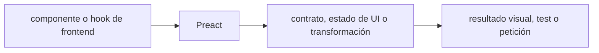

# Preact — Vigilio 11 (mayor estable)

## Qué es, qué hace y cuándo usarla

Biblioteca ligera de interfaces basada en componentes y hooks. Requiere distinguir compatibilidad de React y su configuración de bundler.

**Ubicación en Vigilio:** usa esta dependencia en su stack propietario; otras skills deben enlazar esta guía, no duplicar sus reglas. **Versión:** la indicada en el encabezado es la línea documentada; consultar `technology/versions.md` y el lockfile antes de copiar APIs o aprobar un upgrade.

> **Guía propia de Preact (frontend).** Estado a **2026-10-25**: 11 (mayor estable). Versión del proyecto consumidor = `pnpm-lock.yaml` / `composer.lock` / imagen o manifest. Fuente: [documentación oficial](https://preactjs.com/blog/preact-11/). Fuente normativa transversal de versiones: [versions.md](../versions.md). **No implica instalación automática ni upgrade aprobado.**

## Objetivo, responsabilidad y dónde usar

Separar hooks de datos de UI; shared contracts Zod y ApiClient; usar `preact/compat` solo donde corresponde. No mezclar JSX runtimes ambiguos.

**Uso:** aplicar solo si está declarada y resulta pertinente al consumidor; ver [política de adopción y DRY](README.md).

### Diagrama de integración (Mermaid)



El flujo muestra la **responsabilidad arquitectónica** de la librería; no representa llamadas reales de red para todas las operaciones.


## Instalación o verificación

```bash
pnpm add preact@^11
```

**Gate de instalación:** consultar [procedimiento compartido](README.md#protocolo-de-adopción-y-actualización); estos comandos son indicativos, no ejecuciones sobre un consumidor.

## ✅ Correcto — uso actual y ejemplo de referencia

```typescript
import { h } from 'preact';
import { useState } from 'preact/hooks';
export function Counter(){const [count,setCount]=useState(0);return <button onClick={()=>setCount(v=>v+1)}>{count}</button>;}
```

**Por qué:** Separar hooks de datos de UI; shared contracts Zod y ApiClient; usar `preact/compat` solo donde corresponde. No mezclar JSX runtimes ambiguos.

## ❌ Incorrecto — patrón legacy, inseguro o mal ubicado

**Nota técnica (no es código ejecutable):** ❌ asumir que compatibilidad React de v10 se mantiene sin probar ❌ mutar estado in place y esperar render automático.

**Riesgo:** confundir versiones o responsabilidades y obtener un contrato incorrecto.

## Nuevas capacidades, migración y breaking changes

v10→v11: hidratación 2.0, forwarding automático de refs, `Object.is` para deps de hooks y tipado más estricto; revisar compat, SSR y presets.

Aplicar el [protocolo de migración común](README.md#protocolo-de-adopción-y-actualización), sin asumir que una release nueva está desplegada.

## Buenas prácticas, seguridad, rendimiento y operación

Consultar la [política transversal de librerías](README.md) para seguridad, versionado, evidencia y revisión de contratos. Para esta librería, además, aplicar las verificaciones concretas que se detallan a continuación.

## Gates de aceptación y compatibilidad

Probar SSR/hidratación, compat con paquetes React y eventos/ref, build Vite, pruebas visuales, accesibilidad.

Estado de prueba de estos ejemplos documentales: **NOT_RUN** en aplicaciones consumidoras; ver [criterios de evidencia](README.md#criterios-de-validación).


## Preact 11: controles de migración

- v11 cambia hydration y ref forwarding; revisar compatibilidad `preact/compat` con librerías React (Table, Query, forms).
- `Object.is` en deps de hooks: tests de memo/useEffect con NaN/-0 y referencias reales.
- ESLint/Biome y TS JSX runtime deben apuntar al mismo stack; no usar ReactDOM por accidente.
- SSR render/hydration del MFE y microfrontends con isolation; no dos runtimes mezclados.
- Nuevo código usar hooks y estado sin efectos innecesarios; APIs DOM no funcionan en Expo.

## Referencias

- [Documentación oficial y migración de Preact](https://preactjs.com/blog/preact-11/)
- [Matriz y baseline de versiones](../versions.md)
- [Calidad de código canónica](../../foundations/engineering/code-quality.md)


## Recetario operativo ampliado — preact (2026-10-25)

### API actual: dos tareas reales que debe saber ejecutar una skill

1. **Usar hooks/componentes compat de Preact con entrypoints correctos.**
2. **Optimizar bundle/lazy loading y compat React cuando sea necesaria.**

### Migración desde versiones anteriores: decisión concreta

- **Qué cambia o se debe revisar:** Preact 10→11 major requiere validar hydration, compat libs y Vite config.

### Responsabilidades y capas

UI web; APIs de negocio fuera de componentes.

**✅ Correcto:** mantener la integración encapsulada, alinear los nombres del negocio con Vigilio y depender de un contrato estable.

**❌ Incorrecto:** importar internals de la librería desde Domain, declarar `any` para resolver un upgrade, o duplicar reglas ya propietarias de otra tecnología.

### Seguridad, resiliencia y rendimiento

- SSR mismatches, side effects e import alias roto.

### Test de aceptación específico y evidencia mínima

- **Escenario comprobable:** Render/hydration tests, profiler, bundle diff.


## Guía operativa detallada — 8 casos y 4 antipatrones

### Ocho ejemplos de la API y casos de uso relevantes

Los fragmentos siguientes ilustran **operaciones independientes**. Variables, imports, provider, extensión y configuración se completan en el proyecto consumidor; **no están certificados como un archivo único compilable**. Cuando hay comentarios `#`, son pasos de integración o configuración y no APIs inventadas.

#### Ejemplo 1. Componente

**✅ Correcto — componente**

```tsx
export function ProductCard({ name }: { name: string }) { return <article>{name}</article>; }
```


#### Ejemplo 2. Estado

**✅ Correcto — estado**

```tsx
const [selected_id, setSelectedId] = useState<string | null>(null);
```


#### Ejemplo 3. Effect

**✅ Correcto — effect**

```tsx
useEffect(() => { document.title = title; }, [title]);
```


#### Ejemplo 4. Memo

**✅ Correcto — memo**

```tsx
const filtered = useMemo(() => products.filter(matches), [products]);
```


#### Ejemplo 5. Context

**✅ Correcto — context**

```tsx
const ThemeContext = createContext('light');
```


#### Ejemplo 6. Portal

**✅ Correcto — portal**

```tsx
createPortal(<Modal />, document.body);
```


#### Ejemplo 7. Render

**✅ Correcto — render**

```tsx
render(<App />, document.getElementById('app')!);
```


#### Ejemplo 8. Limpieza

**✅ Correcto — limpieza**

```tsx
useEffect(() => { const sub = subscribe(); return () => sub.unsubscribe(); }, []);
```


### Cuatro antipatrones frecuentes y su sustitución

#### Antipatrón 1 — riesgo y alternativa

**❌ Incorrecto — Effect sin dependencias claras.**

**Por qué está mal:** Omite un control operativo necesario, por lo que el comportamiento puede ser inseguro o difícil de verificar.

**✅ Correcto**

```tsx
useEffect(() => { return cleanup; }, [resource_id])
```

**Por qué mejora:** El patrón «useEffect(() => { return cleanup; }, [resource_id])» mejora el caso: el build y los recursos se verifican mediante gates de despliegue y rendimiento.

#### Antipatrón 2 — riesgo y alternativa

**❌ Incorrecto — SetState en render.**

**Por qué está mal:** El patrón «SetState en render» es riesgoso: puede exponer datos obsoletos o mezclar estados de usuarios, sesiones y consultas diferentes.

**✅ Correcto — Actualizar desde event/effect.**

**Por qué mejora:** El patrón «Actualizar desde event/effect» mejora el caso: el estado se identifica e invalida con criterios explícitos y verificables.

#### Antipatrón 3 — riesgo y alternativa

**❌ Incorrecto — Keys por index para lista dinámica.**

**Por qué está mal:** El patrón «Keys por index para lista dinámica» es riesgoso: la consulta puede producir resultados incorrectos, lentitud o aislamiento insuficiente de datos.

**✅ Correcto**

```tsx
key={product.id}
```

**Por qué mejora:** El patrón «key={product.id}» mejora el caso: la consulta o el contrato se valida y mide sobre datos representativos.

#### Antipatrón 4 — riesgo y alternativa

**❌ Incorrecto — Side effects dentro de JSX.**

**Por qué está mal:** El patrón «Side effects dentro de JSX» es riesgoso: puede publicar cambios sin evidencia suficiente ni una revisión del impacto.

**✅ Correcto — Hooks/acciones aisladas.**

**Por qué mejora:** El patrón «Hooks/acciones aisladas» mejora el caso: el cambio pasa por gates automáticos y aprobación de riesgos operativos.

### Versión estable, breaking changes y verificación

- **Versión estable exacta:** no se declara un parche universal cuando no hay verificación específica de su registry/release. Consultar el encabezado de esta guía, `technology/versions.md` y el manifiesto del servicio. **Estado de patch: VERIFY_LOCKFILE**.
- **Migración:** identificar major anterior, APIs retiradas/cambiadas, peer dependencies, requisitos de runtime, cambios de tipos, ejecución CI y plan de rollback. Si no hay prueba sobre el consumidor, **NOT_RUN**, no PASS.
- **Versiones previas:** el ejemplo marcado ❌ en esta guía explica al menos una incompatibilidad o un uso obsoleto; no trasplantar APIs de otras versiones.
- **Tests:** probar al menos happy path, error, seguridad/permiso y compatibilidad con el runtime donde aplique; solo activar nuevas capacidades mediante una PR versionada.

### Fuentes oficiales y referencias al final

- [Referencia propia oficial](https://preactjs.com/blog/preact-11/)
- [Matriz canónica de versiones](../versions.md)
- [Política de adopción de librerías](README.md)

## Guía de compatibilidad y evaluación por versión (2026-10-25)

**Estado del patch exacto:** `VERIFY_LOCKFILE`. La guía documenta la familia de APIs; **no se ha verificado hoy el patch estable preciso de esta dependencia**. Consultar la fuente oficial enlazada al inicio y el lockfile antes de generar código o aprobar un upgrade.

### Checklist específico de esta librería

- v11 rompe aspectos de compatibilidad de la línea 10; probar hidratación/SSR y `preact/compat` en librerías.
- No duplicar lógica React hooks o env vars entre aplicaciones; versionar boundary.

**Gate de aprobación:** leer la referencia oficial y resolver la versión del consumidor, ejecutar typecheck y pruebas específicas, registrar PASS/FAIL/NOT_RUN/BLOCKED. No confundir esta guía con validación de un consumidor real. [Procedimiento único de adopción](README.md#protocolo-de-adopción-y-actualización).

