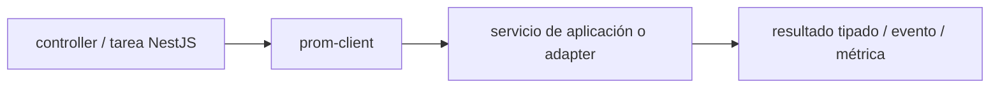

# prom-client — Vigilio línea Node instalada

## Qué es, qué hace y cuándo usarla

Librería Node para exponer métricas Prometheus. Métricas y etiquetas de cardinalidad controlada, sin IDs personales.

**Ubicación en Vigilio:** usa esta dependencia en su stack propietario; otras skills deben enlazar esta guía, no duplicar sus reglas. **Versión:** la indicada en el encabezado es la línea documentada; consultar `technology/versions.md` y el lockfile antes de copiar APIs o aprobar un upgrade.

> **Guía propia de prom-client (observability).** Estado a **2026-10-25**: línea Node instalada. Versión del proyecto consumidor = `pnpm-lock.yaml` / `composer.lock` / imagen o manifest. Fuente: [documentación oficial](https://github.com/siimon/prom-client). Fuente normativa transversal de versiones: [versions.md](../versions.md). **No implica instalación automática ni upgrade aprobado.**

## Objetivo, responsabilidad y dónde usar

Histograms y counters con pocos labels, exposición autenticada/internal y scrapes.

**Uso:** aplicar solo si está declarada y resulta pertinente al consumidor; ver [política de adopción y DRY](README.md).

### Diagrama de integración (Mermaid)



El flujo muestra la **responsabilidad arquitectónica** de la librería; no representa llamadas reales de red para todas las operaciones.


## Instalación o verificación

```bash
pnpm add prom-client
```

**Gate de instalación:** consultar [procedimiento compartido](README.md#protocolo-de-adopción-y-actualización); estos comandos son indicativos, no ejecuciones sobre un consumidor.

## ✅ Correcto — uso actual y ejemplo de referencia

```typescript
import client from 'prom-client';
const request_duration = new client.Histogram({name:'http_request_duration_seconds',help:'HTTP latency',labelNames:['route','method','status']});
// route usar patrón /products/:id, no URI individual
```

**Por qué:** Histograms y counters con pocos labels, exposición autenticada/internal y scrapes.

## ❌ Incorrecto — patrón legacy, inseguro o mal ubicado

```typescript
// ❌ etiqueta id por cliente produce cardinalidad extrema
counter.inc({product_id});
```

**Riesgo:** confundir versiones o responsabilidades y obtener un contrato incorrecto.

## Nuevas capacidades, migración y breaking changes

Compat de runtime Node y formato OpenMetrics/Prometheus; confirmar librería instalada.

Aplicar el [protocolo de migración común](README.md#protocolo-de-adopción-y-actualización), sin asumir que una release nueva está desplegada.

## Buenas prácticas, seguridad, rendimiento y operación

Consultar la [política transversal de librerías](README.md) para seguridad, versionado, evidencia y revisión de contratos. Para esta librería, además, aplicar las verificaciones concretas que se detallan a continuación.

## Gates de aceptación y compatibilidad

Validar cardinalidad, `/metrics` acceso, etiquetas y dashboards.

Estado de prueba de estos ejemplos documentales: **NOT_RUN** en aplicaciones consumidoras; ver [criterios de evidencia](README.md#criterios-de-validación).


## Referencias

- [Documentación oficial y migración de prom-client](https://github.com/siimon/prom-client)
- [Matriz y baseline de versiones](../versions.md)
- [Calidad de código canónica](../../foundations/engineering/code-quality.md)


## Recetario operativo ampliado — prom-client (2026-10-25)

### API actual: dos tareas reales que debe saber ejecutar una skill

1. **`Registry`, `Counter`, `Histogram` y `collectDefaultMetrics` en Node.**
2. **Etiquetas de cardinalidad acotada y buckets basados en SLO.**

### Migración desde versiones anteriores: decisión concreta

- **Qué cambia o se debe revisar:** APIs entre mayores de prom-client cambian labels/registry; verificar lock.

### Responsabilidades y capas

Instrumentación métricas backend; no agregar a React público.

**✅ Correcto:** mantener la integración encapsulada, alinear los nombres del negocio con Vigilio y depender de un contrato estable.

**❌ Incorrecto:** importar internals de la librería desde Domain, declarar `any` para resolver un upgrade, o duplicar reglas ya propietarias de otra tecnología.

### Seguridad, resiliencia y rendimiento

- Nunca label product_id/tenant_id/user_id, ni exponer endpoint sin control.

### Test de aceptación específico y evidencia mínima

- **Escenario comprobable:** Scrape test, histogram buckets, 0 PII y alert simulation.

### Ejemplo de integración vigente (fragmento adicional)

```typescript
const duration = new Histogram({ name:'http_request_duration_seconds', help:'HTTP latency', labelNames:['route','method','status_class'] });
const stop = duration.startTimer({ route:'/products', method:'GET' });
// Tras respuesta: stop({ status_class:'2xx' }); nunca product_id como etiqueta.
```

**Nota:** los fragmentos muestran la API específica y requieren imports/providers/fixtures del consumidor; no se certifica compilación por el solo hecho de aparecer aquí.


## Guía operativa detallada — 8 casos y 4 antipatrones

### Ocho ejemplos de la API y casos de uso relevantes

Los fragmentos siguientes ilustran **operaciones independientes**. Variables, imports, provider, extensión y configuración se completan en el proyecto consumidor; **no están certificados como un archivo único compilable**. Cuando hay comentarios `#`, son pasos de integración o configuración y no APIs inventadas.

#### Ejemplo 1. Registry

**✅ Correcto — registry**

```typescript
const registry = new Registry();
```


#### Ejemplo 2. Counter

**✅ Correcto — counter**

```typescript
const requests = new Counter({ name: 'http_requests_total', help: 'Requests' });
```


#### Ejemplo 3. Histogram

**✅ Correcto — histogram**

```typescript
const duration = new Histogram({ name: 'http_request_duration_seconds', help: 'Duration', buckets: [0.1, 0.5, 1, 5] });
```


#### Ejemplo 4. Incrementar

**✅ Correcto — incrementar**

```typescript
requests.inc();
```


#### Ejemplo 5. Observar

**✅ Correcto — observar**

```typescript
duration.observe(0.25);
```


#### Ejemplo 6. Métricas Node

**✅ Correcto — métricas node**

```typescript
collectDefaultMetrics({ register: registry });
```


#### Ejemplo 7. Endpoint

**✅ Correcto — endpoint**

```typescript
res.setHeader('Content-Type', registry.contentType); res.end(await registry.metrics());
```


#### Ejemplo 8. Limpieza tests

**✅ Correcto — limpieza tests**

```typescript
registry.clear();
```


### Cuatro antipatrones frecuentes y su sustitución

#### Antipatrón 1 — riesgo y alternativa

**❌ Incorrecto**

```typescript
new Counter({name:"requests"}) // colisiones
```

**Por qué está mal:** El patrón «new Counter({name:"requests"}) // colisiones» es riesgoso: puede elevar el coste de runtime, causar fallos de despliegue o empaquetar dependencias no deseadas.

**✅ Correcto**

```typescript
new Counter({ name:"http_requests_total", help:"Requests", registers:[registry] })
```

**Por qué mejora:** El patrón «new Counter({ name:"http_requests_total", help:"Requests", registers:[registry] })» mejora el caso: el build y los recursos se verifican mediante gates de despliegue y rendimiento.

#### Antipatrón 2 — riesgo y alternativa

**❌ Incorrecto**

```typescript
counter.labels(tenant_id).inc()
```

**Por qué está mal:** El patrón «counter.labels(tenant_id).inc()» es riesgoso: puede permitir acceso a recursos no autorizados o de otro tenant.

**✅ Correcto**

```typescript
counter.labels("products.listProducts").inc() # labels de baja cardinalidad configuradas
```

**Por qué mejora:** El patrón «counter.labels("products.listProducts").inc() # labels de baja cardinalidad configuradas» mejora el caso: se fuerza autorización en el borde/servidor y se limita el acceso por recurso.

#### Antipatrón 3 — riesgo y alternativa

**❌ Incorrecto — Métricas con email/user ID.**

**Por qué está mal:** El patrón «Métricas con email/user ID» es riesgoso: mezcla responsabilidades de interfaz y navegación o genera comportamiento inconsistente.

**✅ Correcto — Route/status/method discretos.**

**Por qué mejora:** El patrón «Route/status/method discretos» mejora el caso: la interfaz utiliza la API adecuada y separa presentación, estado y comunicación.

#### Antipatrón 4 — riesgo y alternativa

**❌ Incorrecto — Crear Counter en cada request.**

**Por qué está mal:** El patrón «Crear Counter en cada request» es riesgoso: puede elevar el coste de runtime, causar fallos de despliegue o empaquetar dependencias no deseadas.

**✅ Correcto — Definir métricas una sola vez.**

**Por qué mejora:** El patrón «Definir métricas una sola vez» mejora el caso: el build y los recursos se verifican mediante gates de despliegue y rendimiento.

### Versión estable, breaking changes y verificación

- **Versión estable exacta:** no se declara un parche universal cuando no hay verificación específica de su registry/release. Consultar el encabezado de esta guía, `technology/versions.md` y el manifiesto del servicio. **Estado de patch: VERIFY_LOCKFILE**.
- **Migración:** identificar major anterior, APIs retiradas/cambiadas, peer dependencies, requisitos de runtime, cambios de tipos, ejecución CI y plan de rollback. Si no hay prueba sobre el consumidor, **NOT_RUN**, no PASS.
- **Versiones previas:** el ejemplo marcado ❌ en esta guía explica al menos una incompatibilidad o un uso obsoleto; no trasplantar APIs de otras versiones.
- **Tests:** probar al menos happy path, error, seguridad/permiso y compatibilidad con el runtime donde aplique; solo activar nuevas capacidades mediante una PR versionada.

### Fuentes oficiales y referencias al final

- [Referencia propia oficial](https://github.com/siimon/prom-client)
- [Matriz canónica de versiones](../versions.md)
- [Política de adopción de librerías](README.md)

## Guía de compatibilidad y evaluación por versión (2026-10-25)

**Estado del patch exacto:** `VERIFY_LOCKFILE`. La guía documenta la familia de APIs; **no se ha verificado hoy el patch estable preciso de esta dependencia**. Consultar la fuente oficial enlazada al inicio y el lockfile antes de generar código o aprobar un upgrade.

### Checklist específico de esta librería

- **Migración/compatibilidad:** APIs entre mayores de prom-client cambian labels/registry; verificar lock.
- **Prueba propia:** Scrape test, histogram buckets, 0 PII y alert simulation.
- **Límite de responsabilidad:** usar esta librería solo en su adaptador o capa propietaria; consultar los ejemplos de API y antipatrones anteriores antes de cambiar llamadas públicas.

**Gate de aprobación:** leer la referencia oficial y resolver la versión del consumidor, ejecutar typecheck y pruebas específicas, registrar PASS/FAIL/NOT_RUN/BLOCKED. No confundir esta guía con validación de un consumidor real. [Procedimiento único de adopción](README.md#protocolo-de-adopción-y-actualización).

