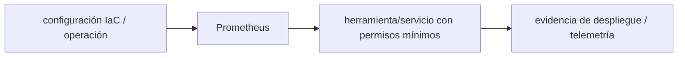

# Prometheus — Vigilio línea por stack observabilidad

## Qué es, qué hace y cuándo usarla

Almacén de series temporales y evaluador de consultas PromQL/alertas. Recolecta métricas de exporters; no reemplaza logs/tracing.

**Ubicación en Vigilio:** usa esta dependencia en su stack propietario; otras skills deben enlazar esta guía, no duplicar sus reglas. **Versión:** la indicada en el encabezado es la línea documentada; consultar `technology/versions.md` y el lockfile antes de copiar APIs o aprobar un upgrade.

> **Guía propia de Prometheus (observability).** Estado a **2026-10-25**: línea por stack observabilidad. Versión del proyecto consumidor = `pnpm-lock.yaml` / `composer.lock` / imagen o manifest. Fuente: [documentación oficial](https://prometheus.io/docs/introduction/overview/). Fuente normativa transversal de versiones: [versions.md](../versions.md). **No implica instalación automática ni upgrade aprobado.**

## Objetivo, responsabilidad y dónde usar

SLIs, reglas de alerta, recording rules, retención y coste.

**Uso:** aplicar solo si está declarada y resulta pertinente al consumidor; ver [política de adopción y DRY](README.md).

### Diagrama de integración (Mermaid)



El flujo muestra la **responsabilidad arquitectónica** de la librería; no representa llamadas reales de red para todas las operaciones.


## Instalación o verificación

```bash
deploy con Helm/operator compatible
```

**Gate de instalación:** consultar [procedimiento compartido](README.md#protocolo-de-adopción-y-actualización); estos comandos son indicativos, no ejecuciones sobre un consumidor.

## ✅ Correcto — uso actual y ejemplo de referencia

```typescript
# PromQL básica
sum(rate(http_requests_total{route="/products"}[5m])) by (status)
```

**Por qué:** SLIs, reglas de alerta, recording rules, retención y coste.

## ❌ Incorrecto — patrón legacy, inseguro o mal ubicado

**Nota técnica (no es código ejecutable):** ❌ label usuario/product_id/tenant_id de cardinalidad descontrolada.

**Riesgo:** confundir versiones o responsabilidades y obtener un contrato incorrecto.

## Nuevas capacidades, migración y breaking changes

Prometheus metrics exporters y OTLP receivvers evolucionan por versión; comprobar PromQL y scrape auth.

Aplicar el [protocolo de migración común](README.md#protocolo-de-adopción-y-actualización), sin asumir que una release nueva está desplegada.

## Buenas prácticas, seguridad, rendimiento y operación

Consultar la [política transversal de librerías](README.md) para seguridad, versionado, evidencia y revisión de contratos. Para esta librería, además, aplicar las verificaciones concretas que se detallan a continuación.

## Gates de aceptación y compatibilidad

Verificar cardinalidad, promtool, SLO alert noise y dashboards.

Estado de prueba de estos ejemplos documentales: **NOT_RUN** en aplicaciones consumidoras; ver [criterios de evidencia](README.md#criterios-de-validación).


## Referencias

- [Documentación oficial y migración de Prometheus](https://prometheus.io/docs/introduction/overview/)
- [Matriz y baseline de versiones](../versions.md)
- [Calidad de código canónica](../../foundations/engineering/code-quality.md)


## Recetario operativo ampliado — prometheus (2026-10-25)

### API actual: dos tareas reales que debe saber ejecutar una skill

1. **Scrape targets, recording rules, Alertmanager y exporter definidos.**
2. **Reglas de baja cardinalidad, ventanas de SLO y retención.**

### Migración desde versiones anteriores: decisión concreta

- **Qué cambia o se debe revisar:** Prometheus 2→3 changes config/storage; validar server/evaluator con rule tool.

### Responsabilidades y capas

Infra métricas; app solo exporta por prom-client/OTel.

**✅ Correcto:** mantener la integración encapsulada, alinear los nombres del negocio con Vigilio y depender de un contrato estable.

**❌ Incorrecto:** importar internals de la librería desde Domain, declarar `any` para resolver un upgrade, o duplicar reglas ya propietarias de otra tecnología.

### Seguridad, resiliencia y rendimiento

- Label explosion, almacenamiento y privacidad.

### Test de aceptación específico y evidencia mínima

- **Escenario comprobable:** `promtool check rules/config`, load test cardinalidad y alert routing.


## Guía operativa detallada — 8 casos y 4 antipatrones

### Ocho ejemplos de la API y casos de uso relevantes

Los fragmentos siguientes ilustran **operaciones independientes**. Variables, imports, provider, extensión y configuración se completan en el proyecto consumidor; **no están certificados como un archivo único compilable**. Cuando hay comentarios `#`, son pasos de integración o configuración y no APIs inventadas.

#### Ejemplo 1. Scrape

**✅ Correcto — scrape**

**Nota técnica (no es código ejecutable):** Prometheus.yml: scrape_configs: [{ job_name: 'api', static_configs: [{targets: ['api:3000']}]}].


#### Ejemplo 2. Rate

**✅ Correcto — rate**

```yaml
rate(http_requests_total[5m])
```


#### Ejemplo 3. P95

**✅ Correcto — p95**

```yaml
histogram_quantile(0.95, sum by(le) (rate(http_request_duration_seconds_bucket[5m])))
```


#### Ejemplo 4. Error ratio

**✅ Correcto — error ratio**

```yaml
sum(rate(http_requests_total{status=~"5.."}[5m])) / sum(rate(http_requests_total[5m]))
```


#### Ejemplo 5. Targets

**✅ Correcto — targets**

**Nota técnica (no es código ejecutable):** UI /targets: confirmar scrape exitoso.


#### Ejemplo 6. Rules

**✅ Correcto — rules**

```yaml
promtool check rules rules.yaml
```


#### Ejemplo 7. Config

**✅ Correcto — config**

```yaml
promtool check config prometheus.yml
```


#### Ejemplo 8. Alert

**✅ Correcto — alert**

**Nota técnica (no es código ejecutable):** Alert: APIErrorRate expr: (...) > 0.05 for: 10m.


### Cuatro antipatrones frecuentes y su sustitución

#### Antipatrón 1 — riesgo y alternativa

**❌ Incorrecto**

```yaml
http_requests_total # usar counter crudo como tasa
```

**Por qué está mal:** El patrón «http_requests_total # usar counter crudo como tasa» es riesgoso: puede elevar el coste de runtime, causar fallos de despliegue o empaquetar dependencias no deseadas.

**✅ Correcto**

```yaml
rate(http_requests_total[5m])
```

**Por qué mejora:** El patrón «rate(http_requests_total[5m])» mejora el caso: el build y los recursos se verifican mediante gates de despliegue y rendimiento.

#### Antipatrón 2 — riesgo y alternativa

**❌ Incorrecto — Label user_id en todas las series.**

**Por qué está mal:** El patrón «Label user_id en todas las series» es riesgoso: la telemetría puede perder trazabilidad, crecer en cardinalidad o filtrar valores sensibles.

**✅ Correcto — Etiquetas acotadas route/status.**

**Por qué mejora:** El patrón «Etiquetas acotadas route/status» mejora el caso: la observabilidad conserva contexto útil sin usar identificadores sensibles como etiquetas masivas.

#### Antipatrón 3 — riesgo y alternativa

**❌ Incorrecto — Alertar un pico de 1s.**

**Por qué está mal:** El patrón «Alertar un pico de 1s» es riesgoso: la elección «Alertar un pico de 1s» puede incumplir los requisitos operativos de prometheus.

**✅ Correcto — For: 10m + runbook.**

**Por qué mejora:** El patrón «For: 10m + runbook» mejora el caso: la alternativa «For: 10m + runbook» establece el comportamiento esperado de prometheus.

#### Antipatrón 4 — riesgo y alternativa

**❌ Incorrecto — Panel sin retención/límites.**

**Por qué está mal:** Omite un control operativo necesario, por lo que el comportamiento puede ser inseguro o difícil de verificar.

**✅ Correcto — Definir cardinalidad y TSDB storage.**

**Por qué mejora:** El patrón «Definir cardinalidad y TSDB storage» mejora el caso: la consulta o el contrato se valida y mide sobre datos representativos.

### Versión estable, breaking changes y verificación

- **Versión estable exacta:** no se declara un parche universal cuando no hay verificación específica de su registry/release. Consultar el encabezado de esta guía, `technology/versions.md` y el manifiesto del servicio. **Estado de patch: VERIFY_LOCKFILE**.
- **Migración:** identificar major anterior, APIs retiradas/cambiadas, peer dependencies, requisitos de runtime, cambios de tipos, ejecución CI y plan de rollback. Si no hay prueba sobre el consumidor, **NOT_RUN**, no PASS.
- **Versiones previas:** el ejemplo marcado ❌ en esta guía explica al menos una incompatibilidad o un uso obsoleto; no trasplantar APIs de otras versiones.
- **Tests:** probar al menos happy path, error, seguridad/permiso y compatibilidad con el runtime donde aplique; solo activar nuevas capacidades mediante una PR versionada.

### Fuentes oficiales y referencias al final

- [Referencia propia oficial](https://prometheus.io/docs/introduction/overview/)
- [Matriz canónica de versiones](../versions.md)
- [Política de adopción de librerías](README.md)

## Guía de compatibilidad y evaluación por versión (2026-10-25)

**Estado del patch exacto:** `VERIFY_LOCKFILE`. La guía documenta la familia de APIs; **no se ha verificado hoy el patch estable preciso de esta dependencia**. Consultar la fuente oficial enlazada al inicio y el lockfile antes de generar código o aprobar un upgrade.

### Checklist específico de esta librería

- **Migración/compatibilidad:** Prometheus 2→3 changes config/storage; validar server/evaluator con rule tool.
- **Prueba propia:** `promtool check rules/config`, load test cardinalidad y alert routing.
- **Límite de responsabilidad:** usar esta librería solo en su adaptador o capa propietaria; consultar los ejemplos de API y antipatrones anteriores antes de cambiar llamadas públicas.

**Gate de aprobación:** leer la referencia oficial y resolver la versión del consumidor, ejecutar typecheck y pruebas específicas, registrar PASS/FAIL/NOT_RUN/BLOCKED. No confundir esta guía con validación de un consumidor real. [Procedimiento único de adopción](README.md#protocolo-de-adopción-y-actualización).

