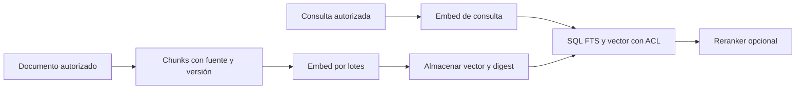

# Qwen3-Embedding — guía de implementación y migración

**Revisión documental:** 2026-10-25. **Modelo de referencia:** `Qwen3-Embedding-0.6B` (1024 dimensiones máximas; también existen 4B/2560 y 8B/4096). **Release de SDK / digest desplegado:** lo decide y fija el consumidor. La cantidad `0.6B` es el tamaño del modelo, no su release. No instalar un tag mutable como evidencia de versión reproducible.

**Propietario:** inferencia y embeddings. No repetir las normas SQL, ACL y lifecycle aquí: ver [seguridad de RAG](../../standards/ai/hybrid-rag-postgresql.md), [ciclo de modelos](../../standards/ai/model-lifecycle.md) y [pgvector](pgvector.md).

## 1. Cuándo usarlo y responsabilidades

- Generar vectores de búsqueda semántica para **documentos** en ingesta, y para **consultas** en recuperación.
- No reemplaza autorización, índices de texto de PostgreSQL, clasificación de seguridad ni reranking. Añadir búsqueda léxica cuando importan identificadores exactos, nombres de pólizas o códigos.
- Elegir 0.6B tras medir relevancia, latencia, memoria y calidad en español; 4B/8B son candidatos que exigen validar hardware, dimensiones e índices.
- Mantener dos rutas distintas: **ingesta de documentos** (lotes y reintentos acotados) y **consulta** (timeout bajo, ACL e inferencia controlada).

## 2. Instalación y versión real

```bash
# Ollama debe instalarse/administrarse por plataforma; el siguiente comando descarga un modelo.
ollama pull qwen3-embedding:0.6b
ollama list
# En producción guardar el digest real obtenido del despliegue.
```

No asumir que `qwen3-embedding:latest` equivale a 0.6B: el catálogo de Ollama también ofrece 4B y 8B. Conservar `model_id`, `model_digest`, normalización, instrucción y dimensiones en el manifiesto de índices. La versión del servidor Ollama es independiente del artefacto del modelo.

**API recomendada del servidor Ollama:** `POST /api/embed`. El campo `embeddings` es una matriz, incluso para una sola cadena. Validar respuesta y longitud. No confundir con `/api/embeddings` de tutoriales viejos.

```bash
curl --fail-with-body http://127.0.0.1:11434/api/embed \
  -H 'Content-Type: application/json' \
  -d '{"model":"qwen3-embedding:0.6b","input":["cobertura de póliza"]}'
```

## 3. Adapter TypeScript con validación real

`EmbeddingProvider` es un puerto de infraestructura; la implementación usa HTTP. No importar Ollama en Domain. `snake_case` para variables ordinarias; métodos en `camelCase`.

```typescript
import { z } from 'zod';

const ollamaEmbedResponseDto = z.object({
  embeddings: z.array(z.array(z.number().finite())).min(1),
});

type EmbedResult = {
  vectors: number[][];
  model_id: string;
};

export async function embedTexts(
  input_texts: readonly string[],
  endpoint: string,
  expected_dimensions: number,
  signal?: AbortSignal,
): Promise<EmbedResult> {
  if (input_texts.length === 0 || input_texts.length > 32) {
    throw new Error('Lote fuera del límite configurado');
  }
  const model_id = 'qwen3-embedding:0.6b';
  const response = await fetch(`${endpoint}/api/embed`, {
    method: 'POST',
    headers: { 'content-type': 'application/json' },
    body: JSON.stringify({ model: model_id, input: [...input_texts] }),
    signal,
  });
  if (!response.ok) throw new Error(`Embed HTTP ${response.status}`);
  const raw: unknown = await response.json();
  const parsed = ollamaEmbedResponseDto.parse(raw);
  if (parsed.embeddings.length !== input_texts.length) {
    throw new Error('Número de vectores inesperado');
  }
  for (const vector of parsed.embeddings) {
    if (vector.length !== expected_dimensions) {
      throw new Error('Dimensión incompatible con el índice');
    }
  }
  return { vectors: parsed.embeddings, model_id };
}
```

**Este ejemplo representa un adaptador**, no un módulo NestJS compilado en Vigilio. El endpoint debe proceder de configuración confiable, con acceso de red restringido; agregar timeout mediante `AbortSignal.timeout(...)` cuando la plataforma lo soporte y respuesta de error normalizada en un cliente compartido.

## 4. Ejemplo de ingesta vs. búsqueda



- Documentos: contenido depurado, chunking con IDs estables, idioma, `tenant_id`, ACL documental, versión y digest. Reintentos de ingesta idempotentes con checkpoint; no embedding por fila si existe batching compatible.
- Consultas: aplicar instrucción de búsqueda apropiada si el modelo la usa y **documentar su versión**; comprobar consistencia de intención consulta/documento mediante evals, no inventar que sus textos deben ser idénticos.
- Cambios del modelo o de prompt: no comparar vectores de espacios distintos; escribir en una colección/columna nueva y usar doble lectura temporal para medir, con rollback.

## 5. PostgreSQL + pgvector (ejemplo conceptual)

```sql
-- Ejemplo para salida 0.6B con 1024 dimensiones verificadas.
-- La tabla, ACL/RLS, roles y FKs vienen de sus migraciones canónicas.
CREATE TABLE knowledge_embeddings_demo (
  tenant_id uuid NOT NULL,
  chunk_id uuid NOT NULL,
  model_digest text NOT NULL,
  embedding vector(1024) NOT NULL,
  PRIMARY KEY (tenant_id, chunk_id, model_digest)
);
-- Crear HNSW/IVFFlat solo tras benchmark; validar métrica elegida.
```

`vector(1024)` solo corresponde a este contrato de ejemplo: si se reduce la dimensión vía Matryoshka Representation Learning o se usa otro modelo, cambiar **la migración y el índice**. Para modelos con dimensión superior a límites indexables de `vector`, estudiar `halfvec` y estrategia de proyección en la guía de pgvector; no truncar vectores por intuición.

## 6. Capacidades y compatibilidad de la familia

| Capacidad | 0.6B | 4B | 8B | Comprobación |
|---|---:|---:|---:|---|
| Dimensión máxima | 1024 | 2560 | 4096 | Medir vector real recibido |
| Multilingüe | Sí | Sí | Sí | Recall@K español/casos propios |
| Instrucciones de consulta | Sí | Sí | Sí | Registrar instrucción y versión |
| Matryoshka/dimensiones flexibles | Según runner | Según runner | Según runner | Probar API de runner y normalización |
| Costo GPU/RAM | Menor relativo | Mayor | Mayor | Medir hardware real |

## 7. ✅ Correcto / ❌ Incorrecto

**✅ Correcto:** separar corpus/ACL de modelo, medir Recall@K/nDCG, guardar hash/revisión, validar `embeddings.length` y dimensión, y reindexar al cambiar configuración.

**❌ Incorrecto:** usar `latest` como pin, suponer que embeddings devuelve un vector plano, loguear documentos personales, aceptar dimensiones desconocidas o crear un embedding nuevo por cada request de lectura de un documento inmutable.

**✅ Correcto:** permitir caché de embeddings por hash+modelo+instrucción+normalización con invalidación sobre documento/versionado.

**❌ Incorrecto:** compartir la misma clave o índice entre diferentes modelos, tenants no autorizados o configuraciones sin separar corpus.

## 8. Migración desde código anterior

| Antes | Ahora | Riesgo |
|---|---|---|
| `/api/embeddings` de ejemplos antiguos | `/api/embed` | Payload/respuesta distintos |
| `embedding: number[]` supuesto | `embeddings: number[][]` validado | Runtime shape |
| Tag sin digest | Modelo+revisión/digest fijados | Resultados no reproducibles |
| Una consulta SQL sin ACL | Filtrar tenant + permiso documental **antes** de ranking | Fuga de datos |
| `vector(N)` fijo sin medición | Dimensión verificada y esquema versionado | Inserciones e índices fallidos |

## 9. Pruebas mínimas y gates

1. Ollama no disponible → timeout acotado y respuesta controlada; nada de reintentos infinitos.
2. Lote parcial o vectores no finitos → rechazar y registrar métrica sin almacenar contenido en logs.
3. Cambio accidental de modelo/digest/dimensión → gate de compatibilidad **FAIL** antes de INSERT.
4. Dos documentos de otro tenant → nunca aparecen en el ranking autorizado.
5. Benchmark en español y con pólizas exactas → comparar solo vector, vector+FTS y reranker opcional.
6. Comparar costos de inferencia, latencia p50/p95, tamaño del índice y drift por cambios del corpus.

**Estado de ejecución en los repositorios de usuario: NOT_RUN.** No se instaló Ollama ni se ejecutó PostgreSQL aquí.

## Referencias oficiales y normas relacionadas

- [Qwen3 Embedding/Reranking](https://github.com/QwenLM/Qwen3-Embedding)
- [Qwen3 en Ollama: modelos y `/api/embed`](https://ollama.com/library/qwen3-embedding)
- [Ollama API](https://docs.ollama.com/api/embed)
- [Pgvector y limitaciones](pgvector.md) · [Lifecycle de modelos](../../standards/ai/model-lifecycle.md) · [Hybrid RAG](../../standards/ai/hybrid-rag-postgresql.md)
