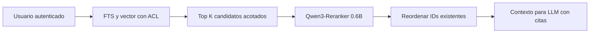

# Qwen3-Reranker — guía de API real, scores y compatibilidad

**Fecha documental:** 2026-10-25. **Modelo candidato:** `Qwen/Qwen3-Reranker-0.6B` (32K de contexto según ficha). Fijar revisión/commit del modelo y versión del runner en el proyecto. **No existe en esta guía un supuesto endpoint `/api/rerank` de Ollama:** el modelo de reranking no es una función embedding de Ollama.

**Propietario:** runtime de reranking. Criterios de recuperación Hybrid/FTS están en [Hybrid RAG](../../standards/ai/hybrid-rag-postgresql.md); políticas de evidencia/citas en [reranking](../../standards/ai/reranking.md).

## 1. Qué hace y cuándo aporta valor

Partiendo de los mejores K chunks **ya autorizados**, estima relevancia pregunta–pasaje y devuelve un ranking de sus IDs. No amplía permisos, no descubre documentos por sí solo y no garantiza verdad. Medir nDCG@K, recall efectivo, costo y latencia antes de habilitarlo.



Evitar en búsquedas transaccionales sencillas por ID o estado, donde SQL con índices proporciona el dato exacto y autorizable.

## 2. Runtime verificado: Sentence Transformers

La ficha del modelo publica `CrossEncoder` con `predict` sobre pares. El runner Python puede correr **como servicio separado**; Node/NestJS o PHP/Laravel usan su puerto HTTP autorizado. No importar `sentence-transformers` al dominio.

```bash
# Instalar en un entorno Python virtual propio de inferencia y fijar hashes en lockfile.
python -m pip install 'sentence-transformers>=5.4,<6'
# Fijar revisión real del modelo para producción; probar compatibilidad CUDA/PyTorch.
```

```python
# Smoke test offline del motor; descarga el modelo al primer uso.
from sentence_transformers import CrossEncoder

model_id = 'Qwen/Qwen3-Reranker-0.6B'
model = CrossEncoder(model_id)  # Definir revision=<commit> verificado en producción.
query = '¿Cuándo se anula la póliza?'
passages = [
    'Una póliza pendiente puede cancelarse antes de su emisión.',
    'Este capítulo explica los impuestos de importación.',
]
pairs = [(query, passage) for passage in passages]
scores = model.predict(pairs)
ranked = sorted(zip(range(len(passages)), scores), key=lambda x: float(x[1]), reverse=True)
for idx, score in ranked:
    print(idx, float(score))
```

**Advertencia de runner:** con el modelo original, algunos backends calculan logits de `yes/no` y requieren formatos de prompt específicos; un modelo convertido a sequence classification **no es equivalente automáticamente**. Para vLLM hay conversiones y protocolos distintos. Elegir uno y testear un dataset de referencia antes de adoptar su endpoint.

## 3. Contrato del adaptador Node/PHP (propio, no API oficial)

```typescript
export type RerankInput = {
  query: string;
  candidates: readonly { chunk_id: string; text: string }[];
};
export type RerankResult = readonly { chunk_id: string; score: number }[];

export interface RerankProvider {
  rankCandidates(input: RerankInput, signal?: AbortSignal): Promise<RerankResult>;
}
```

El servidor que implemente este contrato debe comprobar la autenticación entre servicios y no tener acceso a la base de datos sin filtros. Preferir entradas con ID estable, límite total de tokens, tiempos y permisos explícitos; no registrar pasajes privados.

```typescript
// Capa Application. La recuperación ya aplicó tenant + ACL documental.
export async function rerankAuthorized(
  input: RerankInput,
  provider: RerankProvider,
  signal?: AbortSignal,
): Promise<RerankResult> {
  if (input.candidates.length === 0) return [];
  if (input.candidates.length > 40) throw new Error('Límite de candidatos excedido');
  const allowed_ids = new Set(input.candidates.map((x) => x.chunk_id));
  if (allowed_ids.size !== input.candidates.length) {
    throw new Error('IDs duplicados en candidatos');
  }
  const result = await provider.rankCandidates(input, signal);
  const seen = new Set<string>();
  for (const item of result) {
    if (!allowed_ids.has(item.chunk_id) || seen.has(item.chunk_id) || !Number.isFinite(item.score)) {
      throw new Error('Respuesta de reranker inválida');
    }
    seen.add(item.chunk_id);
  }
  if (seen.size !== allowed_ids.size) throw new Error('Faltan candidatos en resultado');
  return [...result].sort((a, b) => b.score - a.score);
}
```

Es un contrato del proyecto, no un import de la librería Qwen. Los scores pueden ser logits/transformaciones diferentes según runtime; **no interpretarlos como probabilidades comparables entre modelos**.

## 4. Pipeline recomendado y fallbacks

1. Recuperar con `tenant_id` y ACL documental, y conservar `chunk_id`, `document_version`, `source`, contenido y permiso.
2. Acotar top K por latencia/costo; truncar textos al presupuesto conocido sin eliminar datos decisivos inadvertidamente.
3. Rerankear solo esos IDs; comparar salida con la lista original y rechazar IDs extraños.
4. Opcionalmente aplicar umbral propio calibrado con evals; nunca dar a un score autoridad para saltarse ACL.
5. Si falla el modelo, usar únicamente el ranking **preautorizado**, o abstenerse si el riesgo exige revisión; hacer explícita la política por dominio.
6. Registrar en tracing nombre/revisión del modelo, tiempo, cantidad de pares y tasas de error, evitando exponer texto o IDs de alta cardinalidad en métricas.

## 5. Migración y cambio frente a código anterior

| Patrón anterior | Forma correcta para Qwen3-Reranker | Justificación |
|---|---|---|
| `ollama.embed(query + passage)` | `CrossEncoder.predict([(query, passage)])` o runner de reranking compatible | Embedding != par de relevancia |
| Supuesto `POST /api/rerank` nativo de Ollama | Endpoint de **servicio propio** documentado, o API real de proveedor | No inventar interfaces externas |
| Usar el score como confianza factual | Tratar el score solo como orden relativo | No es evaluación de truthfulness |
| Reordenar documento sin ACL | Recuperar con permisos primero | Seguridad por diseño |
| Cambio de 0.6B a 4B sin pruebas | Comparar calidad/recursos/versiones | Salidas no equivalentes |

## 6. ✅ Correcto / ❌ Incorrecto

**✅ Correcto:** conservar `chunk_id`, validar que el reranker no introduce ni borra candidatos salvo contrato explícito, fijar revisión del modelo y probar rankings sobre casos reales.

**❌ Incorrecto:** enviar textos completos no autorizados al proveedor; usar `CrossEncoder` en cada request sin límite de concurrencia; asumir que cambiar de runtime preserva scores.

**✅ Correcto:** aplicar el *circuit breaker* cuando el motor no responde y registrar caída de calidad del fallback; medir p95 para 10/20/40 pares.

**❌ Incorrecto:** crear un agente autónomo para ordenar 10 chunks o fabricar una API que no está documentada por el proveedor.

## 7. Pruebas y aceptación

- Lista vacía, duplicados, top K excesivo y respuestas con IDs adicionales → rechazo predecible.
- Timeout, cancelación de solicitud, modelo no disponible, lote truncado y error de versión → fallback controlado.
- Casos ambiguos multilingües, negaciones, nombres de pólizas y fechas → evaluar orden contra una lista humana de relevancia.
- Ataque: documento de tenant B inyectado en candidatos → bloquear **antes** de invocar al reranker; test adversarial de salida también.
- Métricas: nDCG@10, MRR, cobertura relevante y p95; no adoptar si el incremento de calidad no compensa costo o SLA.

**Ejecución con modelos reales:** NOT_RUN en este repositorio documental. La API Python está basada en la ficha del modelo, pero debe instalarse y probarse con su CUDA/CPU y revisión efectiva.

## Fuentes y referencias canónicas

- [Qwen3-Reranker-0.6B, ficha oficial y CrossEncoder](https://huggingface.co/Qwen/Qwen3-Reranker-0.6B)
- [Qwen3 Embedding/Reranking — repositorio oficial](https://github.com/QwenLM/Qwen3-Embedding)
- [Diferencias de modelos convertidos en vLLM](https://github.com/vllm-project/vllm/blob/main/examples/pooling/score/qwen3_reranker_offline.py)
- [Norma de reranking](../../standards/ai/reranking.md) · [Seguridad Hybrid RAG](../../standards/ai/hybrid-rag-postgresql.md)
