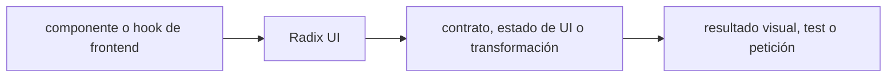

# Radix UI — Vigilio línea instalada; revisar @radix-ui/* efectivas

## Qué es, qué hace y cuándo usarla

Primitivas accesibles y sin estilos cerrados para React. Gestionan foco, teclado y atributos ARIA; la aplicación aporta diseño y pruebas.

**Ubicación en Vigilio:** usa esta dependencia en su stack propietario; otras skills deben enlazar esta guía, no duplicar sus reglas. **Versión:** la indicada en el encabezado es la línea documentada; consultar `technology/versions.md` y el lockfile antes de copiar APIs o aprobar un upgrade.

> **Guía propia de Radix UI (frontend).** Estado a **2026-10-25**: línea instalada; revisar @radix-ui/* efectivas. Versión del proyecto consumidor = `pnpm-lock.yaml` / `composer.lock` / imagen o manifest. Fuente: [documentación oficial](https://www.radix-ui.com/primitives/docs/overview/introduction). Fuente normativa transversal de versiones: [versions.md](../versions.md). **No implica instalación automática ni upgrade aprobado.**

## Objetivo, responsabilidad y dónde usar

Primitives accesibles y sin opinión de estilo; Tailwind pertenece a capa UI.

**Uso:** aplicar solo si está declarada y resulta pertinente al consumidor; ver [política de adopción y DRY](README.md).

### Diagrama de integración (Mermaid)



El flujo muestra la **responsabilidad arquitectónica** de la librería; no representa llamadas reales de red para todas las operaciones.


## Instalación o verificación

```bash
pnpm add @radix-ui/react-dialog
```

**Gate de instalación:** consultar [procedimiento compartido](README.md#protocolo-de-adopción-y-actualización); estos comandos son indicativos, no ejecuciones sobre un consumidor.

## ✅ Correcto — uso actual y ejemplo de referencia

```typescript
import * as Dialog from '@radix-ui/react-dialog';
// <Dialog.Root><Dialog.Trigger>Abrir</Dialog.Trigger><Dialog.Portal>...</Dialog.Portal></Dialog.Root>
```

**Por qué:** Primitives accesibles y sin opinión de estilo; Tailwind pertenece a capa UI.

## ❌ Incorrecto — patrón legacy, inseguro o mal ubicado

```typescript
// ❌ dialog sin etiqueta, foco o Escape
<div role="dialog">...</div>
```

**Riesgo:** confundir versiones o responsabilidades y obtener un contrato incorrecto.

## Nuevas capacidades, migración y breaking changes

Paquetes de primitives pueden versionar independientemente; inspeccionar peer dependencies.

Aplicar el [protocolo de migración común](README.md#protocolo-de-adopción-y-actualización), sin asumir que una release nueva está desplegada.

## Buenas prácticas, seguridad, rendimiento y operación

Consultar la [política transversal de librerías](README.md) para seguridad, versionado, evidencia y revisión de contratos. Para esta librería, además, aplicar las verificaciones concretas que se detallan a continuación.

## Gates de aceptación y compatibilidad

Test teclado, focus trap, screen readers y cierres.

Estado de prueba de estos ejemplos documentales: **NOT_RUN** en aplicaciones consumidoras; ver [criterios de evidencia](README.md#criterios-de-validación).


## Referencias

- [Documentación oficial y migración de Radix UI](https://www.radix-ui.com/primitives/docs/overview/introduction)
- [Matriz y baseline de versiones](../versions.md)
- [Calidad de código canónica](../../foundations/engineering/code-quality.md)


## Recetario operativo ampliado — radix-ui (2026-10-25)

### API actual: dos tareas reales que debe saber ejecutar una skill

1. **Componer primitivas accesibles (Dialog, Popover, Select) con foco controlado.**
2. **Control/uncontrol explícito, portals y asChild cuando exista.**

### Migración desde versiones anteriores: decisión concreta

- **Qué cambia o se debe revisar:** Subpaquetes React/versions y cambios API; no copiar props de shadcn sin comprobar.

### Responsabilidades y capas

Primitivas UI; no dominio ni API client.

**✅ Correcto:** mantener la integración encapsulada, alinear los nombres del negocio con Vigilio y depender de un contrato estable.

**❌ Incorrecto:** importar internals de la librería desde Domain, declarar `any` para resolver un upgrade, o duplicar reglas ya propietarias de otra tecnología.

### Seguridad, resiliencia y rendimiento

- Focus trap y aria-label, tests teclado y screenreader.

### Test de aceptación específico y evidencia mínima

- **Escenario comprobable:** Axe, tab cycles, escape/click-outside y SSR portal.


## Guía operativa detallada — 8 casos y 4 antipatrones

### Ocho ejemplos de la API y casos de uso relevantes

Los fragmentos siguientes ilustran **operaciones independientes**. Variables, imports, provider, extensión y configuración se completan en el proyecto consumidor; **no están certificados como un archivo único compilable**. Cuando hay comentarios `#`, son pasos de integración o configuración y no APIs inventadas.

#### Ejemplo 1. Dialog

**✅ Correcto — dialog**

```tsx
import * as Dialog from '@radix-ui/react-dialog';
```


#### Ejemplo 2. Root

**✅ Correcto — root**

```tsx
const modal = <Dialog.Root open={open} onOpenChange={setOpen} />;
```


#### Ejemplo 3. Trigger

**✅ Correcto — trigger**

```tsx
<Dialog.Trigger>Registrar</Dialog.Trigger>
```


#### Ejemplo 4. Content

**✅ Correcto — content**

```tsx
<Dialog.Content><Dialog.Title>Registro</Dialog.Title></Dialog.Content>
```


#### Ejemplo 5. Close

**✅ Correcto — close**

```tsx
<Dialog.Close>Cancelar</Dialog.Close>
```


#### Ejemplo 6. Tooltip

**✅ Correcto — tooltip**

```tsx
<Tooltip.Root><Tooltip.Trigger>Ayuda</Tooltip.Trigger><Tooltip.Content>Detalle</Tooltip.Content></Tooltip.Root>
```


#### Ejemplo 7. Tabs

**✅ Correcto — tabs**

```tsx
<Tabs.Root defaultValue="general"><Tabs.List><Tabs.Trigger value="general">General</Tabs.Trigger></Tabs.List></Tabs.Root>
```


#### Ejemplo 8. A11y

**✅ Correcto — a11y**

**Nota técnica (no es código ejecutable):** Usar Title/Description y foco; no perder teclado al envolver asChild.


### Cuatro antipatrones frecuentes y su sustitución

#### Antipatrón 1 — riesgo y alternativa

**❌ Incorrecto**

```tsx
<Dialog.Content><input /></Dialog.Content>
```

**Por qué está mal:** El patrón «<Dialog.Content><input /></Dialog.Content>» es riesgoso: la telemetría puede perder trazabilidad, crecer en cardinalidad o filtrar valores sensibles.

**✅ Correcto**

```tsx
<Dialog.Content><Dialog.Title>Registro</Dialog.Title><input /></Dialog.Content>
```

**Por qué mejora:** El patrón «<Dialog.Content><Dialog.Title>Registro</Dialog.Title><input /></Dialog.Content>» mejora el caso: la observabilidad conserva contexto útil sin usar identificadores sensibles como etiquetas masivas.

#### Antipatrón 2 — riesgo y alternativa

**❌ Incorrecto — Trigger div sin teclado.**

**Por qué está mal:** Omite un control operativo necesario, por lo que el comportamiento puede ser inseguro o difícil de verificar.

**✅ Correcto**

```tsx
<Dialog.Trigger>Registrar</Dialog.Trigger>
```

**Por qué mejora:** El patrón «<Dialog.Trigger>Registrar</Dialog.Trigger>» mejora el caso: el comportamiento se verifica con pruebas y criterios observables.

#### Antipatrón 3 — riesgo y alternativa

**❌ Incorrecto — Hardcodear foco sin ciclo modal.**

**Por qué está mal:** Omite un control operativo necesario, por lo que el comportamiento puede ser inseguro o difícil de verificar.

**✅ Correcto — Usar primitives focus-management.**

**Por qué mejora:** El patrón «Usar primitives focus-management» mejora el caso: el comportamiento se verifica con pruebas y criterios observables.

#### Antipatrón 4 — riesgo y alternativa

**❌ Incorrecto — Usar CSS que hace elementos invisibles pero focusables.**

**Por qué está mal:** El patrón «Usar CSS que hace elementos invisibles pero focusables» es riesgoso: la implementación puede fallar sin que el flujo crítico o la accesibilidad lo detecte.

**✅ Correcto — Comprobar focus/aria.**

**Por qué mejora:** El patrón «Comprobar focus/aria» mejora el caso: el comportamiento se verifica con pruebas y criterios observables.

### Versión estable, breaking changes y verificación

- **Versión estable exacta:** no se declara un parche universal cuando no hay verificación específica de su registry/release. Consultar el encabezado de esta guía, `technology/versions.md` y el manifiesto del servicio. **Estado de patch: VERIFY_LOCKFILE**.
- **Migración:** identificar major anterior, APIs retiradas/cambiadas, peer dependencies, requisitos de runtime, cambios de tipos, ejecución CI y plan de rollback. Si no hay prueba sobre el consumidor, **NOT_RUN**, no PASS.
- **Versiones previas:** el ejemplo marcado ❌ en esta guía explica al menos una incompatibilidad o un uso obsoleto; no trasplantar APIs de otras versiones.
- **Tests:** probar al menos happy path, error, seguridad/permiso y compatibilidad con el runtime donde aplique; solo activar nuevas capacidades mediante una PR versionada.

### Fuentes oficiales y referencias al final

- [Referencia propia oficial](https://www.radix-ui.com/primitives/docs/overview/introduction)
- [Matriz canónica de versiones](../versions.md)
- [Política de adopción de librerías](README.md)

## Guía de compatibilidad y evaluación por versión (2026-10-25)

**Estado del patch exacto:** `VERIFY_LOCKFILE`. La guía documenta la familia de APIs; **no se ha verificado hoy el patch estable preciso de esta dependencia**. Consultar la fuente oficial enlazada al inicio y el lockfile antes de generar código o aprobar un upgrade.

### Checklist específico de esta librería

- **Migración/compatibilidad:** Subpaquetes React/versions y cambios API; no copiar props de shadcn sin comprobar.
- **Prueba propia:** Axe, tab cycles, escape/click-outside y SSR portal.
- **Límite de responsabilidad:** usar esta librería solo en su adaptador o capa propietaria; consultar los ejemplos de API y antipatrones anteriores antes de cambiar llamadas públicas.

**Gate de aprobación:** leer la referencia oficial y resolver la versión del consumidor, ejecutar typecheck y pruebas específicas, registrar PASS/FAIL/NOT_RUN/BLOCKED. No confundir esta guía con validación de un consumidor real. [Procedimiento único de adopción](README.md#protocolo-de-adopción-y-actualización).

