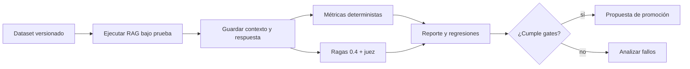

# Ragas 0.4.3 — guía práctica de evaluación RAG y migración

**Release contrastada:** `ragas==0.4.3` en PyPI a 2026-10-25. **Estado:** herramienta opcional del *runner de evaluación Python*, no dependencia de Domain, NestJS, Laravel ni de cada respuesta de producción. Pin del consumidor: `uv.lock`/`poetry.lock`/requirements con hashes. [Releases PyPI](https://pypi.org/project/ragas/).

**Propietario de esta guía:** APIs de Ragas. Los criterios globales de aceptación y los datasets de negocio se mantienen en [evaluación de calidad](../../standards/ai/evaluacion-calidad.md); no duplicarlos aquí.

## 1. Cuándo usarlo (y cuándo no)

- Evaluar sistemáticamente un *pipeline* de recuperación + generación y comparar configuraciones: vector, Hybrid RAG, reranker, prompts y modelos.
- Medir calidad del ranking y de las respuestas con múltiples métricas; usar review humano en dominios sensibles.
- No usar métricas basadas en LLM como autorización, prueba de ausencia de filtraciones o garantía de cumplimiento legal.
- Cuando los objetivos sean deterministas (ACL, IDs de evidencia, citas obligatorias, formato JSON), utilizar assertions tradicionales incluso si Ragas no está disponible.

## 2. Arquitectura de evaluación



El runner puede leer resultados anonimizados de la API, pero el servicio productivo no debe depender sincrónicamente de un juez costoso por cada petición.

## 3. Instalación y verificación

```bash
# Ejemplo en un entorno aislado de evaluación (Python soportado y lock real).
python -m pip install 'ragas==0.4.3' 'openai'
python -m pip show ragas
# En CI utilizar uv pip compile/uv.lock o herramienta equivalente con versión fija.
```

Confirmar compatibilidad Python, proveedor de LLM juez, límites de costo y privacidad. Los nombres de métricas y la API pueden cambiar al migrar desde 0.3.

## 4. Dataset evaluable y métricas

```json
{
  "case_id": "policy-48392-cancel",
  "question": "¿Se puede cancelar la póliza?",
  "reference": "Solo antes de procesarse",
  "relevant_chunk_ids": ["policy-48392:v2:p4:c1"],
  "allowed_document_ids": ["policy-48392"],
  "expected_abstention": false
}
```

Usar múltiples casos: exact IDs, negaciones, español, solicitudes fuera de corpus, citas incorrectas, documentos revocados y accesos entre tenants. Evitar datasets con solo preguntas fáciles o documentos de entrenamiento.

| Métrica | Pregunta que responde | Advertencia |
|---|---|---|
| Faithfulness | ¿Afirmaciones sustentadas por contexto recuperado? | No demuestra verdad externa ni permiso |
| Context Precision | ¿Ranking prioriza contexto pertinente? | Necesita ejemplos de relevancia |
| Context Recall | ¿Llegó el contexto que responde? | Comparar con referencia confiable |
| Response/Answer Relevancy | ¿La respuesta atiende la pregunta? | No prueba que sea correcta |
| Recall@K determinista | ¿Están los IDs relevantes entre top K? | Depende de anotación de IDs |
| Evaluación de ACL | ¿Se filtró una fuente no autorizada? | **Asserción de seguridad**, no LLM judge |

## 5. Ejemplo Ragas 0.4: Faithfulness

La API **de collections** utiliza `llm_factory` y `Faithfulness.ascore`; no usar como referencia el `evaluate()` antiguo. El LLM juez es una dependencia externa con costos y política de datos propia.

```python
import asyncio
from openai import AsyncOpenAI
from ragas.llms import llm_factory
from ragas.metrics.collections import Faithfulness

async def main() -> None:
    client = AsyncOpenAI()  # URL y credenciales configuradas fuera del código.
    llm = llm_factory('gpt-4o-mini', client=client)  # Solo ejemplo: puede generar costo.
    scorer = Faithfulness(llm=llm)
    result = await scorer.ascore(
        user_input='¿Quién puede autorizar una póliza?',
        response='Debe autorizarla un supervisor.',
        retrieved_contexts=['La política v2 exige autorización de supervisor.'],
    )
    print('score', result.value)
    print('reason', result.reason)

if __name__ == '__main__':
    asyncio.run(main())
```

**NOT_RUN:** no se suministraron credenciales de proveedor y no se ejecutó en este proyecto. Para producción: configurar concurrencia, timeout, reintentos acotados, privacidad, enmascaramiento de PII y budget de tokens.

## 6. Ejemplo determinista complementario

```python
def recall_at_k(retrieved_ids: list[str], relevant_ids: list[str], k: int) -> float:
    if not relevant_ids or k <= 0:
        raise ValueError('Se requieren referencias y K positivo')
    expected = set(relevant_ids)
    return len(expected.intersection(retrieved_ids[:k])) / len(expected)

assert recall_at_k(['docA', 'docB'], ['docA'], 2) == 1.0
assert recall_at_k(['docB'], ['docA'], 1) == 0.0
```

La métrica por IDs debe corresponder a un dataset con anotación fiable; no usar un juez generativo para ignorar un test de autorización fallido.

## 7. Migración 0.3 → 0.4 (breaking changes)

| API anterior ❌ para nuevo código | API 0.4 ✅ | Qué cambia |
|---|---|---|
| `ragas.metrics` con métricas antiguas | `ragas.metrics.collections` | Ubicación y contratos |
| Inicialización ad hoc del judge | `llm_factory(...)` | Factory de proveedor |
| `single_turn_ascore(...)` | `ascore(...)` | Firma de evaluación |
| `ground_truths` | `reference` cuando aplique | Cambio de nombre de entrada |
| Resultado numérico asumido | `MetricResult.value` y `MetricResult.reason` | Resultado estructurado |
| `AspectCritic` legado | Métrica discreta según docs 0.4 | No sustituir sin revisión |

La guía oficial de migración incluye el sistema de experiments, nuevos prompts y métricas eliminadas. No asumir que todos los ejemplos antiguos de Ragas funcionan con 0.4.3 solo porque el import no falla.

## 8. ✅ Correcto / ❌ Incorrecto

**✅ Correcto:** fijar dataset, versión del corpus, embedding, modelo juez, temperatura/configuración, hashes y métricas por grupo; comparar contra un baseline anterior y registrar errores.

**❌ Incorrecto:** declarar 99 % de calidad con cinco preguntas, confiar en una única métrica, enviar PII a un juez externo sin aprobación o comparar scores de jueces diferentes sin recalibrar.

**✅ Correcto:** separar gates de seguridad (100 % por assertions) de métricas subjetivas (umbrales y distribución); revisar manualmente muestras de bajo score y falsos positivos.

**❌ Incorrecto:** ejecutar jueces costosos en cada request productivo o tratar `Faithfulness` como comprobación de SQL/RLS.

## 9. Quality gates reproducibles

1. Smoke test de importación y llamada `ascore` con credenciales de prueba autorizadas.
2. Dataset particionado por tenant, idioma, tipo de consulta, negación y abstención; cobertura por categoría.
3. 0 documentos no autorizados, 0 citas a documentos revocados (gates deterministas); failures bloquean promoción.
4. Recall@5/10, context precision y faithfulness por segmento; umbrales derivados de baseline y variación estadística.
5. Tiempo/costo de juez presupuestado, resultados persistidos con digest/configuración y versión de Ragas.
6. Test de migración que compara la API 0.4 con fixtures versionados, no reutiliza en silencio prompts legacy.

## Fuentes oficiales

- [Ragas 0.4.3 en PyPI](https://pypi.org/project/ragas/)
- [Migración oficial 0.3→0.4](https://docs.ragas.io/en/v0.4.3/howtos/migrations/migrate_from_v03_to_v04/)
- [Faithfulness, API oficial](https://github.com/vibrantlabsai/ragas/blob/main/docs/concepts/metrics/available_metrics/faithfulness.md)
- [Norma canónica de evaluación](../../standards/ai/evaluacion-calidad.md)
