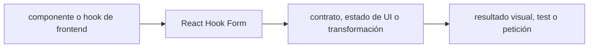

# React Hook Form — Vigilio v7 (comprobar lockfile; alternativo a TanStack Form)

## Qué es, qué hace y cuándo usarla

Gestor eficiente de formularios React. Integra resolución de validación y estados de inputs sin replicar campos en varios contratos.

**Ubicación en Vigilio:** usa esta dependencia en su stack propietario; otras skills deben enlazar esta guía, no duplicar sus reglas. **Versión:** la indicada en el encabezado es la línea documentada; consultar `technology/versions.md` y el lockfile antes de copiar APIs o aprobar un upgrade.

> **Guía propia de React Hook Form (frontend).** Estado a **2026-10-25**: v7 (comprobar lockfile; alternativo a TanStack Form). Versión del proyecto consumidor = `pnpm-lock.yaml` / `composer.lock` / imagen o manifest. Fuente: [documentación oficial](https://react-hook-form.com/get-started). Fuente normativa transversal de versiones: [versions.md](../versions.md). **No implica instalación automática ni upgrade aprobado.**

## Objetivo, responsabilidad y dónde usar

Usar librería de formulario elegida por aplicación; no instalar RHF y TanStack Form por defecto a la vez.

**Uso:** aplicar solo si está declarada y resulta pertinente al consumidor; ver [política de adopción y DRY](README.md).

### Diagrama de integración (Mermaid)



El flujo muestra la **responsabilidad arquitectónica** de la librería; no representa llamadas reales de red para todas las operaciones.


## Instalación o verificación

```bash
pnpm add react-hook-form @hookform/resolvers
```

**Gate de instalación:** consultar [procedimiento compartido](README.md#protocolo-de-adopción-y-actualización); estos comandos son indicativos, no ejecuciones sobre un consumidor.

## ✅ Correcto — uso actual y ejemplo de referencia

```typescript
import { useForm } from 'react-hook-form';
const { register, handleSubmit } = useForm<RegisterProductRequestDto>();
// Validar request DTO con zodResolver(registerProductRequestDto) si se configura resolver.
```

**Por qué:** Usar librería de formulario elegida por aplicación; no instalar RHF y TanStack Form por defecto a la vez.

## ❌ Incorrecto — patrón legacy, inseguro o mal ubicado

```typescript
// ❌ definir campos y validaciones duplicados sin schema compartido
const fakeValid=true;
```

**Riesgo:** confundir versiones o responsabilidades y obtener un contrato incorrecto.

## Nuevas capacidades, migración y breaking changes

Resolver debe ser compatible con Zod v4 y el contrato input/output en transforms; no presumir que todas las versiones admiten igual.

Aplicar el [protocolo de migración común](README.md#protocolo-de-adopción-y-actualización), sin asumir que una release nueva está desplegada.

## Buenas prácticas, seguridad, rendimiento y operación

Consultar la [política transversal de librerías](README.md) para seguridad, versionado, evidencia y revisión de contratos. Para esta librería, además, aplicar las verificaciones concretas que se detallan a continuación.

## Gates de aceptación y compatibilidad

Test errors, reset, transforms, submit disabled, responsividad.

Estado de prueba de estos ejemplos documentales: **NOT_RUN** en aplicaciones consumidoras; ver [criterios de evidencia](README.md#criterios-de-validación).


## Referencias

- [Documentación oficial y migración de React Hook Form](https://react-hook-form.com/get-started)
- [Matriz y baseline de versiones](../versions.md)
- [Calidad de código canónica](../../foundations/engineering/code-quality.md)


## Recetario operativo ampliado — react-hook-form (2026-10-25)

### API actual: dos tareas reales que debe saber ejecutar una skill

1. **`useForm` con `zodResolver` y `handleSubmit` tipados desde DTO.**
2. **`Controller` para componentes controlados; field errors y resets coherentes.**

### Migración desde versiones anteriores: decisión concreta

- **Qué cambia o se debe revisar:** No duplicar validación de DTO frontend; usar paquete contracts publicado.

### Responsabilidades y capas

Forms React/Expo, nunca schema propio espejo del backend.

**✅ Correcto:** mantener la integración encapsulada, alinear los nombres del negocio con Vigilio y depender de un contrato estable.

**❌ Incorrecto:** importar internals de la librería desde Domain, declarar `any` para resolver un upgrade, o duplicar reglas ya propietarias de otra tecnología.

### Seguridad, resiliencia y rendimiento

- Errores backend field-level y dirty state no deben perderse.

### Test de aceptación específico y evidencia mínima

- **Escenario comprobable:** Test submit valid/invalid, server 409 y focus en error.


## Guía operativa detallada — 8 casos y 4 antipatrones

### Ocho ejemplos de la API y casos de uso relevantes

Los fragmentos siguientes ilustran **operaciones independientes**. Variables, imports, provider, extensión y configuración se completan en el proyecto consumidor; **no están certificados como un archivo único compilable**. Cuando hay comentarios `#`, son pasos de integración o configuración y no APIs inventadas.

#### Ejemplo 1. Form

**✅ Correcto — form**

```tsx
const form = useForm<RegisterProductRequestDto>({ defaultValues: { nro_poliza: '' } });
```


#### Ejemplo 2. Campo

**✅ Correcto — campo**

```tsx
const input = form.register('nro_poliza');
```


#### Ejemplo 3. Submit

**✅ Correcto — submit**

```tsx
const onSubmit = form.handleSubmit(registerProductApi);
```


#### Ejemplo 4. Error

**✅ Correcto — error**

```tsx
form.formState.errors.nro_poliza?.message
```


#### Ejemplo 5. Validación Zod

**✅ Correcto — validación zod**

```tsx
useForm({ resolver: zodResolver(registerProductRequestDto) });
```


#### Ejemplo 6. Reset

**✅ Correcto — reset**

```tsx
form.reset();
```


#### Ejemplo 7. SetValue

**✅ Correcto — setvalue**

```tsx
form.setValue('nro_poliza', 'POL-001');
```


#### Ejemplo 8. Watch

**✅ Correcto — watch**

```tsx
const nro_poliza = form.watch('nro_poliza');
```


### Cuatro antipatrones frecuentes y su sustitución

#### Antipatrón 1 — riesgo y alternativa

**❌ Incorrecto**

```tsx
useState() # por cada tecla de 50 inputs
```

**Por qué está mal:** El patrón «useState() # por cada tecla de 50 inputs» es riesgoso: puede exponer datos obsoletos o mezclar estados de usuarios, sesiones y consultas diferentes.

**✅ Correcto**

```tsx
const form = useForm()
```

**Por qué mejora:** El patrón «const form = useForm()» mejora el caso: el estado se identifica e invalida con criterios explícitos y verificables.

#### Antipatrón 2 — riesgo y alternativa

**❌ Incorrecto — Duplicar schema Zod en validator y dto.**

**Por qué está mal:** El patrón «Duplicar schema Zod en validator y dto» es riesgoso: puede elevar el coste de runtime, causar fallos de despliegue o empaquetar dependencias no deseadas.

**✅ Correcto — Reutilizar registerProductRequestDto en zodResolver.**

**Por qué mejora:** El patrón «Reutilizar registerProductRequestDto en zodResolver» mejora el caso: el build y los recursos se verifican mediante gates de despliegue y rendimiento.

#### Antipatrón 3 — riesgo y alternativa

**❌ Incorrecto — OnSubmit invoca API antes de validar.**

**Por qué está mal:** El patrón «OnSubmit invoca API antes de validar» es riesgoso: puede aceptar entradas inválidas o duplicar contratos difíciles de mantener.

**✅ Correcto**

```tsx
form.handleSubmit(registerProductApi)
```

**Por qué mejora:** El patrón «form.handleSubmit(registerProductApi)» mejora el caso: el contrato queda tipado y validado en el borde que recibe datos externos.

#### Antipatrón 4 — riesgo y alternativa

**❌ Incorrecto — Olvidar reset al editar otro registro.**

**Por qué está mal:** Omite un control operativo necesario, por lo que el comportamiento puede ser inseguro o difícil de verificar.

**✅ Correcto**

```tsx
form.reset(next_values)
```

**Por qué mejora:** El patrón «form.reset(next_values)» mejora el caso: el contrato queda tipado y validado en el borde que recibe datos externos.

### Versión estable, breaking changes y verificación

- **Versión estable exacta:** no se declara un parche universal cuando no hay verificación específica de su registry/release. Consultar el encabezado de esta guía, `technology/versions.md` y el manifiesto del servicio. **Estado de patch: VERIFY_LOCKFILE**.
- **Migración:** identificar major anterior, APIs retiradas/cambiadas, peer dependencies, requisitos de runtime, cambios de tipos, ejecución CI y plan de rollback. Si no hay prueba sobre el consumidor, **NOT_RUN**, no PASS.
- **Versiones previas:** el ejemplo marcado ❌ en esta guía explica al menos una incompatibilidad o un uso obsoleto; no trasplantar APIs de otras versiones.
- **Tests:** probar al menos happy path, error, seguridad/permiso y compatibilidad con el runtime donde aplique; solo activar nuevas capacidades mediante una PR versionada.

### Fuentes oficiales y referencias al final

- [Referencia propia oficial](https://react-hook-form.com/get-started)
- [Matriz canónica de versiones](../versions.md)
- [Política de adopción de librerías](README.md)

## Guía de compatibilidad y evaluación por versión (2026-10-25)

**Estado del patch exacto:** `VERIFY_LOCKFILE`. La guía documenta la familia de APIs; **no se ha verificado hoy el patch estable preciso de esta dependencia**. Consultar la fuente oficial enlazada al inicio y el lockfile antes de generar código o aprobar un upgrade.

### Checklist específico de esta librería

- **Migración/compatibilidad:** No duplicar validación de DTO frontend; usar paquete contracts publicado.
- **Prueba propia:** Test submit valid/invalid, server 409 y focus en error.
- **Límite de responsabilidad:** usar esta librería solo en su adaptador o capa propietaria; consultar los ejemplos de API y antipatrones anteriores antes de cambiar llamadas públicas.

**Gate de aprobación:** leer la referencia oficial y resolver la versión del consumidor, ejecutar typecheck y pruebas específicas, registrar PASS/FAIL/NOT_RUN/BLOCKED. No confundir esta guía con validación de un consumidor real. [Procedimiento único de adopción](README.md#protocolo-de-adopción-y-actualización).

