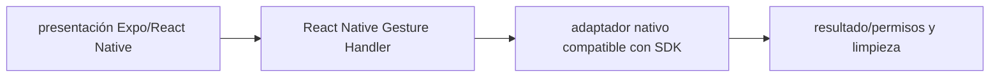

# React Native Gesture Handler — Vigilio versión determinada por Expo SDK 58 (migración desde 57)

## Qué es, qué hace y cuándo usarla

Detector de gestos de React Native. Coordina recognizers y componentes nativos sin listeners manuales frágiles.

**Ubicación en Vigilio:** usa esta dependencia en su stack propietario; otras skills deben enlazar esta guía, no duplicar sus reglas. **Versión:** la indicada en el encabezado es la línea documentada; consultar `technology/versions.md` y el lockfile antes de copiar APIs o aprobar un upgrade.

> **Guía propia de React Native Gesture Handler (mobile).** Estado a **2026-10-25**: versión determinada por Expo SDK 58 (migración desde 57). Versión del proyecto consumidor = `pnpm-lock.yaml` / `composer.lock` / imagen o manifest. Fuente: [documentación oficial](https://docs.swmansion.com/react-native-gesture-handler/). Fuente normativa transversal de versiones: [versions.md](../versions.md). **No implica instalación automática ni upgrade aprobado.**

## Objetivo, responsabilidad y dónde usar

Gestos accesibles y cancelables; evitar bloquear scroll/inputs.

**Uso:** aplicar solo si está declarada y resulta pertinente al consumidor; ver [política de adopción y DRY](README.md).

### Diagrama de integración (Mermaid)



El flujo muestra la **responsabilidad arquitectónica** de la librería; no representa llamadas reales de red para todas las operaciones.


## Instalación o verificación

```bash
npx expo install react-native-gesture-handler
```

**Gate de instalación:** consultar [procedimiento compartido](README.md#protocolo-de-adopción-y-actualización); estos comandos son indicativos, no ejecuciones sobre un consumidor.

## ✅ Correcto — uso actual y ejemplo de referencia

**Nota técnica (no es código ejecutable):** Gesture.Tap().onEnd(...); confirmar API de la versión instalada GestureDetector a nivel de componente nativo, no en Domain.

**Por qué:** Gestos accesibles y cancelables; evitar bloquear scroll/inputs.

## ❌ Incorrecto — patrón legacy, inseguro o mal ubicado

**Nota técnica (no es código ejecutable):** ❌ usar legacy handler components desaconsejados sin gate.

**Riesgo:** confundir versiones o responsabilidades y obtener un contrato incorrecto.

## Nuevas capacidades, migración y breaking changes

API Gesture moderna frente a componentes antiguos; compat con Reanimated y SDK.

Aplicar el [protocolo de migración común](README.md#protocolo-de-adopción-y-actualización), sin asumir que una release nueva está desplegada.

## Buenas prácticas, seguridad, rendimiento y operación

Consultar la [política transversal de librerías](README.md) para seguridad, versionado, evidencia y revisión de contratos. Para esta librería, además, aplicar las verificaciones concretas que se detallan a continuación.

## Gates de aceptación y compatibilidad

Tests simultaneidad pan/tap, Android/iOS y accessibility.

Estado de prueba de estos ejemplos documentales: **NOT_RUN** en aplicaciones consumidoras; ver [criterios de evidencia](README.md#criterios-de-validación).


## Referencias

- [Documentación oficial y migración de React Native Gesture Handler](https://docs.swmansion.com/react-native-gesture-handler/)
- [Matriz y baseline de versiones](../versions.md)
- [Calidad de código canónica](../../foundations/engineering/code-quality.md)


## Recetario operativo ampliado — react-native-gesture-handler (2026-10-25)

### API actual: dos tareas reales que debe saber ejecutar una skill

1. **Usar GestureDetector/Gesture API y root view compatibles SDK.**
2. **Coordinar gestures con scroll/navigation sin bloquear lector pantalla.**

### Migración desde versiones anteriores: decisión concreta

- **Qué cambia o se debe revisar:** Migrar old gesture handlers/component props a Gesture API según versión.

### Responsabilidades y capas

Capa interacción RN, no dominio ni hooks de API.

**✅ Correcto:** mantener la integración encapsulada, alinear los nombres del negocio con Vigilio y depender de un contrato estable.

**❌ Incorrecto:** importar internals de la librería desde Domain, declarar `any` para resolver un upgrade, o duplicar reglas ya propietarias de otra tecnología.

### Seguridad, resiliencia y rendimiento

- Conflictos touch y fallos Android back, reconocimiento accesible.

### Test de aceptación específico y evidencia mínima

- **Escenario comprobable:** Tests gestos simultáneos y background/foreground.


## Guía operativa detallada — 8 casos y 4 antipatrones

### Ocho ejemplos de la API y casos de uso relevantes

Los fragmentos siguientes ilustran **operaciones independientes**. Variables, imports, provider, extensión y configuración se completan en el proyecto consumidor; **no están certificados como un archivo único compilable**. Cuando hay comentarios `#`, son pasos de integración o configuración y no APIs inventadas.

#### Ejemplo 1. Root

**✅ Correcto — root**

```tsx
const app = <GestureHandlerRootView style={{ flex: 1 }}><App/></GestureHandlerRootView>;
```


#### Ejemplo 2. Tap

**✅ Correcto — tap**

```tsx
const tap = Gesture.Tap().onEnd(() => runOnJS(onPress)());
```


#### Ejemplo 3. Pan

**✅ Correcto — pan**

```tsx
const pan = Gesture.Pan().onUpdate((event) => { translation.value = event.translationX; });
```


#### Ejemplo 4. Gesture detector

**✅ Correcto — gesture detector**

```tsx
<GestureDetector gesture={pan}><Animated.View /></GestureDetector>
```


#### Ejemplo 5. Long press

**✅ Correcto — long press**

```tsx
const longPress = Gesture.LongPress().minDuration(500);
```


#### Ejemplo 6. Simultáneo

**✅ Correcto — simultáneo**

```tsx
const combined = Gesture.Simultaneous(pan, tap);
```


#### Ejemplo 7. Exclusivo

**✅ Correcto — exclusivo**

```tsx
const exclusive = Gesture.Exclusive(doubleTap, singleTap);
```


#### Ejemplo 8. Cleanup

**✅ Correcto — cleanup**

**Nota técnica (no es código ejecutable):** Desmontar detectors y cancelar animaciones en unmount.


### Cuatro antipatrones frecuentes y su sustitución

#### Antipatrón 1 — riesgo y alternativa

**❌ Incorrecto — Detectar pan con touch DIY no cleanup.**

**Por qué está mal:** El patrón «Detectar pan con touch DIY no cleanup» es riesgoso: la elección «Detectar pan con touch DIY no cleanup» puede incumplir los requisitos operativos de react-native-gesture-handler.

**✅ Correcto**

```tsx
Gesture.Pan().onUpdate(handler)
```

**Por qué mejora:** El patrón «Gesture.Pan().onUpdate(handler)» mejora el caso: la alternativa «Gesture.Pan().onUpdate(handler)» establece el comportamiento esperado de react-native-gesture-handler.

#### Antipatrón 2 — riesgo y alternativa

**❌ Incorrecto — Instalar GestureDetector sin root.**

**Por qué está mal:** Omite un control operativo necesario, por lo que el comportamiento puede ser inseguro o difícil de verificar.

**✅ Correcto**

```tsx
<GestureHandlerRootView><App/></GestureHandlerRootView>
```

**Por qué mejora:** El patrón «<GestureHandlerRootView><App/></GestureHandlerRootView>» mejora el caso: la alternativa «<GestureHandlerRootView><App/></GestureHandlerRootView>» establece el comportamiento esperado de react-native-gesture-handler.

#### Antipatrón 3 — riesgo y alternativa

**❌ Incorrecto — Ejecutar setState directamente en worklet.**

**Por qué está mal:** El patrón «Ejecutar setState directamente en worklet» es riesgoso: puede mezclar firmas incompatibles o ejecutar una API retirada en la versión instalada.

**✅ Correcto — RunOnJS solo según versión/requisitos.**

**Por qué mejora:** El patrón «RunOnJS solo según versión/requisitos» mejora el caso: se utiliza la API apropiada para el major documentado y se comprueba el lockfile.

#### Antipatrón 4 — riesgo y alternativa

**❌ Incorrecto — Gestos simultáneos sin prioridad.**

**Por qué está mal:** Omite un control operativo necesario, por lo que el comportamiento puede ser inseguro o difícil de verificar.

**✅ Correcto**

```tsx
Gesture.Exclusive(gesture_a, gesture_b)
```

**Por qué mejora:** El patrón «Gesture.Exclusive(gesture_a, gesture_b)» mejora el caso: la alternativa «Gesture.Exclusive(gesture_a, gesture_b)» establece el comportamiento esperado de react-native-gesture-handler.

### Versión estable, breaking changes y verificación

- **Versión estable exacta:** no se declara un parche universal cuando no hay verificación específica de su registry/release. Consultar el encabezado de esta guía, `technology/versions.md` y el manifiesto del servicio. **Estado de patch: VERIFY_LOCKFILE**.
- **Migración:** identificar major anterior, APIs retiradas/cambiadas, peer dependencies, requisitos de runtime, cambios de tipos, ejecución CI y plan de rollback. Si no hay prueba sobre el consumidor, **NOT_RUN**, no PASS.
- **Versiones previas:** el ejemplo marcado ❌ en esta guía explica al menos una incompatibilidad o un uso obsoleto; no trasplantar APIs de otras versiones.
- **Tests:** probar al menos happy path, error, seguridad/permiso y compatibilidad con el runtime donde aplique; solo activar nuevas capacidades mediante una PR versionada.

### Fuentes oficiales y referencias al final

- [Referencia propia oficial](https://docs.swmansion.com/react-native-gesture-handler/)
- [Matriz canónica de versiones](../versions.md)
- [Política de adopción de librerías](README.md)

## Guía de compatibilidad y evaluación por versión (2026-10-25)

**Estado del patch exacto:** `VERIFY_LOCKFILE`. La guía documenta la familia de APIs; **no se ha verificado hoy el patch estable preciso de esta dependencia**. Consultar la fuente oficial enlazada al inicio y el lockfile antes de generar código o aprobar un upgrade.

### Checklist específico de esta librería

- **Migración/compatibilidad:** Migrar old gesture handlers/component props a Gesture API según versión.
- **Prueba propia:** Tests gestos simultáneos y background/foreground.
- **Límite de responsabilidad:** usar esta librería solo en su adaptador o capa propietaria; consultar los ejemplos de API y antipatrones anteriores antes de cambiar llamadas públicas.

**Gate de aprobación:** leer la referencia oficial y resolver la versión del consumidor, ejecutar typecheck y pruebas específicas, registrar PASS/FAIL/NOT_RUN/BLOCKED. No confundir esta guía con validación de un consumidor real. [Procedimiento único de adopción](README.md#protocolo-de-adopción-y-actualización).

