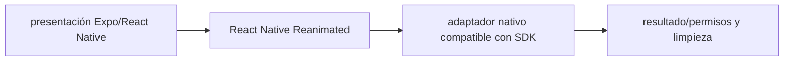

# React Native Reanimated — Vigilio versión determinada por Expo SDK 58 (migración desde 57)

## Qué es, qué hace y cuándo usarla

Motor de animaciones React Native con worklets en UI thread. Versiones estrictamente compatibles con Expo/RN y plugin/babel apropiado.

**Ubicación en Vigilio:** usa esta dependencia en su stack propietario; otras skills deben enlazar esta guía, no duplicar sus reglas. **Versión:** la indicada en el encabezado es la línea documentada; consultar `technology/versions.md` y el lockfile antes de copiar APIs o aprobar un upgrade.

> **Guía propia de React Native Reanimated (mobile).** Estado a **2026-10-25**: versión determinada por Expo SDK 58 (migración desde 57). Versión del proyecto consumidor = `pnpm-lock.yaml` / `composer.lock` / imagen o manifest. Fuente: [documentación oficial](https://docs.swmansion.com/react-native-reanimated/). Fuente normativa transversal de versiones: [versions.md](../versions.md). **No implica instalación automática ni upgrade aprobado.**

## Objetivo, responsabilidad y dónde usar

Animación UI no negocio; reducir layout thrashing.

**Uso:** aplicar solo si está declarada y resulta pertinente al consumidor; ver [política de adopción y DRY](README.md).

### Diagrama de integración (Mermaid)



El flujo muestra la **responsabilidad arquitectónica** de la librería; no representa llamadas reales de red para todas las operaciones.


## Instalación o verificación

```bash
npx expo install react-native-reanimated
```

**Gate de instalación:** consultar [procedimiento compartido](README.md#protocolo-de-adopción-y-actualización); estos comandos son indicativos, no ejecuciones sobre un consumidor.

## ✅ Correcto — uso actual y ejemplo de referencia

**Nota técnica (no es código ejecutable):** Confirmar compat del babel plugin y worklets según SDK Mover animaciones intensivas a worklets validados por la versión.

**Por qué:** Animación UI no negocio; reducir layout thrashing.

## ❌ Incorrecto — patrón legacy, inseguro o mal ubicado

**Nota técnica (no es código ejecutable):** ❌ pegar import/plugins de Reanimated v2 en v4 sin comprobar compat.

**Riesgo:** confundir versiones o responsabilidades y obtener un contrato incorrecto.

## Nuevas capacidades, migración y breaking changes

Cambios mayores afectan Worklets, Babel plugin e integración con Gesture Handler; Expo decide versiones.

Aplicar el [protocolo de migración común](README.md#protocolo-de-adopción-y-actualización), sin asumir que una release nueva está desplegada.

## Buenas prácticas, seguridad, rendimiento y operación

Consultar la [política transversal de librerías](README.md) para seguridad, versionado, evidencia y revisión de contratos. Para esta librería, además, aplicar las verificaciones concretas que se detallan a continuación.

## Gates de aceptación y compatibilidad

Test Android/iOS low-end, gesture conflicts y smoothness.

Estado de prueba de estos ejemplos documentales: **NOT_RUN** en aplicaciones consumidoras; ver [criterios de evidencia](README.md#criterios-de-validación).


## Referencias

- [Documentación oficial y migración de React Native Reanimated](https://docs.swmansion.com/react-native-reanimated/)
- [Matriz y baseline de versiones](../versions.md)
- [Calidad de código canónica](../../foundations/engineering/code-quality.md)


## Recetario operativo ampliado — react-native-reanimated (2026-10-25)

### API actual: dos tareas reales que debe saber ejecutar una skill

1. **Animaciones en UI thread con shared values/worklets compatibles.**
2. **Limpiar animations y aplicar prefers-reduced-motion donde corresponda.**

### Migración desde versiones anteriores: decisión concreta

- **Qué cambia o se debe revisar:** Reanimated majors cambian plugin/worklet config; Expo SDK fija conjunto.

### Responsabilidades y capas

Animación RN; no guardar estado de negocio en shared values.

**✅ Correcto:** mantener la integración encapsulada, alinear los nombres del negocio con Vigilio y depender de un contrato estable.

**❌ Incorrecto:** importar internals de la librería desde Domain, declarar `any` para resolver un upgrade, o duplicar reglas ya propietarias de otra tecnología.

### Seguridad, resiliencia y rendimiento

- Memory leaks y freezing JS thread por combinaciones incompatibles.

### Test de aceptación específico y evidencia mínima

- **Escenario comprobable:** Pruebas Android/iOS, reduced motion, FPS y navigation teardown.


## Guía operativa detallada — 8 casos y 4 antipatrones

### Ocho ejemplos de la API y casos de uso relevantes

Los fragmentos siguientes ilustran **operaciones independientes**. Variables, imports, provider, extensión y configuración se completan en el proyecto consumidor; **no están certificados como un archivo único compilable**. Cuando hay comentarios `#`, son pasos de integración o configuración y no APIs inventadas.

#### Ejemplo 1. Valor compartido

**✅ Correcto — valor compartido**

```tsx
const offset = useSharedValue(0);
```


#### Ejemplo 2. Estilo animado

**✅ Correcto — estilo animado**

```tsx
const style = useAnimatedStyle(() => ({ transform: [{ translateX: offset.value }] }));
```


#### Ejemplo 3. Timing

**✅ Correcto — timing**

```tsx
offset.value = withTiming(120, { duration: 250 });
```


#### Ejemplo 4. Spring

**✅ Correcto — spring**

```tsx
offset.value = withSpring(0);
```


#### Ejemplo 5. Interpolar

**✅ Correcto — interpolar**

```tsx
interpolate(progress.value, [0, 1], [0, 100]);
```


#### Ejemplo 6. Scroll

**✅ Correcto — scroll**

```tsx
const scroll_handler = useAnimatedScrollHandler({ onScroll: event => { scroll_y.value = event.contentOffset.y; } });
```


#### Ejemplo 7. Cancelar

**✅ Correcto — cancelar**

```tsx
cancelAnimation(offset);
```


#### Ejemplo 8. Reduced motion

**✅ Correcto — reduced motion**

**Nota técnica (no es código ejecutable):** Respetar preferencia reduce motion; comprobar versión SDK/Reanimated.


### Cuatro antipatrones frecuentes y su sustitución

#### Antipatrón 1 — riesgo y alternativa

**❌ Incorrecto**

```tsx
setInterval(()
```

**Por qué está mal:** El patrón «setInterval(()» es riesgoso: la elección «setInterval(()» puede incumplir los requisitos operativos de react-native-reanimated.

**✅ Correcto**

```tsx
setX(x+1), 16) => offset.value = withTiming(120)
```

**Por qué mejora:** El patrón «setX(x+1), 16) => offset.value = withTiming(120)» mejora el caso: la alternativa «setX(x+1), 16) => offset.value = withTiming(120)» establece el comportamiento esperado de react-native-reanimated.

#### Antipatrón 2 — riesgo y alternativa

**❌ Incorrecto — No limpiar animación al salir.**

**Por qué está mal:** El patrón «No limpiar animación al salir» es riesgoso: puede publicar cambios sin evidencia suficiente ni una revisión del impacto.

**✅ Correcto**

```tsx
cancelAnimation(offset)
```

**Por qué mejora:** El patrón «cancelAnimation(offset)» mejora el caso: el cambio pasa por gates automáticos y aprobación de riesgos operativos.

#### Antipatrón 3 — riesgo y alternativa

**❌ Incorrecto — Animaciones invasivas sin reduced motion.**

**Por qué está mal:** Omite un control operativo necesario, por lo que el comportamiento puede ser inseguro o difícil de verificar.

**✅ Correcto — Respetar reduced motion.**

**Por qué mejora:** El patrón «Respetar reduced motion» mejora el caso: el cambio pasa por gates automáticos y aprobación de riesgos operativos.

#### Antipatrón 4 — riesgo y alternativa

**❌ Incorrecto — Usar RN/Reanimated incompatible Expo SDK.**

**Por qué está mal:** El patrón «Usar RN/Reanimated incompatible Expo SDK» es riesgoso: puede mezclar firmas incompatibles o ejecutar una API retirada en la versión instalada.

**✅ Correcto**

```tsx
npx expo install --check
```

**Por qué mejora:** El patrón «npx expo install --check» mejora el caso: se utiliza la API apropiada para el major documentado y se comprueba el lockfile.

### Versión estable, breaking changes y verificación

- **Versión estable exacta:** no se declara un parche universal cuando no hay verificación específica de su registry/release. Consultar el encabezado de esta guía, `technology/versions.md` y el manifiesto del servicio. **Estado de patch: VERIFY_LOCKFILE**.
- **Migración:** identificar major anterior, APIs retiradas/cambiadas, peer dependencies, requisitos de runtime, cambios de tipos, ejecución CI y plan de rollback. Si no hay prueba sobre el consumidor, **NOT_RUN**, no PASS.
- **Versiones previas:** el ejemplo marcado ❌ en esta guía explica al menos una incompatibilidad o un uso obsoleto; no trasplantar APIs de otras versiones.
- **Tests:** probar al menos happy path, error, seguridad/permiso y compatibilidad con el runtime donde aplique; solo activar nuevas capacidades mediante una PR versionada.

### Fuentes oficiales y referencias al final

- [Referencia propia oficial](https://docs.swmansion.com/react-native-reanimated/)
- [Matriz canónica de versiones](../versions.md)
- [Política de adopción de librerías](README.md)

## Guía de compatibilidad y evaluación por versión (2026-10-25)

**Estado del patch exacto:** `VERIFY_LOCKFILE`. La guía documenta la familia de APIs; **no se ha verificado hoy el patch estable preciso de esta dependencia**. Consultar la fuente oficial enlazada al inicio y el lockfile antes de generar código o aprobar un upgrade.

### Checklist específico de esta librería

- **Migración/compatibilidad:** Reanimated majors cambian plugin/worklet config; Expo SDK fija conjunto.
- **Prueba propia:** Pruebas Android/iOS, reduced motion, FPS y navigation teardown.
- **Límite de responsabilidad:** usar esta librería solo en su adaptador o capa propietaria; consultar los ejemplos de API y antipatrones anteriores antes de cambiar llamadas públicas.

**Gate de aprobación:** leer la referencia oficial y resolver la versión del consumidor, ejecutar typecheck y pruebas específicas, registrar PASS/FAIL/NOT_RUN/BLOCKED. No confundir esta guía con validación de un consumidor real. [Procedimiento único de adopción](README.md#protocolo-de-adopción-y-actualización).

