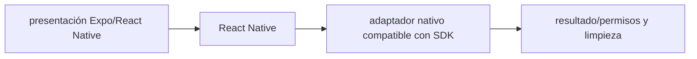

# React Native — Vigilio 0.88 + Expo SDK 58

## Qué es, qué hace y cuándo usarla

Framework React para apps iOS y Android. La versión debe seguir Expo SDK o plantilla nativa compatible, no un pin web independiente.

**Ubicación en Vigilio:** usa esta dependencia en su stack propietario; otras skills deben enlazar esta guía, no duplicar sus reglas. **Versión:** la indicada en el encabezado es la línea documentada; consultar `technology/versions.md` y el lockfile antes de copiar APIs o aprobar un upgrade.

> **Guía propia de React Native (mobile).** Estado a **2026-10-25**: React Native 0.88 (Expo SDK 58); standalone exige gate. Versión del proyecto consumidor = `pnpm-lock.yaml` / `composer.lock` / imagen o manifest. Fuente: [documentación oficial](https://reactnative.dev/docs/getting-started). Fuente normativa transversal de versiones: [versions.md](../versions.md). **No implica instalación automática ni upgrade aprobado.**

## Objetivo, responsabilidad y dónde usar

Componentes y adaptadores nativos específicos, contratos Zod compartidos con web y hooks reutilizables.

**Uso:** aplicar solo si está declarada y resulta pertinente al consumidor; ver [política de adopción y DRY](README.md).

### Diagrama de integración (Mermaid)



El flujo muestra la **responsabilidad arquitectónica** de la librería; no representa llamadas reales de red para todas las operaciones.


## Instalación o verificación

```bash
usar expo install si aplicación Expo
```

**Gate de instalación:** consultar [procedimiento compartido](README.md#protocolo-de-adopción-y-actualización); estos comandos son indicativos, no ejecuciones sobre un consumidor.

## ✅ Correcto — uso actual y ejemplo de referencia

```typescript
// RN básico con accesibilidad
import { Pressable, Text } from 'react-native';
<Pressable accessibilityRole="button" onPress={onRegister}><Text>Registrar</Text></Pressable>
```

**Por qué:** Componentes y adaptadores nativos específicos, contratos Zod compartidos con web y hooks reutilizables.

## ❌ Incorrecto — patrón legacy, inseguro o mal ubicado

**Nota técnica (no es código ejecutable):** ❌ asumir que elementos DOM como div/input funcionan en React Native nativo.

**Riesgo:** confundir versiones o responsabilidades y obtener un contrato incorrecto.

## Nuevas capacidades, migración y breaking changes

RN standalone sigue otra cadencia; cambios JS/native/Gradle/Xcode/Hermes deben probarse. Con Expo jamás actualizar RN aislado del SDK.

Aplicar el [protocolo de migración común](README.md#protocolo-de-adopción-y-actualización), sin asumir que una release nueva está desplegada.

## Buenas prácticas, seguridad, rendimiento y operación

Consultar la [política transversal de librerías](README.md) para seguridad, versionado, evidencia y revisión de contratos. Para esta librería, además, aplicar las verificaciones concretas que se detallan a continuación.

## Gates de aceptación y compatibilidad

Test iOS/Android, permisos, offline/reconnect, memoria y crashes.

Estado de prueba de estos ejemplos documentales: **NOT_RUN** en aplicaciones consumidoras; ver [criterios de evidencia](README.md#criterios-de-validación).


## Referencias

- [Documentación oficial y migración de React Native](https://reactnative.dev/docs/getting-started)
- [Matriz y baseline de versiones](../versions.md)
- [Calidad de código canónica](../../foundations/engineering/code-quality.md)


## Recetario operativo ampliado — react-native (2026-10-25)

### API actual: dos tareas reales que debe saber ejecutar una skill

1. **Usar componentes nativos, FlatList/FlashList según perfil y Platform API cuando corresponda.**
2. **Separar adaptadores de permisos/files de components/hooks.**

### Migración desde versiones anteriores: decisión concreta

- **Qué cambia o se debe revisar:** Standalone RN no debe instalarse sobre Expo sin `expo install --check`.

### Responsabilidades y capas

UI nativa; contratos browser-safe compartidos.

**✅ Correcto:** mantener la integración encapsulada, alinear los nombres del negocio con Vigilio y depender de un contrato estable.

**❌ Incorrecto:** importar internals de la librería desde Domain, declarar `any` para resolver un upgrade, o duplicar reglas ya propietarias de otra tecnología.

### Seguridad, resiliencia y rendimiento

- Permisos, accesibilidad, offline y puentes nativos.

### Test de aceptación específico y evidencia mínima

- **Escenario comprobable:** EAS builds, deep links, startup time y crash regressions.


## Guía operativa detallada — 8 casos y 4 antipatrones

### Ocho ejemplos de la API y casos de uso relevantes

Los fragmentos siguientes ilustran **operaciones independientes**. Variables, imports, provider, extensión y configuración se completan en el proyecto consumidor; **no están certificados como un archivo único compilable**. Cuando hay comentarios `#`, son pasos de integración o configuración y no APIs inventadas.

#### Ejemplo 1. Lista

**✅ Correcto — lista**

```tsx
const Products = () => <FlatList data={products} keyExtractor={item => item.id} renderItem={({ item }) => <Text>{item.nro_poliza}</Text>} />;
```


#### Ejemplo 2. Área segura

**✅ Correcto — área segura**

```tsx
const layout = <SafeAreaView><Text>Productos</Text></SafeAreaView>;
```


#### Ejemplo 3. Loading

**✅ Correcto — loading**

```tsx
const loading = <ActivityIndicator accessibilityLabel="Cargando" />;
```


#### Ejemplo 4. Accesibilidad

**✅ Correcto — accesibilidad**

```tsx
const button = <Pressable accessibilityRole="button" onPress={onPress}><Text>Guardar</Text></Pressable>;
```


#### Ejemplo 5. Teclado

**✅ Correcto — teclado**

```tsx
const input = <TextInput keyboardType="email-address" autoCapitalize="none" />;
```


#### Ejemplo 6. AppState

**✅ Correcto — appstate**

```tsx
AppState.addEventListener('change', handleStateChange);
```


#### Ejemplo 7. Enlace externo

**✅ Correcto — enlace externo**

```tsx
Linking.openURL('https://example.com');
```


#### Ejemplo 8. Platform

**✅ Correcto — platform**

```tsx
const is_ios = Platform.OS === 'ios';
```


### Cuatro antipatrones frecuentes y su sustitución

#### Antipatrón 1 — riesgo y alternativa

**❌ Incorrecto**

```tsx
<ScrollView>{items.map(renderItem)}</ScrollView> // miles
```

**Por qué está mal:** El patrón «<ScrollView>{items.map(renderItem)}</ScrollView> // miles» es riesgoso: mezcla responsabilidades de interfaz y navegación o genera comportamiento inconsistente.

**✅ Correcto**

```tsx
<FlatList data={items} renderItem={renderItem} />
```

**Por qué mejora:** El patrón «<FlatList data={items} renderItem={renderItem} />» mejora el caso: la interfaz utiliza la API adecuada y separa presentación, estado y comunicación.

#### Antipatrón 2 — riesgo y alternativa

**❌ Incorrecto — Componente Pressable sin accessibilityRole.**

**Por qué está mal:** Omite un control operativo necesario, por lo que el comportamiento puede ser inseguro o difícil de verificar.

**✅ Correcto**

```tsx
<Pressable accessibilityRole="button" />
```

**Por qué mejora:** El patrón «<Pressable accessibilityRole="button" />» mejora el caso: la interfaz utiliza la API adecuada y separa presentación, estado y comunicación.

#### Antipatrón 3 — riesgo y alternativa

**❌ Incorrecto — TextInput secretos sin secureTextEntry.**

**Por qué está mal:** Expone credenciales o confunde autenticación con autorización; puede ocasionar filtración o acceso indebido.

**✅ Correcto**

```tsx
<TextInput secureTextEntry />
```

**Por qué mejora:** El patrón «<TextInput secureTextEntry />» mejora el caso: las credenciales quedan fuera del código o bajo un mecanismo de acceso controlado.

#### Antipatrón 4 — riesgo y alternativa

**❌ Incorrecto — Importar filesystem en Domain.**

**Por qué está mal:** El patrón «Importar filesystem en Domain» es riesgoso: puede permitir acceso a recursos no autorizados o de otro tenant.

**✅ Correcto — Adapter para storage/permissions.**

**Por qué mejora:** El patrón «Adapter para storage/permissions» mejora el caso: se fuerza autorización en el borde/servidor y se limita el acceso por recurso.

### Versión estable, breaking changes y verificación

- **Versión estable exacta:** no se declara un parche universal cuando no hay verificación específica de su registry/release. Consultar el encabezado de esta guía, `technology/versions.md` y el manifiesto del servicio. **Estado de patch: VERIFY_LOCKFILE**.
- **Migración:** identificar major anterior, APIs retiradas/cambiadas, peer dependencies, requisitos de runtime, cambios de tipos, ejecución CI y plan de rollback. Si no hay prueba sobre el consumidor, **NOT_RUN**, no PASS.
- **Versiones previas:** el ejemplo marcado ❌ en esta guía explica al menos una incompatibilidad o un uso obsoleto; no trasplantar APIs de otras versiones.
- **Tests:** probar al menos happy path, error, seguridad/permiso y compatibilidad con el runtime donde aplique; solo activar nuevas capacidades mediante una PR versionada.

### Fuentes oficiales y referencias al final

- [Referencia propia oficial](https://reactnative.dev/docs/getting-started)
- [Matriz canónica de versiones](../versions.md)
- [Política de adopción de librerías](README.md)

## Guía de compatibilidad y evaluación por versión (2026-10-25)

**Release contrastada para esta familia:** `0.88.0`. Fuente: [publicación oficial](https://reactnative.dev/blog/2026/10/19/react-native-0.88). **Cambio clave:** RN 0.88; Strict TS API, no deep imports; Expo 58 compatible.

### Checklist específico de esta librería

- 0.88 va con SDK 58 en Expo; apps standalone tienen su propio gate de upgrade.
- No importar desde `react-native/Libraries/*`; migrar refs a tipos de instancia en RN Strict TS API.
- No usar InteractionManager en code nuevo; validar reemplazo adecuado y timing real.

**Gate de aprobación:** leer la referencia oficial y resolver la versión del consumidor, ejecutar typecheck y pruebas específicas, registrar PASS/FAIL/NOT_RUN/BLOCKED. No confundir esta guía con validación de un consumidor real. [Procedimiento único de adopción](README.md#protocolo-de-adopción-y-actualización).

## Compatibilidad de native builds en RN 0.88

React Native 0.88 corresponde a Expo SDK 58 (si se usa Expo) y requiere gates de toolchain iOS/Android/Node. **✅ Correcto:** usar tipos públicos y refs de instancia cuando el Strict TS API lo requiera, junto con adaptadores nativos aislados. **❌ Incorrecto:** `import ... from 'react-native/Libraries/...';` o suponer que una dependencia con código nativo se actualiza por OTA. Ver [release oficial RN 0.88](https://reactnative.dev/blog/2026/10/19/react-native-0.88) y [Expo 58](https://expo.dev/changelog/sdk-58).
