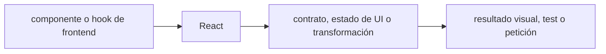

# React — Vigilio web 19.3.1 / Expo SDK 58 React 19.3.0

## Qué es, qué hace y cuándo usarla

Biblioteca de UI basada en componentes, hooks y renderizado declarativo. Hooks deben respetar reglas de llamadas; datos del servidor van al gestor de caché.

**Ubicación en Vigilio:** usa esta dependencia en su stack propietario; otras skills deben enlazar esta guía, no duplicar sus reglas. **Versión:** la indicada en el encabezado es la línea documentada; consultar `technology/versions.md` y el lockfile antes de copiar APIs o aprobar un upgrade.

> **Guía propia de React (frontend).** Estado a **2026-10-25**: web 19.3.1; Expo SDK 58 fija React 19.3.0. Versión del proyecto consumidor = `pnpm-lock.yaml` / `composer.lock` / imagen o manifest. Fuente: [documentación oficial](https://react.dev/reference/react). Fuente normativa transversal de versiones: [versions.md](../versions.md). **No implica instalación automática ni upgrade aprobado.**

## Objetivo, responsabilidad y dónde usar

Render debe ser puro, hooks a nivel superior, keys estables, estado local mínimo; server state a TanStack Query; Auth nunca solo en frontend.

**Uso:** aplicar solo si está declarada y resulta pertinente al consumidor; ver [política de adopción y DRY](README.md).

### Diagrama de integración (Mermaid)



El flujo muestra la **responsabilidad arquitectónica** de la librería; no representa llamadas reales de red para todas las operaciones.


## Instalación o verificación

```bash
pnpm add react react-dom
```

**Gate de instalación:** consultar [procedimiento compartido](README.md#protocolo-de-adopción-y-actualización); estos comandos son indicativos, no ejecuciones sobre un consumidor.

## ✅ Correcto — uso actual y ejemplo de referencia

```typescript
import { useState } from 'react';
export function RegisterProductForm(){
 const [nro_poliza,set_nro_poliza]=useState('');
 return <form><label>Número<input value={nro_poliza} onChange={e=>set_nro_poliza(e.target.value)}/></label></form>;
}
```

**Por qué:** Render debe ser puro, hooks a nivel superior, keys estables, estado local mínimo; server state a TanStack Query; Auth nunca solo en frontend.

## ❌ Incorrecto — patrón legacy, inseguro o mal ubicado

```typescript
// ❌ side effect en render
function Widget(){fetch('/api/products');return null;}
```

**Riesgo:** confundir versiones o responsabilidades y obtener un contrato incorrecto.

## Nuevas capacidades, migración y breaking changes

React 18→19: revisar acciones, formulario useActionState, ref como prop, compatibilidad de componentes externos y Server Components según framework. No mezclar reglas de cliente y servidor.

Aplicar el [protocolo de migración común](README.md#protocolo-de-adopción-y-actualización), sin asumir que una release nueva está desplegada.

## Buenas prácticas, seguridad, rendimiento y operación

Consultar la [política transversal de librerías](README.md) para seguridad, versionado, evidencia y revisión de contratos. Para esta librería, además, aplicar las verificaciones concretas que se detallan a continuación.

## Gates de aceptación y compatibilidad

StrictMode, hydration, accesibilidad, errores y Suspense en condiciones reales, bundle y profiling.

Estado de prueba de estos ejemplos documentales: **NOT_RUN** en aplicaciones consumidoras; ver [criterios de evidencia](README.md#criterios-de-validación).


## Referencias

- [Documentación oficial y migración de React](https://react.dev/reference/react)
- [Matriz y baseline de versiones](../versions.md)
- [Calidad de código canónica](../../foundations/engineering/code-quality.md)


## Recetario operativo ampliado — react (2026-10-25)

### API actual: dos tareas reales que debe saber ejecutar una skill

1. **Separar efectos sincronizadores de eventos y derivar estado cuando sea posible.**
2. **Error boundaries, Suspense y useTransition donde el framework/versión lo admita.**

### Migración desde versiones anteriores: decisión concreta

- **Qué cambia o se debe revisar:** React 18→19 APIs/refs/actions cambian; no mezclar Expo React pin con web.

### Responsabilidades y capas

UI React: Server State TanStack Query no es useState local.

**✅ Correcto:** mantener la integración encapsulada, alinear los nombres del negocio con Vigilio y depender de un contrato estable.

**❌ Incorrecto:** importar internals de la librería desde Domain, declarar `any` para resolver un upgrade, o duplicar reglas ya propietarias de otra tecnología.

### Seguridad, resiliencia y rendimiento

- XSS, hydration mismatches, effects duplicados en StrictMode dev.

### Test de aceptación específico y evidencia mínima

- **Escenario comprobable:** Tests componentes, a11y, hydration y React Profiler.

### Ejemplo de integración vigente (fragmento adicional)

```tsx
export function ProductList({ products }: { products: readonly ProductSummary[] }) {
  return <ul>{products.map((product) => <li key={product.id}>{product.nro_poliza}</li>)}</ul>;
}
// No guardar productos del servidor en estado duplicado de useState si ya hay Query.
```

**Nota:** los fragmentos muestran la API específica y requieren imports/providers/fixtures del consumidor; no se certifica compilación por el solo hecho de aparecer aquí.


## Guía operativa detallada — 8 casos y 4 antipatrones

### Ocho ejemplos de la API y casos de uso relevantes

Los fragmentos siguientes ilustran **operaciones independientes**. Variables, imports, provider, extensión y configuración se completan en el proyecto consumidor; **no están certificados como un archivo único compilable**. Cuando hay comentarios `#`, son pasos de integración o configuración y no APIs inventadas.

#### Ejemplo 1. Estado local

**✅ Correcto — estado local**

```tsx
const [open, setOpen] = useState(false);
```


#### Ejemplo 2. Effect cleanup

**✅ Correcto — effect cleanup**

```tsx
useEffect(() => { const listener = subscribe(); return () => listener.unsubscribe(); }, []);
```


#### Ejemplo 3. Memo

**✅ Correcto — memo**

```tsx
const filtered = useMemo(() => products.filter(matches), [products]);
```


#### Ejemplo 4. Callback

**✅ Correcto — callback**

```tsx
const onSelect = useCallback((product_id: string) => setSelectedId(product_id), []);
```


#### Ejemplo 5. Ref

**✅ Correcto — ref**

```tsx
const input_ref = useRef<HTMLInputElement>(null);
```


#### Ejemplo 6. Context

**✅ Correcto — context**

```tsx
const AuthContext = createContext<AuthContextType | null>(null);
```


#### Ejemplo 7. Suspense

**✅ Correcto — suspense**

```tsx
<Suspense fallback={<Loading/>}><Products /></Suspense>
```


#### Ejemplo 8. Transition

**✅ Correcto — transition**

```tsx
const [pending, startTransition] = useTransition();
```


### Cuatro antipatrones frecuentes y su sustitución

#### Antipatrón 1 — riesgo y alternativa

**❌ Incorrecto**

```tsx
useEffect(()
```

**Por qué está mal:** El patrón «useEffect(()» es riesgoso: puede exponer datos obsoletos o mezclar estados de usuarios, sesiones y consultas diferentes.

**✅ Correcto**

```tsx
fetchProducts(), [products]) // loop => # server state en TanStack Query
```

**Por qué mejora:** El patrón «fetchProducts(), [products]) // loop => # server state en TanStack Query» mejora el caso: el estado se identifica e invalida con criterios explícitos y verificables.

#### Antipatrón 2 — riesgo y alternativa

**❌ Incorrecto**

```tsx
items.map((item,index)
```

**Por qué está mal:** El patrón «items.map((item,index)» es riesgoso: la consulta puede producir resultados incorrectos, lentitud o aislamiento insuficiente de datos.

**✅ Correcto**

```tsx
<Row key={index}/>) => items.map(item => <Row key={item.id}/>)
```

**Por qué mejora:** El patrón «<Row key={index}/>) => items.map(item => <Row key={item.id}/>)» mejora el caso: la consulta o el contrato se valida y mide sobre datos representativos.

#### Antipatrón 3 — riesgo y alternativa

**❌ Incorrecto — UseMemo para toda expresión trivial.**

**Por qué está mal:** El patrón «UseMemo para toda expresión trivial» es riesgoso: puede elevar el coste de runtime, causar fallos de despliegue o empaquetar dependencias no deseadas.

**✅ Correcto — Perf medir antes de memorizar.**

**Por qué mejora:** El patrón «Perf medir antes de memorizar» mejora el caso: el build y los recursos se verifican mediante gates de despliegue y rendimiento.

#### Antipatrón 4 — riesgo y alternativa

**❌ Incorrecto — Mutar props directamente.**

**Por qué está mal:** El patrón «Mutar props directamente» es riesgoso: puede exponer datos obsoletos o mezclar estados de usuarios, sesiones y consultas diferentes.

**✅ Correcto — Estado inmutable controlado.**

**Por qué mejora:** El patrón «Estado inmutable controlado» mejora el caso: el estado se identifica e invalida con criterios explícitos y verificables.

### Versión estable, breaking changes y verificación

- **Versión estable exacta:** no se declara un parche universal cuando no hay verificación específica de su registry/release. Consultar el encabezado de esta guía, `technology/versions.md` y el manifiesto del servicio. **Estado de patch: VERIFY_LOCKFILE**.
- **Migración:** identificar major anterior, APIs retiradas/cambiadas, peer dependencies, requisitos de runtime, cambios de tipos, ejecución CI y plan de rollback. Si no hay prueba sobre el consumidor, **NOT_RUN**, no PASS.
- **Versiones previas:** el ejemplo marcado ❌ en esta guía explica al menos una incompatibilidad o un uso obsoleto; no trasplantar APIs de otras versiones.
- **Tests:** probar al menos happy path, error, seguridad/permiso y compatibilidad con el runtime donde aplique; solo activar nuevas capacidades mediante una PR versionada.

### Fuentes oficiales y referencias al final

- [Referencia propia oficial](https://react.dev/reference/react)
- [Matriz canónica de versiones](../versions.md)
- [Política de adopción de librerías](README.md)

## Guía de compatibilidad y evaluación por versión (2026-10-25)

**Release contrastada para esta familia:** `19.3.1`. Fuente: [publicación oficial](https://github.com/react/react/releases). **Cambio clave:** web independiente; Expo 58 fija React 19.3.0.

### Checklist específico de esta librería

- Identificar límites server/client y componentes controlados; no llamar hooks de manera condicional.
- Priorizar keys estables y actualización inmutable del estado; no mutar datos cacheados.
- React 19.3 estabilizó ViewTransition y Fragment refs; en web 19.3.1 corrige transporte RSC, no instalar 19.3.1 arbitrariamente sobre Expo.

**Gate de aprobación:** leer la referencia oficial y resolver la versión del consumidor, ejecutar typecheck y pruebas específicas, registrar PASS/FAIL/NOT_RUN/BLOCKED. No confundir esta guía con validación de un consumidor real. [Procedimiento único de adopción](README.md#protocolo-de-adopción-y-actualización).

## React web 19.3.1 ≠ dependencia React fijada por Expo

**✅ Correcto:** en web confirmar `react` y `react-dom` pareja compatible y comprobar SSR/hidratación; en Expo 58 usar React 19.3.0 según la matriz del SDK. React 19.3 consolidó View Transitions y Fragment Refs; el patch 19.3.1 incluye correcciones del transporte de React Server Components. **❌ Incorrecto:** importar React 19.3.1 arbitrariamente a Expo porque es el patch web más reciente, o invocar hooks de forma condicional. [Notas React](https://github.com/react/react/releases) · [Expo 58](https://expo.dev/changelog/sdk-58).
