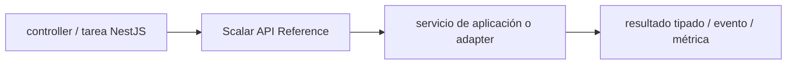

# Scalar API Reference — guía version-aware Vigilio

## Qué es, qué hace y cuándo usarla

Herramienta para publicar y visualizar referencias OpenAPI y clientes. Consume OpenAPI correcto; no valida por sí misma permisos ni inputs.

**Ubicación en Vigilio:** usa esta dependencia en su stack propietario; otras skills deben enlazar esta guía, no duplicar sus reglas. **Versión:** la indicada en el encabezado es la línea documentada; consultar `technology/versions.md` y el lockfile antes de copiar APIs o aprobar un upgrade.

**Stack propietario:** Backend NestJS / Node. **Versión objetivo:** línea compatible OpenAPI y Nest integration; versión instalada siempre desde lockfile/manifest. [Documentación oficial](https://guides.scalar.com/scalar/scalar-api-references/integrations/nestjs). [Matriz de versiones](../versions.md).

## Responsabilidad y arquitectura

Visibilidad por entorno, allowlist de docs y seguridad del explorador.

No duplicar las reglas generales de SOLID, DDD y manejo de dependencias: [política de librerías](README.md). Al crear código, leer el API de la versión instalada, no solo un ejemplo de blog.

### Diagrama de integración (Mermaid)



El flujo muestra la **responsabilidad arquitectónica** de la librería; no representa llamadas reales de red para todas las operaciones.


## ✅ Correcto — ejemplo actual

**Nota técnica (no es código ejecutable):** OpenAPI generado desde DTOs; Scalar renderiza el documento resultante. Mantener un único endpoint JSON /openapi.json y UI como vista, no autoridad.

## ❌ Incorrecto — legado o mal uso

**Nota técnica (no es código ejecutable):** ❌ escribir contratos distintos en UI Scalar y controller por separado ❌ exponer documentación interna con tokens reales.

## Migración, nuevas APIs y compatibilidad

Scalar es UI para OpenAPI, no validador ni fuente contractual. Integración por versión y Nest Swagger/CleanupZod puede variar.

## Calidad, seguridad, performance y verificaciones

Comparar snapshots OpenAPI, operationId, 401, DTO y docs UI.

La adopción exige manifest/lockfile, pruebas runtime, seguridad, CI y rollback. Resultado real en consumidores de esta guía: **NOT_RUN**. No instalar nuevas dependencias solamente por estar catalogadas.

## Fuentes

- [Página oficial y referencias](https://guides.scalar.com/scalar/scalar-api-references/integrations/nestjs)
- [Protocolo de adopción](README.md#protocolo-de-adopción-y-actualización)
- [Calidad transversal](../../foundations/engineering/code-quality.md)


## Recetario operativo ampliado — scalar (2026-10-25)

### API actual: dos tareas reales que debe saber ejecutar una skill

1. **Mostrar referencia OpenAPI desde contrato publicado versionado.**
2. **Restringir accesos de docs internos; autenticación try-it-out configurable.**

### Migración desde versiones anteriores: decisión concreta

- **Qué cambia o se debe revisar:** API de integración Scalar/Nest/OpenAPI varía con paquete y major.

### Responsabilidades y capas

Docs API HTTP, no validación runtime ni DTO propietario.

**✅ Correcto:** mantener la integración encapsulada, alinear los nombres del negocio con Vigilio y depender de un contrato estable.

**❌ Incorrecto:** importar internals de la librería desde Domain, declarar `any` para resolver un upgrade, o duplicar reglas ya propietarias de otra tecnología.

### Seguridad, resiliencia y rendimiento

- No exponer tokens en ejemplos o entornos prod.

### Test de aceptación específico y evidencia mínima

- **Escenario comprobable:** OpenAPI snapshot, 401 docs, rutas permitidas y deep links.


## Guía operativa detallada — 8 casos y 4 antipatrones

### Ocho ejemplos de la API y casos de uso relevantes

Los fragmentos siguientes ilustran **operaciones independientes**. Variables, imports, provider, extensión y configuración se completan en el proyecto consumidor; **no están certificados como un archivo único compilable**. Cuando hay comentarios `#`, son pasos de integración o configuración y no APIs inventadas.

#### Ejemplo 1. Referencia OpenAPI

**✅ Correcto — referencia openapi**

**Nota técnica (no es código ejecutable):** Generar /openapi.json desde contrato NestJS, no duplicar JSON manualmente.


#### Ejemplo 2. Instalar paquete

**✅ Correcto — instalar paquete**

```typescript
pnpm add @scalar/nestjs-api-reference
```


#### Ejemplo 3. Integración

**✅ Correcto — integración**

```typescript
app.use('/reference', apiReference({ url: '/openapi.json' }));
```


#### Ejemplo 4. Title

**✅ Correcto — title**

```typescript
apiReference({ url: '/openapi.json', pageTitle: 'Vigilio API' });
```


#### Ejemplo 5. Contrato

**✅ Correcto — contrato**

**Nota técnica (no es código ejecutable):** Revisar operationId: listProducts, registerProduct, approvePolicy.


#### Ejemplo 6. Autenticación

**✅ Correcto — autenticación**

**Nota técnica (no es código ejecutable):** Restringir docs privadas/servidores sensibles.


#### Ejemplo 7. Spec snapshot

**✅ Correcto — spec snapshot**

**Nota técnica (no es código ejecutable):** CI compara openapi.json versión anterior con actual.


#### Ejemplo 8. Smoke

**✅ Correcto — smoke**

**Nota técnica (no es código ejecutable):** Abrir /reference e inspeccionar GET /products/response 200.


## Integración real Scalar + NestJS + OpenAPI

**Qué resuelve:** generar una especificación OpenAPI desde los controllers NestJS y presentarla en `/reference`. **Scalar renderiza la documentación, pero no sustituye validación Zod, Guards, Policies ni tests de autorización.**

**✅ Correcto — `main.ts` (NestJS con adapter Express)**

```typescript
import { NestFactory } from '@nestjs/core';
import { DocumentBuilder, SwaggerModule } from '@nestjs/swagger';
import { apiReference } from '@scalar/nestjs-api-reference';
import { AppModule } from './app.module';

async function bootstrap(): Promise<void> {
  const app = await NestFactory.create(AppModule);
  const openapi_config = new DocumentBuilder()
    .setTitle('Vigilio API')
    .setVersion('1.0.0')
    .addBearerAuth()
    .build();
  const openapi_document = SwaggerModule.createDocument(app, openapi_config);

  // Proteger /reference según entorno; si es documentación privada, aplicar auth.
  app.use('/reference', apiReference({ content: openapi_document }));
  await app.listen(process.env.PORT ?? 3000);
}
void bootstrap();
```

**❌ Incorrecto:** publicar especificaciones con rutas internas, tokens reales o `operationId: store` heredados, y asumir que el explorador impide peticiones no autorizadas.

**✅ Correcto:** generar `operationId` semánticos desde los endpoints, mantener ejemplos con identificadores ficticios, proteger `/reference` cuando corresponda y validar las peticiones en el borde del backend. Para Fastify el middleware necesita la configuración `withFastify: true` documentada por Scalar.

**Prueba:** abrir `/reference`, comprobar que `listProducts` y los códigos HTTP coincidan con la especificación, y ejecutar pruebas de contrato y 401/403 contra el API real.

[Integración oficial Scalar/NestJS](https://scalar.com/products/api-references/integrations/nestjs).

### Cuatro antipatrones frecuentes y su sustitución

#### Antipatrón 1 — riesgo y alternativa

**❌ Incorrecto — Mantener OpenAPI a mano distinto de Zod.**

**Por qué está mal:** El patrón «Mantener OpenAPI a mano distinto de Zod» es riesgoso: puede aceptar entradas inválidas o duplicar contratos difíciles de mantener.

**✅ Correcto — Generar openapi.json desde DTOs y validar.**

**Por qué mejora:** Convierte la condición en un control verificable mediante validación o pruebas.

#### Antipatrón 2 — riesgo y alternativa

**❌ Incorrecto — Publicar UI con endpoints internos en prod pública.**

**Por qué está mal:** El patrón «Publicar UI con endpoints internos en prod pública» es riesgoso: puede permitir acceso a recursos no autorizados o de otro tenant.

**✅ Correcto — Restringir docs por entorno.**

**Por qué mejora:** El patrón «Restringir docs por entorno» mejora el caso: se fuerza autorización en el borde/servidor y se limita el acceso por recurso.

#### Antipatrón 3 — riesgo y alternativa

**❌ Incorrecto — Incluir token real en ejemplos.**

**Por qué está mal:** Expone credenciales o confunde autenticación con autorización; puede ocasionar filtración o acceso indebido.

**✅ Correcto — Variables placeholder sin credenciales.**

**Por qué mejora:** El patrón «Variables placeholder sin credenciales» mejora el caso: las credenciales quedan fuera del código o bajo un mecanismo de acceso controlado.

#### Antipatrón 4 — riesgo y alternativa

**❌ Incorrecto — Asumir Scalar valida requests.**

**Por qué está mal:** El patrón «Asumir Scalar valida requests» es riesgoso: puede elevar el coste de runtime, causar fallos de despliegue o empaquetar dependencias no deseadas.

**✅ Correcto — Pipe/DTO valida en HTTP.**

**Por qué mejora:** Convierte la condición en un control verificable mediante validación o pruebas.

### Versión estable, breaking changes y verificación

- **Versión estable exacta:** no se declara un parche universal cuando no hay verificación específica de su registry/release. Consultar el encabezado de esta guía, `technology/versions.md` y el manifiesto del servicio. **Estado de patch: VERIFY_LOCKFILE**.
- **Migración:** identificar major anterior, APIs retiradas/cambiadas, peer dependencies, requisitos de runtime, cambios de tipos, ejecución CI y plan de rollback. Si no hay prueba sobre el consumidor, **NOT_RUN**, no PASS.
- **Versiones previas:** el ejemplo marcado ❌ en esta guía explica al menos una incompatibilidad o un uso obsoleto; no trasplantar APIs de otras versiones.
- **Tests:** probar al menos happy path, error, seguridad/permiso y compatibilidad con el runtime donde aplique; solo activar nuevas capacidades mediante una PR versionada.

### Fuentes oficiales y referencias al final

- [Referencia propia oficial](https://guides.scalar.com/scalar/scalar-api-references/integrations/nestjs)
- [Matriz canónica de versiones](../versions.md)
- [Política de adopción de librerías](README.md)

## Guía de compatibilidad y evaluación por versión (2026-10-25)

**Estado del patch exacto:** `VERIFY_LOCKFILE`. La guía documenta la familia de APIs; **no se ha verificado hoy el patch estable preciso de esta dependencia**. Consultar la fuente oficial enlazada al inicio y el lockfile antes de generar código o aprobar un upgrade.

### Checklist específico de esta librería

- **Migración/compatibilidad:** API de integración Scalar/Nest/OpenAPI varía con paquete y major.
- **Prueba propia:** OpenAPI snapshot, 401 docs, rutas permitidas y deep links.
- **Límite de responsabilidad:** usar esta librería solo en su adaptador o capa propietaria; consultar los ejemplos de API y antipatrones anteriores antes de cambiar llamadas públicas.

**Gate de aprobación:** leer la referencia oficial y resolver la versión del consumidor, ejecutar typecheck y pruebas específicas, registrar PASS/FAIL/NOT_RUN/BLOCKED. No confundir esta guía con validación de un consumidor real. [Procedimiento único de adopción](README.md#protocolo-de-adopción-y-actualización).

