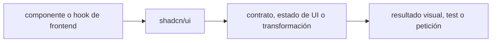

# shadcn/ui — Vigilio componentes distribuidos; CLI y dependencias por proyecto

## Qué es, qué hace y cuándo usarla

Colección/distribución de componentes UI que se copian al proyecto. El código se vuelve propiedad de la app y requiere pruebas a11y.

**Ubicación en Vigilio:** usa esta dependencia en su stack propietario; otras skills deben enlazar esta guía, no duplicar sus reglas. **Versión:** la indicada en el encabezado es la línea documentada; consultar `technology/versions.md` y el lockfile antes de copiar APIs o aprobar un upgrade.

> **Guía propia de shadcn/ui (frontend).** Estado a **2026-10-25**: componentes distribuidos; CLI y dependencias por proyecto. Versión del proyecto consumidor = `pnpm-lock.yaml` / `composer.lock` / imagen o manifest. Fuente: [documentación oficial](https://ui.shadcn.com/docs). Fuente normativa transversal de versiones: [versions.md](../versions.md). **No implica instalación automática ni upgrade aprobado.**

## Objetivo, responsabilidad y dónde usar

UI accesible, semántica HTML, no business logic en primitives; versionar cambios locales.

**Uso:** aplicar solo si está declarada y resulta pertinente al consumidor; ver [política de adopción y DRY](README.md).

### Diagrama de integración (Mermaid)



El flujo muestra la **responsabilidad arquitectónica** de la librería; no representa llamadas reales de red para todas las operaciones.


## Instalación o verificación

```bash
pnpm dlx shadcn@latest init
```

**Gate de instalación:** consultar [procedimiento compartido](README.md#protocolo-de-adopción-y-actualización); estos comandos son indicativos, no ejecuciones sobre un consumidor.

## ✅ Correcto — uso actual y ejemplo de referencia

**Nota técnica (no es código ejecutable):** Código UI se copia al repositorio para adaptación; revisar licencia, estilos Tailwind 4, Radix y tokens de diseño antes de añadir. pnpm dlx shadcn@latest add button.

**Por qué:** UI accesible, semántica HTML, no business logic en primitives; versionar cambios locales.

## ❌ Incorrecto — patrón legacy, inseguro o mal ubicado

```typescript
// ❌ tratar shadcn como paquete runtime monolítico versionado
import { Button } from 'shadcn-ui';
```

**Riesgo:** confundir versiones o responsabilidades y obtener un contrato incorrecto.

## Nuevas capacidades, migración y breaking changes

Migrar configuración Tailwind y componentes generados según CLI; los componentes viven en el código del consumidor.

Aplicar el [protocolo de migración común](README.md#protocolo-de-adopción-y-actualización), sin asumir que una release nueva está desplegada.

## Buenas prácticas, seguridad, rendimiento y operación

Consultar la [política transversal de librerías](README.md) para seguridad, versionado, evidencia y revisión de contratos. Para esta librería, además, aplicar las verificaciones concretas que se detallan a continuación.

## Gates de aceptación y compatibilidad

Test navegación teclado, contraste, modales, SSR, deps Radix.

Estado de prueba de estos ejemplos documentales: **NOT_RUN** en aplicaciones consumidoras; ver [criterios de evidencia](README.md#criterios-de-validación).


## Referencias

- [Documentación oficial y migración de shadcn/ui](https://ui.shadcn.com/docs)
- [Matriz y baseline de versiones](../versions.md)
- [Calidad de código canónica](../../foundations/engineering/code-quality.md)


## Recetario operativo ampliado — shadcn-ui (2026-10-25)

### API actual: dos tareas reales que debe saber ejecutar una skill

1. **Instalar componentes como código fuente del proyecto y revisar cambios.**
2. **Componer a11y con Radix y Tailwind bajo patrones de estilo locales.**

### Migración desde versiones anteriores: decisión concreta

- **Qué cambia o se debe revisar:** CLI/component templates cambian; no considerar shadcn paquete runtime único.

### Responsabilidades y capas

UI components/copy ownership del repo, no capa Domain.

**✅ Correcto:** mantener la integración encapsulada, alinear los nombres del negocio con Vigilio y depender de un contrato estable.

**❌ Incorrecto:** importar internals de la librería desde Domain, declarar `any` para resolver un upgrade, o duplicar reglas ya propietarias de otra tecnología.

### Seguridad, resiliencia y rendimiento

- Sobrescritura al re-ejecutar add, revisar diffs.

### Test de aceptación específico y evidencia mínima

- **Escenario comprobable:** Visual tests, focus/keyboard, dark mode y update regression.


## Guía operativa detallada — 8 casos y 4 antipatrones

### Ocho ejemplos de la API y casos de uso relevantes

Los fragmentos siguientes ilustran **operaciones independientes**. Variables, imports, provider, extensión y configuración se completan en el proyecto consumidor; **no están certificados como un archivo único compilable**. Cuando hay comentarios `#`, son pasos de integración o configuración y no APIs inventadas.

#### Ejemplo 1. Inicializar

**✅ Correcto — inicializar**

```tsx
pnpm dlx shadcn@latest init
```


#### Ejemplo 2. Agregar botón

**✅ Correcto — agregar botón**

```tsx
pnpm dlx shadcn@latest add button
```


#### Ejemplo 3. Agregar diálogo

**✅ Correcto — agregar diálogo**

```tsx
pnpm dlx shadcn@latest add dialog
```


#### Ejemplo 4. Import

**✅ Correcto — import**

```tsx
import { Button } from '@/components/ui/button';
```


#### Ejemplo 5. Uso

**✅ Correcto — uso**

```tsx
<Button variant="outline">Cancelar</Button>
```


#### Ejemplo 6. Dialog

**✅ Correcto — dialog**

```tsx
<Dialog><DialogTrigger>Nuevo</DialogTrigger><DialogContent><DialogTitle>Registrar</DialogTitle></DialogContent></Dialog>
```


#### Ejemplo 7. Personalizar

**✅ Correcto — personalizar**

**Nota técnica (no es código ejecutable):** Editar src/components/ui/button.tsx (código propiedad del proyecto).


#### Ejemplo 8. Pruebas

**✅ Correcto — pruebas**

**Nota técnica (no es código ejecutable):** Probar focus, Esc, lectores de pantalla, dark mode y responsive.


### Cuatro antipatrones frecuentes y su sustitución

#### Antipatrón 1 — riesgo y alternativa

**❌ Incorrecto — Tratar shadcn/ui como runtime npm centralizado.**

**Por qué está mal:** El patrón «Tratar shadcn/ui como runtime npm centralizado» es riesgoso: puede mezclar firmas incompatibles o ejecutar una API retirada en la versión instalada.

**✅ Correcto — Componentes copiados y versionados por app.**

**Por qué mejora:** El patrón «Componentes copiados y versionados por app» mejora el caso: se utiliza la API apropiada para el major documentado y se comprueba el lockfile.

#### Antipatrón 2 — riesgo y alternativa

**❌ Incorrecto — Modificar componente sin test a11y.**

**Por qué está mal:** Omite un control operativo necesario, por lo que el comportamiento puede ser inseguro o difícil de verificar.

**✅ Correcto — Probar teclado/aria/contraste.**

**Por qué mejora:** El patrón «Probar teclado/aria/contraste» mejora el caso: el comportamiento se verifica con pruebas y criterios observables.

#### Antipatrón 3 — riesgo y alternativa

**❌ Incorrecto — Duplicar button en cada feature.**

**Por qué está mal:** El patrón «Duplicar button en cada feature» es riesgoso: mezcla responsabilidades de interfaz y navegación o genera comportamiento inconsistente.

**✅ Correcto — Reutilizar ui/button.**

**Por qué mejora:** El patrón «Reutilizar ui/button» mejora el caso: la interfaz utiliza la API adecuada y separa presentación, estado y comunicación.

#### Antipatrón 4 — riesgo y alternativa

**❌ Incorrecto — Actualizar CLI sin revisar cambios generados.**

**Por qué está mal:** Omite un control operativo necesario, por lo que el comportamiento puede ser inseguro o difícil de verificar.

**✅ Correcto**

```tsx
git diff --check
```

**Por qué mejora:** El patrón «git diff --check» mejora el caso: el cambio pasa por gates automáticos y aprobación de riesgos operativos.

### Versión estable, breaking changes y verificación

- **Versión estable exacta:** no se declara un parche universal cuando no hay verificación específica de su registry/release. Consultar el encabezado de esta guía, `technology/versions.md` y el manifiesto del servicio. **Estado de patch: VERIFY_LOCKFILE**.
- **Migración:** identificar major anterior, APIs retiradas/cambiadas, peer dependencies, requisitos de runtime, cambios de tipos, ejecución CI y plan de rollback. Si no hay prueba sobre el consumidor, **NOT_RUN**, no PASS.
- **Versiones previas:** el ejemplo marcado ❌ en esta guía explica al menos una incompatibilidad o un uso obsoleto; no trasplantar APIs de otras versiones.
- **Tests:** probar al menos happy path, error, seguridad/permiso y compatibilidad con el runtime donde aplique; solo activar nuevas capacidades mediante una PR versionada.

### Fuentes oficiales y referencias al final

- [Referencia propia oficial](https://ui.shadcn.com/docs)
- [Matriz canónica de versiones](../versions.md)
- [Política de adopción de librerías](README.md)

## Guía de compatibilidad y evaluación por versión (2026-10-25)

**Estado del patch exacto:** `VERIFY_LOCKFILE`. La guía documenta la familia de APIs; **no se ha verificado hoy el patch estable preciso de esta dependencia**. Consultar la fuente oficial enlazada al inicio y el lockfile antes de generar código o aprobar un upgrade.

### Checklist específico de esta librería

- **Migración/compatibilidad:** CLI/component templates cambian; no considerar shadcn paquete runtime único.
- **Prueba propia:** Visual tests, focus/keyboard, dark mode y update regression.
- **Límite de responsabilidad:** usar esta librería solo en su adaptador o capa propietaria; consultar los ejemplos de API y antipatrones anteriores antes de cambiar llamadas públicas.

**Gate de aprobación:** leer la referencia oficial y resolver la versión del consumidor, ejecutar typecheck y pruebas específicas, registrar PASS/FAIL/NOT_RUN/BLOCKED. No confundir esta guía con validación de un consumidor real. [Procedimiento único de adopción](README.md#protocolo-de-adopción-y-actualización).

