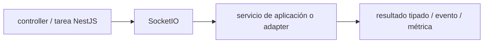

# Socket.IO — Vigilio v4 línea instalada; verificar patch

## Qué es, qué hace y cuándo usarla

Canal de eventos bidireccionales sobre WebSocket y fallbacks. Requiere autenticación, autorización por sala, acuse y control de reintentos.

**Ubicación en Vigilio:** usa esta dependencia en su stack propietario; otras skills deben enlazar esta guía, no duplicar sus reglas. **Versión:** la indicada en el encabezado es la línea documentada; consultar `technology/versions.md` y el lockfile antes de copiar APIs o aprobar un upgrade.

> **Guía propia de Socket.IO (backend-node).** Estado a **2026-10-25**: v4 línea instalada; verificar patch. Versión del proyecto consumidor = `pnpm-lock.yaml` / `composer.lock` / imagen o manifest. Fuente: [documentación oficial](https://socket.io/docs/v4/). Fuente normativa transversal de versiones: [versions.md](../versions.md). **No implica instalación automática ni upgrade aprobado.**

## Objetivo, responsabilidad y dónde usar

Authz en handshake y cada evento, limits, retry/reconnect y replay.

**Uso:** aplicar solo si está declarada y resulta pertinente al consumidor; ver [política de adopción y DRY](README.md).

### Diagrama de integración (Mermaid)



El flujo muestra la **responsabilidad arquitectónica** de la librería; no representa llamadas reales de red para todas las operaciones.


## Instalación o verificación

```bash
pnpm add socket.io
```

**Gate de instalación:** consultar [procedimiento compartido](README.md#protocolo-de-adopción-y-actualización); estos comandos son indicativos, no ejecuciones sobre un consumidor.

## ✅ Correcto — uso actual y ejemplo de referencia

```typescript
// rooms autorizadas por tenant y cuenta
socket.join(`tenant:${tenant_id}`);
io.to(`tenant:${tenant_id}`).emit('product.updated',{product_id});
```

**Por qué:** Authz en handshake y cada evento, limits, retry/reconnect y replay.

## ❌ Incorrecto — patrón legacy, inseguro o mal ubicado

```typescript
// ❌ permitir unirse a cualquier room enviado por cliente
socket.join(socket.handshake.query.tenant_id);
```

**Riesgo:** confundir versiones o responsabilidades y obtener un contrato incorrecto.

## Nuevas capacidades, migración y breaking changes

No confundir SSE con WebSocket/Socket.IO; versiones cliente-servidor, transporte y auth deben cuadrar.

Aplicar el [protocolo de migración común](README.md#protocolo-de-adopción-y-actualización), sin asumir que una release nueva está desplegada.

## Buenas prácticas, seguridad, rendimiento y operación

Consultar la [política transversal de librerías](README.md) para seguridad, versionado, evidencia y revisión de contratos. Para esta librería, además, aplicar las verificaciones concretas que se detallan a continuación.

## Gates de aceptación y compatibilidad

Test reconexión, tenant isolation, timeouts, ack y rate limit.

Estado de prueba de estos ejemplos documentales: **NOT_RUN** en aplicaciones consumidoras; ver [criterios de evidencia](README.md#criterios-de-validación).


## Referencias

- [Documentación oficial y migración de Socket.IO](https://socket.io/docs/v4/)
- [Matriz y baseline de versiones](../versions.md)
- [Calidad de código canónica](../../foundations/engineering/code-quality.md)


## Recetario operativo ampliado — socket-io (2026-10-25)

### API actual: dos tareas reales que debe saber ejecutar una skill

1. **Definir eventos tipados con ack y timeouts, rooms tenant-scoped.**
2. **Redis adapter para horizontal scale y reconexión idempotente.**

### Migración desde versiones anteriores: decisión concreta

- **Qué cambia o se debe revisar:** Socket.IO v2/v3/v4 changes namespace/rooms/parser; verificar cliente/servidor.

### Responsabilidades y capas

Transporte realtime, no repositorio de estado final.

**✅ Correcto:** mantener la integración encapsulada, alinear los nombres del negocio con Vigilio y depender de un contrato estable.

**❌ Incorrecto:** importar internals de la librería desde Domain, declarar `any` para resolver un upgrade, o duplicar reglas ya propietarias de otra tecnología.

### Seguridad, resiliencia y rendimiento

- Autenticación handshake y autorización rooms por cada join.

### Test de aceptación específico y evidencia mínima

- **Escenario comprobable:** E2E reconnect, auth, ordering y mobile background.


## Guía operativa detallada — 8 casos y 4 antipatrones

### Ocho ejemplos de la API y casos de uso relevantes

Los fragmentos siguientes ilustran **operaciones independientes**. Variables, imports, provider, extensión y configuración se completan en el proyecto consumidor; **no están certificados como un archivo único compilable**. Cuando hay comentarios `#`, son pasos de integración o configuración y no APIs inventadas.

#### Ejemplo 1. Servidor

**✅ Correcto — servidor**

```typescript
const io = new Server(http_server, { cors: { origin: allowed_origins } });
```


#### Ejemplo 2. Namespace

**✅ Correcto — namespace**

```typescript
const admin = io.of('/admin');
```


#### Ejemplo 3. Autenticar

**✅ Correcto — autenticar**

```typescript
io.use(async (socket, next) => { socket.data.user = await verify(socket.handshake.auth.token); next(); });
```


#### Ejemplo 4. Sala tenant

**✅ Correcto — sala tenant**

```typescript
socket.join(`tenant:${tenant_id}`);
```


#### Ejemplo 5. Emitir

**✅ Correcto — emitir**

```typescript
io.to(`tenant:${tenant_id}`).emit('product:processed', payload);
```


#### Ejemplo 6. Ack

**✅ Correcto — ack**

```typescript
socket.timeout(5000).emit('command', payload, (error, response) => handleAck(error, response));
```


#### Ejemplo 7. Cliente

**✅ Correcto — cliente**

```typescript
const socket = io(url, { auth: { token } });
```


#### Ejemplo 8. Cleanup

**✅ Correcto — cleanup**

```typescript
socket.disconnect();
```


### Cuatro antipatrones frecuentes y su sustitución

#### Antipatrón 1 — riesgo y alternativa

**❌ Incorrecto**

```typescript
io.emit("private", payload)
```

**Por qué está mal:** El patrón «io.emit("private", payload)» es riesgoso: puede permitir acceso a recursos no autorizados o de otro tenant.

**✅ Correcto**

```typescript
io.to(`tenant:${tenant_id}`).emit("private", payload)
```

**Por qué mejora:** El patrón «io.to(`tenant:${tenant_id}`).emit("private", payload)» mejora el caso: se fuerza autorización en el borde/servidor y se limita el acceso por recurso.

#### Antipatrón 2 — riesgo y alternativa

**❌ Incorrecto — Confiar socket.handshake.auth.token sin verificar.**

**Por qué está mal:** Expone credenciales o confunde autenticación con autorización; puede ocasionar filtración o acceso indebido.

**✅ Correcto — Verificar JWT/cookie servidor.**

**Por qué mejora:** El patrón «Verificar JWT/cookie servidor» mejora el caso: las credenciales quedan fuera del código o bajo un mecanismo de acceso controlado.

#### Antipatrón 3 — riesgo y alternativa

**❌ Incorrecto — Rooms sin autorización resource.**

**Por qué está mal:** Omite un control operativo necesario, por lo que el comportamiento puede ser inseguro o difícil de verificar.

**✅ Correcto — Comprobar tenant/permisos al join.**

**Por qué mejora:** Separa permisos y secretos del código de negocio y permite comprobar el acceso mínimo.

#### Antipatrón 4 — riesgo y alternativa

**❌ Incorrecto — Reintentos event sin idempotencia.**

**Por qué está mal:** Omite un control operativo necesario, por lo que el comportamiento puede ser inseguro o difícil de verificar.

**✅ Correcto — Event_id dedupe/outbox.**

**Por qué mejora:** El patrón «Event_id dedupe/outbox» mejora el caso: la ejecución se controla con idempotencia, límites y evidencia de errores.

### Versión estable, breaking changes y verificación

- **Versión estable exacta:** no se declara un parche universal cuando no hay verificación específica de su registry/release. Consultar el encabezado de esta guía, `technology/versions.md` y el manifiesto del servicio. **Estado de patch: VERIFY_LOCKFILE**.
- **Migración:** identificar major anterior, APIs retiradas/cambiadas, peer dependencies, requisitos de runtime, cambios de tipos, ejecución CI y plan de rollback. Si no hay prueba sobre el consumidor, **NOT_RUN**, no PASS.
- **Versiones previas:** el ejemplo marcado ❌ en esta guía explica al menos una incompatibilidad o un uso obsoleto; no trasplantar APIs de otras versiones.
- **Tests:** probar al menos happy path, error, seguridad/permiso y compatibilidad con el runtime donde aplique; solo activar nuevas capacidades mediante una PR versionada.

### Fuentes oficiales y referencias al final

- [Referencia propia oficial](https://socket.io/docs/v4/)
- [Matriz canónica de versiones](../versions.md)
- [Política de adopción de librerías](README.md)

## Guía de compatibilidad y evaluación por versión (2026-10-25)

**Estado del patch exacto:** `VERIFY_LOCKFILE`. La guía documenta la familia de APIs; **no se ha verificado hoy el patch estable preciso de esta dependencia**. Consultar la fuente oficial enlazada al inicio y el lockfile antes de generar código o aprobar un upgrade.

### Checklist específico de esta librería

- **Migración/compatibilidad:** Socket.IO v2/v3/v4 changes namespace/rooms/parser; verificar cliente/servidor.
- **Prueba propia:** E2E reconnect, auth, ordering y mobile background.
- **Límite de responsabilidad:** usar esta librería solo en su adaptador o capa propietaria; consultar los ejemplos de API y antipatrones anteriores antes de cambiar llamadas públicas.

**Gate de aprobación:** leer la referencia oficial y resolver la versión del consumidor, ejecutar typecheck y pruebas específicas, registrar PASS/FAIL/NOT_RUN/BLOCKED. No confundir esta guía con validación de un consumidor real. [Procedimiento único de adopción](README.md#protocolo-de-adopción-y-actualización).

