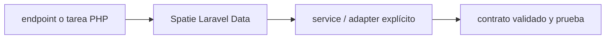

# Spatie Laravel Data — Vigilio 4.23.0 estable verificado

## Qué es, qué hace y cuándo usarla

DTOs PHP tipados con serialización y validación integradas para Laravel. Separa contratos HTTP de entidades DDD y modelos Eloquent.

**Ubicación en Vigilio:** usa esta dependencia en su stack propietario; otras skills deben enlazar esta guía, no duplicar sus reglas. **Versión:** la indicada en el encabezado es la línea documentada; consultar `technology/versions.md` y el lockfile antes de copiar APIs o aprobar un upgrade.

> **Guía propia de Spatie Laravel Data (backend-php).** Estado a **2026-10-25**: 4.23.0 estable verificado. Versión del proyecto consumidor = `pnpm-lock.yaml` / `composer.lock` / imagen o manifest. Fuente: [documentación oficial](https://spatie.be/docs/laravel-data/v4/introduction). Fuente normativa transversal de versiones: [versions.md](../versions.md). **No implica instalación automática ni upgrade aprobado.**

## Objetivo, responsabilidad y dónde usar

Un DTO Spatie por contrato semántico cuando cambie; compartir ProductResponseData, no repetir campos. Separado de Eloquent.

**Uso:** aplicar solo si está declarada y resulta pertinente al consumidor; ver [política de adopción y DRY](README.md).

### Diagrama de integración (Mermaid)



El flujo muestra la **responsabilidad arquitectónica** de la librería; no representa llamadas reales de red para todas las operaciones.


## Instalación o verificación

```bash
composer require spatie/laravel-data:^4
```

**Gate de instalación:** consultar [procedimiento compartido](README.md#protocolo-de-adopción-y-actualización); estos comandos son indicativos, no ejecuciones sobre un consumidor.

## ✅ Correcto — uso actual y ejemplo de referencia

```php
use Spatie\LaravelData\Data;
final class RegisterProductData extends Data {
  public function __construct(public string $nro_poliza,public ProductType $product_type) {}
}
// Validation de request vía Spatie cuando entra por su resolver; comprobar reglas. 
```

**Por qué:** Un DTO Spatie por contrato semántico cuando cambie; compartir ProductResponseData, no repetir campos. Separado de Eloquent.

## ❌ Incorrecto — patrón legacy, inseguro o mal ubicado

```php
// ❌ usar Data como ORM/agregado DDD o como sustituto de autorización
class Product extends Data { public function save(){ /* SQL */ } }
```

**Riesgo:** confundir versiones o responsabilidades y obtener un contrato incorrecto.

## Nuevas capacidades, migración y breaking changes

v4: consultar instalación y validación según versión; 4.23 corrigió reglas `rules()` con default y conflictos de instalación PHP 8.4+Pest. No prometer auto-validación al construir manualmente un objeto.

Aplicar el [protocolo de migración común](README.md#protocolo-de-adopción-y-actualización), sin asumir que una release nueva está desplegada.

## Buenas prácticas, seguridad, rendimiento y operación

Consultar la [política transversal de librerías](README.md) para seguridad, versionado, evidencia y revisión de contratos. Para esta librería, además, aplicar las verificaciones concretas que se detallan a continuación.

## Gates de aceptación y compatibilidad

Feature tests validación request, serialización, lazy props, paginación, cast enums y caching de estructuras.

Estado de prueba de estos ejemplos documentales: **NOT_RUN** en aplicaciones consumidoras; ver [criterios de evidencia](README.md#criterios-de-validación).


## Ejemplo Request / Response y reglas

```php
use Spatie\LaravelData\Data;
use Spatie\LaravelData\Attributes\Validation\Min;
use Spatie\LaravelData\Attributes\Validation\Max;
final class RegisterProductData extends Data {
 public function __construct(
  #[Min(1), Max(30)] public string $nro_poliza,
  public ProductType $product_type,
 ) {}
}
```

- Definir DTOs por contrato HTTP; si dos endpoints tienen exactamente la misma respuesta, reutilizar un `ProductResponseData`.
- Diferenciar `Data::from($raw)` de resolución HTTP con validación automática: en construcción manual debe verificarse explícitamente.
- Usar `DataCollection`/`collect` en respuestas grandes según docs, sin generar Eloquent Models por fila.
- Las reglas `rules()` custom, defaults y `#[WithoutValidation]` tienen comportamiento ajustado en v4.23; cubrir con tests.
- Cache de estructuras de Data para producción (comando según versión instalada), validar deployment/read-only.

✅ Correcto: Password nunca serializado accidentalmente. ❌ Incorrecto: exponer modelo Eloquent entero sin allowlist.

## Referencias

- [Documentación oficial y migración de Spatie Laravel Data](https://spatie.be/docs/laravel-data/v4/introduction)
- [Matriz y baseline de versiones](../versions.md)
- [Calidad de código canónica](../../foundations/engineering/code-quality.md)


## Recetario operativo ampliado — spatie-laravel-data (2026-10-25)

### API actual: dos tareas reales que debe saber ejecutar una skill

1. **Spatie `Data` para request/response, collections y rule attributes.**
2. **Evitar reflejar entidad Domain Eloquent como Data; caching structures al deploy.**

### Migración desde versiones anteriores: decisión concreta

- **Qué cambia o se debe revisar:** Spatie v4 rules() overrides con defaults actualizados en 4.23; revisar regresiones.

### Responsabilidades y capas

Borde Laravel, nada de Zod runtime PHP.

**✅ Correcto:** mantener la integración encapsulada, alinear los nombres del negocio con Vigilio y depender de un contrato estable.

**❌ Incorrecto:** importar internals de la librería desde Domain, declarar `any` para resolver un upgrade, o duplicar reglas ya propietarias de otra tecnología.

### Seguridad, resiliencia y rendimiento

- Automatic validation por origen/config, password never in response.

### Test de aceptación específico y evidencia mínima

- **Escenario comprobable:** Feature test validación y serialización, type enums, data caching y perf.

### Ejemplo de integración vigente (fragmento adicional)

```php
final class RegisterProductData extends Data
{
    public function __construct(
        #[Min(1), Max(30)] public string $nro_poliza,
        public ProductType $product_type,
    ) {}
}
// Controller recibe Data; Domain no importa Data ni Eloquent.
```

**Nota:** los fragmentos muestran la API específica y requieren imports/providers/fixtures del consumidor; no se certifica compilación por el solo hecho de aparecer aquí.

### Cambio validado de v4.23: overrides de validación

- `rules()` explícitos sobre propiedades con default ya no deben quedar ignorados: cubrir inputs omitidos y reglas condicionales.
- `#[WithoutValidation]` no anula automáticamente un override explícito de `rules()`; revisar expectativas previas.
- Verificar `Data::from(request())`, colecciones paginadas, lazy/includes y serialización por ruta.
- Fuente de versión/changelog: https://github.com/spatie/laravel-data/blob/main/CHANGELOG.md


## Guía operativa detallada — 8 casos y 4 antipatrones

### Ocho ejemplos de la API y casos de uso relevantes

Los fragmentos siguientes ilustran **operaciones independientes**. Variables, imports, provider, extensión y configuración se completan en el proyecto consumidor; **no están certificados como un archivo único compilable**. Cuando hay comentarios `#`, son pasos de integración o configuración y no APIs inventadas.

#### Ejemplo 1. DTO

**✅ Correcto — dto**

```php
final class RegisterProductData extends Data { public function __construct(public string $nro_poliza) {} }
```


#### Ejemplo 2. Desde request

**✅ Correcto — desde request**

```php
RegisterProductData::from($request);
```


#### Ejemplo 3. Validación

**✅ Correcto — validación**

**Nota técnica (no es código ejecutable):** [Min(1), Max(30)] public string $nro_poliza.


#### Ejemplo 4. Enum

**✅ Correcto — enum**

```php
public ProductType $product_type
```


#### Ejemplo 5. Collection

**✅ Correcto — collection**

```php
ProductResponseData::collect($records);
```


#### Ejemplo 6. Respuesta

**✅ Correcto — respuesta**

```php
return ProductResponseData::from($product);
```


#### Ejemplo 7. Transformación

**✅ Correcto — transformación**

```php
ProductResponseData::from($record)->toArray();
```


#### Ejemplo 8. Warm cache

**✅ Correcto — warm cache**

```bash
php artisan data:cache-structures
```


### Cuatro antipatrones frecuentes y su sustitución

#### Antipatrón 1 — riesgo y alternativa

**❌ Incorrecto**

```php
return $request->all(); // contrato no tipado
```

**Por qué está mal:** El patrón «return $request->all(); // contrato no tipado» es riesgoso: puede elevar el coste de runtime, causar fallos de despliegue o empaquetar dependencias no deseadas.

**✅ Correcto**

```php
RegisterProductData::from($request)
```

**Por qué mejora:** El patrón «RegisterProductData::from($request)» mejora el caso: el build y los recursos se verifican mediante gates de despliegue y rendimiento.

#### Antipatrón 2 — riesgo y alternativa

**❌ Incorrecto — Duplicar FormRequest+Data validation sin motivo.**

**Por qué está mal:** Omite un control operativo necesario, por lo que el comportamiento puede ser inseguro o difícil de verificar.

**✅ Correcto — Seleccionar una fuente contractual.**

**Por qué mejora:** El patrón «Seleccionar una fuente contractual» mejora el caso: el build y los recursos se verifican mediante gates de despliegue y rendimiento.

#### Antipatrón 3 — riesgo y alternativa

**❌ Incorrecto — Devolver Eloquent directo al cliente.**

**Por qué está mal:** El patrón «Devolver Eloquent directo al cliente» es riesgoso: la elección «Devolver Eloquent directo al cliente» puede incumplir los requisitos operativos de spatie-laravel-data.

**✅ Correcto**

```php
ProductResponseData::from($product)
```

**Por qué mejora:** El patrón «ProductResponseData::from($product)» mejora el caso: la alternativa «ProductResponseData::from($product)» establece el comportamiento esperado de spatie-laravel-data.

#### Antipatrón 4 — riesgo y alternativa

**❌ Incorrecto — Olvidar data:cache-structures en deploy.**

**Por qué está mal:** Omite un control operativo necesario, por lo que el comportamiento puede ser inseguro o difícil de verificar.

**✅ Correcto**

```bash
php artisan data:cache-structures
```

**Por qué mejora:** El patrón «php artisan data:cache-structures» mejora el caso: el estado se identifica e invalida con criterios explícitos y verificables.

### Versión estable, breaking changes y verificación

- **Versión estable exacta:** no se declara un parche universal cuando no hay verificación específica de su registry/release. Consultar el encabezado de esta guía, `technology/versions.md` y el manifiesto del servicio. **Estado de patch: VERIFY_LOCKFILE**.
- **Migración:** identificar major anterior, APIs retiradas/cambiadas, peer dependencies, requisitos de runtime, cambios de tipos, ejecución CI y plan de rollback. Si no hay prueba sobre el consumidor, **NOT_RUN**, no PASS.
- **Versiones previas:** el ejemplo marcado ❌ en esta guía explica al menos una incompatibilidad o un uso obsoleto; no trasplantar APIs de otras versiones.
- **Tests:** probar al menos happy path, error, seguridad/permiso y compatibilidad con el runtime donde aplique; solo activar nuevas capacidades mediante una PR versionada.

### Fuentes oficiales y referencias al final

- [Referencia propia oficial](https://spatie.be/docs/laravel-data/v4/introduction)
- [Matriz canónica de versiones](../versions.md)
- [Política de adopción de librerías](README.md)

## Guía de compatibilidad y evaluación por versión (2026-10-25)

**Estado del patch exacto:** `VERIFY_LOCKFILE`. La guía documenta la familia de APIs; **no se ha verificado hoy el patch estable preciso de esta dependencia**. Consultar la fuente oficial enlazada al inicio y el lockfile antes de generar código o aprobar un upgrade.

### Checklist específico de esta librería

- DTO Spatie representa entrada/salida, no el modelo Eloquent ni agregados DDD.
- Validación mediante resolución HTTP y reglas de Data; instanciar clases manualmente no equivale siempre a validarlas.
- Cachear metadata de Spatie según documentación; tests de paginación, casts y serialización.

**Gate de aprobación:** leer la referencia oficial y resolver la versión del consumidor, ejecutar typecheck y pruebas específicas, registrar PASS/FAIL/NOT_RUN/BLOCKED. No confundir esta guía con validación de un consumidor real. [Procedimiento único de adopción](README.md#protocolo-de-adopción-y-actualización).

## Ejemplo de Request/Response Laravel sin duplicar FormRequest

```php
<?php
use Spatie\LaravelData\Data;
use Spatie\LaravelData\Attributes\Validation\Min;
use Spatie\LaravelData\Attributes\Validation\Max;

final class RegisterProductData extends Data
{
    public function __construct(
        #[Min(1), Max(30)] public string $nro_poliza,
        public ProductType $product_type,
    ) {}
}

final class ProductResponseData extends Data
{
    public function __construct(
        public string $id,
        public string $nro_poliza,
        public string $estado,
    ) {}
}
```

`ProductType` debe ser el backed enum definido por el dominio PHP; no se asume que exista en Spatie. La validación automática se produce en el mecanismo de resolución de entrada adecuado; **instanciar `new RegisterProductData(...)` no garantiza aplicar todas las reglas**. Para registrar: Controller recibe `RegisterProductData`, transforma a input Application, exige autorización, service aplica reglas, presenter produce `ProductResponseData`. **❌ Incorrecto:** devolver Eloquent crudo o persistir con métodos dentro del DTO Data. [Spatie v4](https://spatie.be/docs/laravel-data/v4/introduction).
