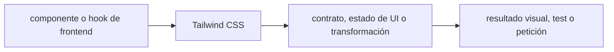

# Tailwind CSS — Vigilio 4.3.3 (estable verificado, 2026-10-25)

## Qué es, qué hace y cuándo usarla

Framework CSS utility-first. En v4 el diseño parte de `@import "tailwindcss"` y tokens CSS `@theme`, con clases detectables por el scanner.

**Ubicación en Vigilio:** usa esta dependencia en su stack propietario; otras skills deben enlazar esta guía, no duplicar sus reglas. **Versión:** la indicada en el encabezado es la línea documentada; consultar `technology/versions.md` y el lockfile antes de copiar APIs o aprobar un upgrade.

> **Guía propia de Tailwind CSS (frontend).** Estado a **2026-10-25**: 4.3.3 (estable verificado, 2026-10-25). Versión del proyecto consumidor = `pnpm-lock.yaml` / `composer.lock` / imagen o manifest. Fuente: [documentación oficial](https://tailwindcss.com/docs/upgrade-guide). Fuente normativa transversal de versiones: [versions.md](../versions.md). **No implica instalación automática ni upgrade aprobado.**

## Objetivo, responsabilidad y dónde usar

Propietario: frontend estilo/UI, no dominio. Documentar tokens `@theme`, variantes responsive, dark mode, accesibilidad WCAG, tamaño de CSS, clases dinámicas extraíbles y conflict resolver. Evitar strings arbitrarios construidos para clases que scanner no puede detectar. El CSS global configura fuentes y tokens; cada componente contiene presentación local.

**Uso:** aplicar solo si está declarada y resulta pertinente al consumidor; ver [política de adopción y DRY](README.md).

### Diagrama de integración (Mermaid)



El flujo muestra la **responsabilidad arquitectónica** de la librería; no representa llamadas reales de red para todas las operaciones.


## Instalación o verificación

```bash
pnpm add -D tailwindcss @tailwindcss/vite
```

**Gate de instalación:** consultar [procedimiento compartido](README.md#protocolo-de-adopción-y-actualización); estos comandos son indicativos, no ejecuciones sobre un consumidor.

## ✅ Correcto — uso actual y ejemplo de referencia

```css
@import "tailwindcss";
@theme { --color-brand-500: oklch(0.58 0.16 252); }
```

Integrar en Vite con `@tailwindcss/vite` (ver ejemplo por archivos más abajo); no mezclar CSS, TS y JSX en un solo snippet.
**Por qué:** Propietario: frontend estilo/UI, no dominio. Documentar tokens `@theme`, variantes responsive, dark mode, accesibilidad WCAG, tamaño de CSS, clases dinámicas extraíbles y conflict resolver. Evitar strings arbitrarios construidos para clases que scanner no puede detectar. El CSS global configura fuentes y tokens; cada componente contiene presentación local.

## ❌ Incorrecto — patrón legacy, inseguro o mal ubicado

```css
/* v3: ya no es el punto de entrada recomendado para v4 */
@tailwind base;
@tailwind components;
@tailwind utilities;
/* ❌ suponer que tailwind.config.js se detecta automáticamente */
```

**Riesgo:** confundir versiones o responsabilidades y obtener un contrato incorrecto.

## Nuevas capacidades, migración y breaking changes

v3→v4: @import CSS-first; @tailwindcss/vite o @tailwindcss/postcss; CLI en @tailwindcss/cli; configuración JS no autodetectada; safelist anterior migra a @source inline; revisar navegadores mínimos y clases renombradas.

Aplicar el [protocolo de migración común](README.md#protocolo-de-adopción-y-actualización), sin asumir que una release nueva está desplegada.

## Buenas prácticas, seguridad, rendimiento y operación

Consultar la [política transversal de librerías](README.md) para seguridad, versionado, evidencia y revisión de contratos. Para esta librería, además, aplicar las verificaciones concretas que se detallan a continuación.

## Gates de aceptación y compatibilidad

Compilar CSS real; comprobar modo oscuro, focus-visible, contraste, responsive y purga en build; validar navegador objetivo; probar SSR y escaneo de clases desde monorepo.

Estado de prueba de estos ejemplos documentales: **NOT_RUN** en aplicaciones consumidoras; ver [criterios de evidencia](README.md#criterios-de-validación).

### Ejemplo real de extracción de clases
✅ Correcto: mapa estático `const status_class = {pending: 'bg-yellow-100', ok:'bg-green-100'} as const;`.
❌ Incorrecto: ``className={`bg-${color}-500`}`` sin un catálogo de clases detectables.
### Integración frontend
Importar CSS raíz una vez. Evitar meter Tailwind directamente en `domain/` o usarlo como librería de estado. Si se usa Expo/React Native, Tailwind web no funciona automáticamente: requiere una solución RN compatible y prueba de estilos nativos.

## API actual: estilos de componentes y sistema de diseño

| Necesidad | Tailwind 4 | Evitar en código nuevo |
|---|---|---|
| Entrada CSS | `@import "tailwindcss";` | `@tailwind base/components/utilities` |
| Tokens | `@theme { --color-brand-500: ... }` | duplicar paleta JS y CSS |
| Integración Vite | `@tailwindcss/vite` | plugin PostCSS v3 `tailwindcss` |
| Clases escapadas | `@source inline(...)` | safelist JS no soportada |
| Breakpoints | variantes `sm:`, `md:`, `lg:` | estilos inline en cada pantalla |
| Estados | `hover:`, `focus-visible:`, `disabled:` | efectos con DOM manual |
| Modo oscuro | variante `dark:` / theme | duplicar componente |

### Ejemplo: tokens y estilos accesibles

```css
@import "tailwindcss";
@theme { --color-brand-600: oklch(0.49 0.17 250); --radius-card: 0.75rem; }
@layer components { .card { @apply rounded-card border p-4 shadow-sm; } }
```

```tsx
export function ProductCard({title}:{title:string}) {
  return <article className="card bg-white text-slate-900 dark:bg-slate-900 dark:text-white">
    <h2 className="font-semibold">{title}</h2>
    <button className="mt-3 rounded-card bg-brand-600 px-4 py-2 text-white focus-visible:ring-2">Ver detalle</button>
  </article>;
}
```

### Migración práctica 3→4

1. Rama separada y comando `npx @tailwindcss/upgrade` con Node compatible.
2. Corregir la importación CSS, plugin Vite y CSS @theme.
3. Revisar clases eliminadas/renombradas y plugins JS legacy.
4. Validar los navegadores soportados (v4 requiere navegadores modernos).
5. Screenshot comparison mobile/tablet/desktop, dark-mode, focus y CSS de producción.

## Referencias

- [Documentación oficial y migración de Tailwind CSS](https://tailwindcss.com/docs/upgrade-guide)
- [Matriz y baseline de versiones](../versions.md)
- [Calidad de código canónica](../../foundations/engineering/code-quality.md)


## Recetario operativo ampliado — tailwind-css (2026-10-25)

### API actual: dos tareas reales que debe saber ejecutar una skill

1. **Tailwind v4 CSS-first: `@import 'tailwindcss';` y tokens `@theme`.**
2. **Vite plugin `@tailwindcss/vite`, @source para paths externos, variantes y dark mode.**

### Migración desde versiones anteriores: decisión concreta

- **Qué cambia o se debe revisar:** Tailwind 3→4 elimina dependencia directa de `@tailwind base/components/utilities` en configuración nueva; migrar.

### Responsabilidades y capas

Solo estilos web, NativeWind RN requiere compat separada.

**✅ Correcto:** mantener la integración encapsulada, alinear los nombres del negocio con Vigilio y depender de un contrato estable.

**❌ Incorrecto:** importar internals de la librería desde Domain, declarar `any` para resolver un upgrade, o duplicar reglas ya propietarias de otra tecnología.

### Seguridad, resiliencia y rendimiento

- Class scanning no detecta strings construidas; Preflight puede afectar componentes.

### Test de aceptación específico y evidencia mínima

- **Escenario comprobable:** Screenshot responsive/dark, CSS size y accessibility contrast.

### Ejemplo de integración vigente (fragmento adicional)

```css
@import "tailwindcss";
@theme { --color-brand-600: oklch(0.55 0.20 255); --font-ui: Inter, sans-serif; }
@source "../node_modules/@vigilio/components";
@custom-variant dark (&:where(.dark, .dark *));
```

**Nota:** los fragmentos muestran la API específica y requieren imports/providers/fixtures del consumidor; no se certifica compilación por el solo hecho de aparecer aquí.

### Migración v3→v4 y funcionalidades específicas de 4.3

- V4: `@import "tailwindcss"`, `@theme`, CSS-first y plugin `@tailwindcss/vite` para Vite; `tailwind.config.js` deja de ser centro de configuración por defecto.
- El scanner requiere **clases completas**: ❌ `bg-${color}-500`; ✅ mapa estático de variantes aprobado.
- `@source` incluye paquetes compartidos que quedan fuera de la ruta escaneada.
- En v4.3: clases de scrollbar, zoom, scrollbar-gutter, `@container-size` y mejoras; usar solo cuando soporte de navegador y UX esté probado.
- Migrar estilos de componentes antes de ajustar el CSS global; medir bundle generado y accesibilidad dark/high-contrast.
- Fuente: https://tailwindcss.com/docs/upgrade-guide y https://github.com/tailwindlabs/tailwindcss/releases


## Guía operativa detallada — 8 casos y 4 antipatrones

### Ocho ejemplos de la API y casos de uso relevantes

Los fragmentos siguientes ilustran **operaciones independientes**. Variables, imports, provider, extensión y configuración se completan en el proyecto consumidor; **no están certificados como un archivo único compilable**. Cuando hay comentarios `#`, son pasos de integración o configuración y no APIs inventadas.

#### Ejemplo 1. CSS entry

**✅ Correcto — css entry**

```css
@import "tailwindcss";
```


#### Ejemplo 2. Tokens

**✅ Correcto — tokens**

```css
@theme { --color-brand-600: oklch(0.52 0.18 255); }
```


#### Ejemplo 3. Plugin Vite

**✅ Correcto — plugin vite**

```css
plugins: [tailwindcss()]
```


#### Ejemplo 4. Utility state

**✅ Correcto — utility state**

```css
className="hover:bg-brand-600 focus-visible:ring-2"
```


#### Ejemplo 5. Responsive

**✅ Correcto — responsive**

```css
className="grid grid-cols-1 md:grid-cols-2 lg:grid-cols-3"
```


#### Ejemplo 6. Dark

**✅ Correcto — dark**

```css
className="bg-white text-slate-950 dark:bg-slate-950 dark:text-white"
```


#### Ejemplo 7. Custom selector

**✅ Correcto — custom selector**

```css
@custom-variant dark (&:where(.dark, .dark *));
```


#### Ejemplo 8. Class scan

**✅ Correcto — class scan**

```css
@source "../node_modules/@vigilio/ui";
```


### Cuatro antipatrones frecuentes y su sustitución

#### Antipatrón 1 — riesgo y alternativa

**❌ Incorrecto**

```css
@tailwind base; @tailwind utilities; // v3
```

**Por qué está mal:** Reutiliza una firma o convención de otra versión sin verificar compatibilidad con la línea documentada.

**✅ Correcto**

```css
@import "tailwindcss";
```

**Por qué mejora:** El patrón «@import "tailwindcss"» mejora el caso: se utiliza la API apropiada para el major documentado y se comprueba el lockfile.

#### Antipatrón 2 — riesgo y alternativa

**❌ Incorrecto**

```css
className={`bg-${tone}-500`}
```

**Por qué está mal:** El patrón «className={`bg-${tone}-500`}» es riesgoso: la elección «className={`bg-${tone}-500`}» puede incumplir los requisitos operativos de tailwind-css.

**✅ Correcto**

```css
className={tone === "ok" ? "bg-green-500" : "bg-amber-500"}
```

**Por qué mejora:** El patrón «className={tone === "ok" ? "bg-green-500" : "bg-amber-500"}» mejora el caso: la alternativa «className={tone === "ok" ? "bg-green-500" : "bg-amber-500"}» establece el comportamiento esperado de tailwind-css.

#### Antipatrón 3 — riesgo y alternativa

**❌ Incorrecto — Config JS v3 supuesta autodetectada.**

**Por qué está mal:** Reutiliza una firma o convención de otra versión sin verificar compatibilidad con la línea documentada.

**✅ Correcto — @theme y @config explícito si procede.**

**Por qué mejora:** El patrón «@theme y @config explícito si procede» mejora el caso: se utiliza la API apropiada para el major documentado y se comprueba el lockfile.

#### Antipatrón 4 — riesgo y alternativa

**❌ Incorrecto — Plugin Vite viejo postcss.**

**Por qué está mal:** El patrón «Plugin Vite viejo postcss» es riesgoso: la elección «Plugin Vite viejo postcss» puede incumplir los requisitos operativos de tailwind-css.

**✅ Correcto**

```css
import tailwindcss from "@tailwindcss/vite"
```

**Por qué mejora:** El patrón «import tailwindcss from "@tailwindcss/vite"» mejora el caso: la alternativa «import tailwindcss from "@tailwindcss/vite"» establece el comportamiento esperado de tailwind-css.

### Versión estable, breaking changes y verificación

- **Release estable contrastada en fuente pública (25-10-2026):** `4.3.3`. Esto **no** significa que el consumidor ya la tenga instalada.
- **Referencia de versiones/releases:** [Tailwind CSS releases](https://github.com/tailwindlabs/tailwindcss/releases).
- **API actual:** [documentación oficial específica](https://tailwindcss.com/docs/functions-and-directives).
- **Migración:** identificar major anterior, APIs retiradas/cambiadas, peer dependencies, requisitos de runtime, cambios de tipos, ejecución CI y plan de rollback. Si no hay prueba sobre el consumidor, **NOT_RUN**, no PASS.
- **Versiones previas:** el ejemplo marcado ❌ en esta guía explica al menos una incompatibilidad o un uso obsoleto; no trasplantar APIs de otras versiones.
- **Tests:** probar al menos happy path, error, seguridad/permiso y compatibilidad con el runtime donde aplique; solo activar nuevas capacidades mediante una PR versionada.

### Fuentes oficiales y referencias al final

- [Referencia propia oficial](https://tailwindcss.com/docs/upgrade-guide)
- [Release o guía oficial](https://github.com/tailwindlabs/tailwindcss/releases)
- [Release o guía oficial](https://tailwindcss.com/docs/functions-and-directives)
- [Matriz canónica de versiones](../versions.md)
- [Política de adopción de librerías](README.md)

## Guía de compatibilidad y evaluación por versión (2026-10-25)

**Release contrastada para esta familia:** `4.3.3`. Fuente: [publicación oficial](https://github.com/tailwindlabs/tailwindcss/releases). **Cambio clave:** CSS-first; @tailwindcss/vite, @theme, @source; revisar soporte de navegadores.

### Checklist específico de esta librería

- Usar `@import "tailwindcss"` y `@theme` en CSS; el plugin de Vite va en vite.config.ts.
- Clases calculadas dinámicamente no son detectables para generación; usar mapas de cadenas estáticas o `@source inline()`.
- En migración v3→v4 no asumir autodescubrimiento de `tailwind.config.js`; revisar @source, soporte navegador, dark mode y variantes.

**Gate de aprobación:** leer la referencia oficial y resolver la versión del consumidor, ejecutar typecheck y pruebas específicas, registrar PASS/FAIL/NOT_RUN/BLOCKED. No confundir esta guía con validación de un consumidor real. [Procedimiento único de adopción](README.md#protocolo-de-adopción-y-actualización).

## Implementación de referencia por archivos — Vite + Tailwind 4

**✅ Correcto — cada lenguaje en su archivo**

`vite.config.ts`:

```typescript
import { defineConfig } from 'vite';
import tailwindcss from '@tailwindcss/vite';

export default defineConfig({ plugins: [tailwindcss()] });
```

`src/styles.css`:

```css
@import "tailwindcss";
@theme {
  --color-brand-600: oklch(0.48 0.17 255);
  --radius-card: 0.75rem;
}
@source "../packages/ui/src";
```

`src/components/product-card.tsx`:

```tsx
const statusClass = {
  pendiente: 'bg-amber-100 text-amber-900',
  procesado: 'bg-green-100 text-green-900',
  anulado: 'bg-slate-200 text-slate-700',
} as const;

export function ProductCard({ estado }: { estado: keyof typeof statusClass }) {
  return <article className={`rounded-card p-4 ${statusClass[estado]}`}>
    <h2>Estado del producto</h2>
    <button className="mt-2 rounded bg-brand-600 px-3 py-2 text-white focus-visible:ring-2">Ver detalle</button>
  </article>;
}
```

**❌ Incorrecto:** combinar `vite.config.ts`, CSS y JSX en un solo bloque de código TypeScript; construir `bg-${color}-600` dinámicamente sin clases detectables; suponer que Tailwind web aplica estilos a Expo nativo.

**Pruebas:** `pnpm build`, verificar estilos del paquete compartido, producción (clases escaneadas), focus, contraste, responsive, dark mode y compatibilidad de navegadores. [Fuente Tailwind v4](https://tailwindcss.com/docs/installation/using-vite).
