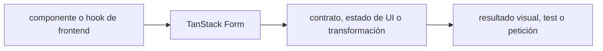

# TanStack Form — Vigilio línea instalada (verificar API por lockfile)

## Qué es, qué hace y cuándo usarla

Administrador headless y tipado de formularios. Distingue estado y validación del formulario de la validación del backend.

**Ubicación en Vigilio:** usa esta dependencia en su stack propietario; otras skills deben enlazar esta guía, no duplicar sus reglas. **Versión:** la indicada en el encabezado es la línea documentada; consultar `technology/versions.md` y el lockfile antes de copiar APIs o aprobar un upgrade.

> **Guía propia de TanStack Form (frontend).** Estado a **2026-10-25**: línea instalada (verificar API por lockfile). Versión del proyecto consumidor = `pnpm-lock.yaml` / `composer.lock` / imagen o manifest. Fuente: [documentación oficial](https://tanstack.com/form/latest/docs/overview). Fuente normativa transversal de versiones: [versions.md](../versions.md). **No implica instalación automática ni upgrade aprobado.**

## Objetivo, responsabilidad y dónde usar

Errores de servidor mapeados a campos; validación client-side para UX, server-side obligatoria.

**Uso:** aplicar solo si está declarada y resulta pertinente al consumidor; ver [política de adopción y DRY](README.md).

### Diagrama de integración (Mermaid)



El flujo muestra la **responsabilidad arquitectónica** de la librería; no representa llamadas reales de red para todas las operaciones.


## Instalación o verificación

```bash
pnpm add @tanstack/react-form
```

**Gate de instalación:** consultar [procedimiento compartido](README.md#protocolo-de-adopción-y-actualización); estos comandos son indicativos, no ejecuciones sobre un consumidor.

## ✅ Correcto — uso actual y ejemplo de referencia

```typescript
// Separar validación, formulario y mutation de servidor
// Form usa DTO Zod de entrada compartido, no duplica definición de campos.
const parsed = registerProductRequestDto.safeParse(form_values);
if (parsed.success) register_product_mutation.mutate(parsed.data);
```

**Por qué:** Errores de servidor mapeados a campos; validación client-side para UX, server-side obligatoria.

## ❌ Incorrecto — patrón legacy, inseguro o mal ubicado

```typescript
// ❌ reglas de negocio únicamente en front
if (client_is_admin) allowRegistration();
```

**Riesgo:** confundir versiones o responsabilidades y obtener un contrato incorrecto.

## Nuevas capacidades, migración y breaking changes

Revisar cambios entre versiones major y compatibilidad de adapters/validators antes de migrar; el snippet usa Zod estable y patrón seguro.

Aplicar el [protocolo de migración común](README.md#protocolo-de-adopción-y-actualización), sin asumir que una release nueva está desplegada.

## Buenas prácticas, seguridad, rendimiento y operación

Consultar la [política transversal de librerías](README.md) para seguridad, versionado, evidencia y revisión de contratos. Para esta librería, además, aplicar las verificaciones concretas que se detallan a continuación.

## Gates de aceptación y compatibilidad

Test campos dinámicos, blur/submit, arrays, errores asíncronos y reset.

Estado de prueba de estos ejemplos documentales: **NOT_RUN** en aplicaciones consumidoras; ver [criterios de evidencia](README.md#criterios-de-validación).


## Referencias

- [Documentación oficial y migración de TanStack Form](https://tanstack.com/form/latest/docs/overview)
- [Matriz y baseline de versiones](../versions.md)
- [Calidad de código canónica](../../foundations/engineering/code-quality.md)


## Recetario operativo ampliado — tanstack-form (2026-10-25)

### API actual: dos tareas reales que debe saber ejecutar una skill

1. **FormApi/field listeners en versión instalada, Zod como validación reusable.**
2. **Async validation debounced y estado submit/dirty controlado.**

### Migración desde versiones anteriores: decisión concreta

- **Qué cambia o se debe revisar:** No mezclar props del React Hook Form en TanStack Form, son APIs distintas.

### Responsabilidades y capas

Form React, DTO HTTP compartido; no persistir business rules aquí.

**✅ Correcto:** mantener la integración encapsulada, alinear los nombres del negocio con Vigilio y depender de un contrato estable.

**❌ Incorrecto:** importar internals de la librería desde Domain, declarar `any` para resolver un upgrade, o duplicar reglas ya propietarias de otra tecnología.

### Seguridad, resiliencia y rendimiento

- Async validation race y password serialización accidental.

### Test de aceptación específico y evidencia mínima

- **Escenario comprobable:** Test dirty/touched, invalid submit, error backend y reset.


## Guía operativa detallada — 8 casos y 4 antipatrones

### Ocho ejemplos de la API y casos de uso relevantes

Los fragmentos siguientes ilustran **operaciones independientes**. Variables, imports, provider, extensión y configuración se completan en el proyecto consumidor; **no están certificados como un archivo único compilable**. Cuando hay comentarios `#`, son pasos de integración o configuración y no APIs inventadas.

#### Ejemplo 1. Form

**✅ Correcto — form**

```typescript
const form = useForm({ defaultValues: { nro_poliza: '' }, onSubmit: ({ value }) => registerProductApi(value) });
```


#### Ejemplo 2. Field

**✅ Correcto — field**

```typescript
form.Field name="nro_poliza"
```


#### Ejemplo 3. Value

**✅ Correcto — value**

```typescript
field.state.value
```


#### Ejemplo 4. Change

**✅ Correcto — change**

```typescript
field.handleChange(event.target.value)
```


#### Ejemplo 5. Blur

**✅ Correcto — blur**

```typescript
field.handleBlur()
```


#### Ejemplo 6. Errors

**✅ Correcto — errors**

```typescript
field.state.meta.errors
```


#### Ejemplo 7. Submit

**✅ Correcto — submit**

```typescript
form.handleSubmit()
```


#### Ejemplo 8. Validación

**✅ Correcto — validación**

```typescript
validators: { onChange: registerProductRequestDto }
```


### Cuatro antipatrones frecuentes y su sustitución

#### Antipatrón 1 — riesgo y alternativa

**❌ Incorrecto — Duplicar useState por cada input.**

**Por qué está mal:** El patrón «Duplicar useState por cada input» es riesgoso: puede exponer datos obsoletos o mezclar estados de usuarios, sesiones y consultas diferentes.

**✅ Correcto**

```typescript
useForm({ defaultValues })
```

**Por qué mejora:** El patrón «useForm({ defaultValues })» mejora el caso: el estado se identifica e invalida con criterios explícitos y verificables.

#### Antipatrón 2 — riesgo y alternativa

**❌ Incorrecto — No validar DTO antes de enviar.**

**Por qué está mal:** El patrón «No validar DTO antes de enviar» es riesgoso: puede elevar el coste de runtime, causar fallos de despliegue o empaquetar dependencias no deseadas.

**✅ Correcto**

```typescript
validators: { onChange: registerProductRequestDto }
```

**Por qué mejora:** Convierte la condición en un control verificable mediante validación o pruebas.

#### Antipatrón 3 — riesgo y alternativa

**❌ Incorrecto — Confiar solo en frontend para seguridad.**

**Por qué está mal:** El patrón «Confiar solo en frontend para seguridad» es riesgoso: puede aceptar entradas inválidas o duplicar contratos difíciles de mantener.

**✅ Correcto — Validar nuevamente en backend.**

**Por qué mejora:** Convierte la condición en un control verificable mediante validación o pruebas.

#### Antipatrón 4 — riesgo y alternativa

**❌ Incorrecto — Invalidar DOM al guardar sin estado.**

**Por qué está mal:** Omite un control operativo necesario, por lo que el comportamiento puede ser inseguro o difícil de verificar.

**✅ Correcto**

```typescript
form.handleSubmit()
```

**Por qué mejora:** El patrón «form.handleSubmit()» mejora el caso: el estado se identifica e invalida con criterios explícitos y verificables.

### Versión estable, breaking changes y verificación

- **Versión estable exacta:** no se declara un parche universal cuando no hay verificación específica de su registry/release. Consultar el encabezado de esta guía, `technology/versions.md` y el manifiesto del servicio. **Estado de patch: VERIFY_LOCKFILE**.
- **Migración:** identificar major anterior, APIs retiradas/cambiadas, peer dependencies, requisitos de runtime, cambios de tipos, ejecución CI y plan de rollback. Si no hay prueba sobre el consumidor, **NOT_RUN**, no PASS.
- **Versiones previas:** el ejemplo marcado ❌ en esta guía explica al menos una incompatibilidad o un uso obsoleto; no trasplantar APIs de otras versiones.
- **Tests:** probar al menos happy path, error, seguridad/permiso y compatibilidad con el runtime donde aplique; solo activar nuevas capacidades mediante una PR versionada.

### Fuentes oficiales y referencias al final

- [Referencia propia oficial](https://tanstack.com/form/latest/docs/overview)
- [Matriz canónica de versiones](../versions.md)
- [Política de adopción de librerías](README.md)

## Guía de compatibilidad y evaluación por versión (2026-10-25)

**Estado del patch exacto:** `VERIFY_LOCKFILE`. La guía documenta la familia de APIs; **no se ha verificado hoy el patch estable preciso de esta dependencia**. Consultar la fuente oficial enlazada al inicio y el lockfile antes de generar código o aprobar un upgrade.

### Checklist específico de esta librería

- **Migración/compatibilidad:** No mezclar props del React Hook Form en TanStack Form, son APIs distintas.
- **Prueba propia:** Test dirty/touched, invalid submit, error backend y reset.
- **Límite de responsabilidad:** usar esta librería solo en su adaptador o capa propietaria; consultar los ejemplos de API y antipatrones anteriores antes de cambiar llamadas públicas.

**Gate de aprobación:** leer la referencia oficial y resolver la versión del consumidor, ejecutar typecheck y pruebas específicas, registrar PASS/FAIL/NOT_RUN/BLOCKED. No confundir esta guía con validación de un consumidor real. [Procedimiento único de adopción](README.md#protocolo-de-adopción-y-actualización).

