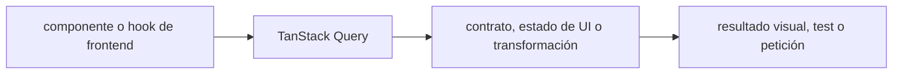

# TanStack Query — Vigilio v5 (última línea documentada; patch por lockfile)

## Qué es, qué hace y cuándo usarla

Caché y sincronización de datos de servidor para React. Proporciona queries, mutations e invalidación; no debe manejar permisos de backend.

**Ubicación en Vigilio:** usa esta dependencia en su stack propietario; otras skills deben enlazar esta guía, no duplicar sus reglas. **Versión:** la indicada en el encabezado es la línea documentada; consultar `technology/versions.md` y el lockfile antes de copiar APIs o aprobar un upgrade.

> **Guía propia de TanStack Query (frontend).** Estado a **2026-10-25**: v5 (última línea documentada; patch por lockfile). Versión del proyecto consumidor = `pnpm-lock.yaml` / `composer.lock` / imagen o manifest. Fuente: [documentación oficial](https://tanstack.com/query/latest/docs/framework/react/guides/migrating-to-v5). Fuente normativa transversal de versiones: [versions.md](../versions.md). **No implica instalación automática ni upgrade aprobado.**

## Objetivo, responsabilidad y dónde usar

El `*.api.ts` comunica HTTP, hook `use...Query` administra datos de servidor, query keys centrales en constants; tokens/permisos manejados por ApiClient. Invalidar listas tras mutation, considerar session/tenant en key y limpiar caché al logout. Nunca tratar la caché del cliente como fuente de autorización.

**Uso:** aplicar solo si está declarada y resulta pertinente al consumidor; ver [política de adopción y DRY](README.md).

### Diagrama de integración (Mermaid)



El flujo muestra la **responsabilidad arquitectónica** de la librería; no representa llamadas reales de red para todas las operaciones.


## Instalación o verificación

```bash
pnpm add @tanstack/react-query
```

**Gate de instalación:** consultar [procedimiento compartido](README.md#protocolo-de-adopción-y-actualización); estos comandos son indicativos, no ejecuciones sobre un consumidor.

## ✅ Correcto — uso actual y ejemplo de referencia

```typescript
import { useMutation, useQuery, useQueryClient } from '@tanstack/react-query';
export const productsQueryKeys = { all: ['products'] as const,
  lists: () => ['products', 'list'] as const,
  list: (query: ListProductsQueryDto) => ['products','list',query] as const };
export function useListProductsQuery(query: ListProductsQueryDto) {
  return useQuery({queryKey:productsQueryKeys.list(query),queryFn:()=>listProductsApi(query),staleTime:30_000});
}
export function useRegisterProductMutation() {
  const query_client = useQueryClient();
  return useMutation({mutationFn:registerProductApi,onSuccess:()=>query_client.invalidateQueries({queryKey:productsQueryKeys.lists()})});
}
```

**Por qué:** El `*.api.ts` comunica HTTP, hook `use...Query` administra datos de servidor, query keys centrales en constants; tokens/permisos manejados por ApiClient. Invalidar listas tras mutation, considerar session/tenant en key y limpiar caché al logout. Nunca tratar la caché del cliente como fuente de autorización.

## ❌ Incorrecto — patrón legacy, inseguro o mal ubicado

```typescript
useQuery(['products'], getProducts, { onSuccess: () => { /* ... */ } });
// ❌ callback query removed in v5; positional overload removed
```

**Riesgo:** confundir versiones o responsabilidades y obtener un contrato incorrecto.

## Nuevas capacidades, migración y breaking changes

v4→v5: firma de objeto única; `useQuery` quita callbacks onSuccess/onError/onSettled; mutations mantienen callbacks. Estados: `isPending` en lugar de `isLoading` histórico; `gcTime` en lugar de `cacheTime`; revisar SSR hydration, defaults de retry, infinite query initialPageParam.

Aplicar el [protocolo de migración común](README.md#protocolo-de-adopción-y-actualización), sin asumir que una release nueva está desplegada.

## Buenas prácticas, seguridad, rendimiento y operación

Consultar la [política transversal de librerías](README.md) para seguridad, versionado, evidencia y revisión de contratos. Para esta librería, además, aplicar las verificaciones concretas que se detallan a continuación.

## Gates de aceptación y compatibilidad

Tests MSW de estados idle/loading/error/success y reintentos; carga concurrente, logout, invalidación por tenant, y diferencias de key; probar prefetch/hidratación SSR.

Estado de prueba de estos ejemplos documentales: **NOT_RUN** en aplicaciones consumidoras; ver [criterios de evidencia](README.md#criterios-de-validación).

### API adicional útil
- `useInfiniteQuery` con `initialPageParam` y `getNextPageParam`.
- `queryOptions`, `useSuspenseQuery`, `placeholderData`, `select`, `enabled`, `networkMode`.
- `queryClient.ensureQueryData()` para precarga, sin disparar consultas duplicadas por efectos.
- Consultar API instalada si cambia firma de `fetchQuery` en parches/mayores posteriores.

## API y configuración senior

| API | Cuándo | Riesgo a controlar |
|---|---|---|
| `useQuery` | lectura idempotente | `enabled` y query key |
| `useMutation` | cambios de estado | invalidación/rollback |
| `useInfiniteQuery` | cursor/páginas | `initialPageParam`, `getNextPageParam` |
| `queryOptions()` | composición tipada | imports desde paquete correcto |
| `useSuspenseQuery` | suspense | ErrorBoundary + SSR |
| `select` | proyección derivada | no mutar cache source |
| `placeholderData` | estabilidad de UI | no confundir con dato persistido |
| `gcTime`, `staleTime` | política de cache | no guardar datos privados indefinidamente |

```typescript
export function useInfiniteProductsQuery() {
  return useInfiniteQuery({
    queryKey: ['products', 'infinite'],
    initialPageParam: null as string | null,
    queryFn: ({ pageParam }) => listProductsApi({cursor:pageParam}),
    getNextPageParam: page => page.next,
  });
}
```

✅ Correcto: `invalidateQueries({queryKey:productsQueryKeys.lists()})` tras mutación. ❌ Incorrecto: pasar `onSuccess` dentro de `useQuery` v5 o usar cache como autorización.

## Referencias

- [Documentación oficial y migración de TanStack Query](https://tanstack.com/query/latest/docs/framework/react/guides/migrating-to-v5)
- [Matriz y baseline de versiones](../versions.md)
- [Calidad de código canónica](../../foundations/engineering/code-quality.md)


## Recetario operativo ampliado — tanstack-query (2026-10-25)

### API actual: dos tareas reales que debe saber ejecutar una skill

1. **`useQuery({queryKey,queryFn})`, `useMutation({mutationFn})`, `queryOptions` reutilizables.**
2. **Invalidación con `queryClient.invalidateQueries({queryKey})`, retries idempotentes.**

### Migración desde versiones anteriores: decisión concreta

- **Qué cambia o se debe revisar:** V4→V5 elimina callbacks en useQuery y firmas posicionales; migrar a objeto.

### Responsabilidades y capas

Server state de frontend, no cache Valkey servidor ni `useState` como servidor.

**✅ Correcto:** mantener la integración encapsulada, alinear los nombres del negocio con Vigilio y depender de un contrato estable.

**❌ Incorrecto:** importar internals de la librería desde Domain, declarar `any` para resolver un upgrade, o duplicar reglas ya propietarias de otra tecnología.

### Seguridad, resiliencia y rendimiento

- Cache multitenant/sesión: scope query key y clear on logout.

### Test de aceptación específico y evidencia mínima

- **Escenario comprobable:** React testing QueryClient aislado, stale/GC, 401, mutation invalidate.

### Ejemplo de integración vigente (fragmento adicional)

```tsx
const productsQueryKeys = {
  all: ['products'] as const,
  lists: () => [...productsQueryKeys.all, 'list'] as const,
  list: (query: ListProductsQueryDto) => [...productsQueryKeys.lists(), query] as const,
};
function useListProductsQuery(query: ListProductsQueryDto) {
  return useQuery({ queryKey: productsQueryKeys.list(query), queryFn: () => listProductsApi(query) });
}
// mutation: onSuccess async -> query_client.invalidateQueries({ queryKey: productsQueryKeys.lists() })
```

**Nota:** los fragmentos muestran la API específica y requieren imports/providers/fixtures del consumidor; no se certifica compilación por el solo hecho de aparecer aquí.

### V5 — caché, mutations y paginación sin APIs legacy

- `useQuery` solo recibe objeto de opciones; `useQuery(key,fn)` es v4 y no es correcto en v5.
- `onSuccess/onError/onSettled` se mantienen en **mutations**, pero se retiraron de **queries** en v5; para efectos dependientes de `data` usar React effect cuando aplique.
- `staleTime` gobierna frescura; `gcTime` sustituye a `cacheTime`; no confundir con TTL de Valkey.
- Para query keys incluir filtros y contexto de sesión en cache privadas; limpiar QueryClient al logout/cambio tenant.
- Usar `useInfiniteQuery` solo si backend define cursor y siguiente página; no tratar offset como cursor opaco.
- Testear `enabled`, `retry`, `AbortSignal`, invalidación, y fallback de error.
- Referencia: https://tanstack.com/query/latest/docs/framework/react/guides/migrating-to-v5


## Guía operativa detallada — 8 casos y 4 antipatrones

### Ocho ejemplos de la API y casos de uso relevantes

Los fragmentos siguientes ilustran **operaciones independientes**. Variables, imports, provider, extensión y configuración se completan en el proyecto consumidor; **no están certificados como un archivo único compilable**. Cuando hay comentarios `#`, son pasos de integración o configuración y no APIs inventadas.

#### Ejemplo 1. Provider

**✅ Correcto — provider**

```typescript
const query_client = new QueryClient();
```


#### Ejemplo 2. Query

**✅ Correcto — query**

```typescript
useQuery({ queryKey: ['products'], queryFn: listProductsApi });
```


#### Ejemplo 3. Keys por filtro

**✅ Correcto — keys por filtro**

```typescript
queryKey: ['products', { estado, limit }]
```


#### Ejemplo 4. Opciones reutilizables

**✅ Correcto — opciones reutilizables**

```typescript
queryOptions({ queryKey: ['products'], queryFn: listProductsApi });
```


#### Ejemplo 5. Mutation

**✅ Correcto — mutation**

```typescript
useMutation({ mutationFn: registerProductApi });
```


#### Ejemplo 6. Invalidación

**✅ Correcto — invalidación**

```typescript
query_client.invalidateQueries({ queryKey: ['products'] });
```


#### Ejemplo 7. Infinite query

**✅ Correcto — infinite query**

```typescript
useInfiniteQuery({ queryKey: ['products'], queryFn: fetchPage, initialPageParam: 0, getNextPageParam: last => last.next });
```


#### Ejemplo 8. Prefetch

**✅ Correcto — prefetch**

```typescript
query_client.prefetchQuery({ queryKey: ['products'], queryFn: listProductsApi });
```


### Cuatro antipatrones frecuentes y su sustitución

#### Antipatrón 1 — riesgo y alternativa

**❌ Incorrecto**

```typescript
useQuery(["products"], listProductsApi) // v4
```

**Por qué está mal:** Reutiliza una firma o convención de otra versión sin verificar compatibilidad con la línea documentada.

**✅ Correcto**

```typescript
useQuery({ queryKey: ["products"], queryFn: listProductsApi })
```

**Por qué mejora:** El patrón «useQuery({ queryKey: ["products"], queryFn: listProductsApi })» mejora el caso: se utiliza la API apropiada para el major documentado y se comprueba el lockfile.

#### Antipatrón 2 — riesgo y alternativa

**❌ Incorrecto**

```typescript
useQuery({onSuccess: doSomething}) // retirado v5
```

**Por qué está mal:** El patrón «useQuery({onSuccess: doSomething}) // retirado v5» es riesgoso: puede mezclar firmas incompatibles o ejecutar una API retirada en la versión instalada.

**✅ Correcto — Usar effect para side effect si aplica.**

**Por qué mejora:** El patrón «Usar effect para side effect si aplica» mejora el caso: se utiliza la API apropiada para el major documentado y se comprueba el lockfile.

#### Antipatrón 3 — riesgo y alternativa

**❌ Incorrecto**

```typescript
cacheTime: 300000 // v4
```

**Por qué está mal:** Reutiliza una firma o convención de otra versión sin verificar compatibilidad con la línea documentada.

**✅ Correcto**

```typescript
gcTime: 300000
```

**Por qué mejora:** El patrón «gcTime: 300000» mejora el caso: se utiliza la API apropiada para el major documentado y se comprueba el lockfile.

#### Antipatrón 4 — riesgo y alternativa

**❌ Incorrecto — QueryKey sin tenant en sesión compartida.**

**Por qué está mal:** Omite un control operativo necesario, por lo que el comportamiento puede ser inseguro o difícil de verificar.

**✅ Correcto**

```typescript
queryKey: ["products", session_scope, filters]
```

**Por qué mejora:** El patrón «queryKey: ["products", session_scope, filters]» mejora el caso: se fuerza autorización en el borde/servidor y se limita el acceso por recurso.

### Versión estable, breaking changes y verificación

- **Release estable contrastada en fuente pública (25-10-2026):** `5.104.5`. Esto **no** significa que el consumidor ya la tenga instalada.
- **Referencia de versiones/releases:** [TanStack Query releases](https://www.npmjs.com/package/@tanstack/react-query).
- **API actual:** [documentación oficial específica](https://tanstack.com/query/latest/docs/framework/react/guides/migrating-to-v5).
- **Migración:** identificar major anterior, APIs retiradas/cambiadas, peer dependencies, requisitos de runtime, cambios de tipos, ejecución CI y plan de rollback. Si no hay prueba sobre el consumidor, **NOT_RUN**, no PASS.
- **Versiones previas:** el ejemplo marcado ❌ en esta guía explica al menos una incompatibilidad o un uso obsoleto; no trasplantar APIs de otras versiones.
- **Tests:** probar al menos happy path, error, seguridad/permiso y compatibilidad con el runtime donde aplique; solo activar nuevas capacidades mediante una PR versionada.

### Fuentes oficiales y referencias al final

- [Referencia propia oficial](https://tanstack.com/query/latest/docs/framework/react/guides/migrating-to-v5)
- [Release o guía oficial](https://www.npmjs.com/package/@tanstack/react-query)
- [Matriz canónica de versiones](../versions.md)
- [Política de adopción de librerías](README.md)

## Guía de compatibilidad y evaluación por versión (2026-10-25)

**Release contrastada para esta familia:** `5.104.5`. Fuente: [publicación oficial](https://www.npmjs.com/package/@tanstack/react-query?activeTab=versions). **Cambio clave:** v5: objeto de opciones, gcTime, query callbacks retirados; mutation callbacks siguen.

### Checklist específico de esta librería

- `queryKey` debe incluir tenant/sesión y filtros; invalidar/limpiar al logout para evitar fuga de estado.
- `useQuery` v5 solo opciones en objeto; `gcTime` sustituyó a `cacheTime`.
- Los callbacks `onSuccess`/`onError` de query se eliminaron en v5; siguen en mutations.
- `useInfiniteQuery` requiere `initialPageParam` y `getNextPageParam`; cursor no es offset.

**Gate de aprobación:** leer la referencia oficial y resolver la versión del consumidor, ejecutar typecheck y pruebas específicas, registrar PASS/FAIL/NOT_RUN/BLOCKED. No confundir esta guía con validación de un consumidor real. [Procedimiento único de adopción](README.md#protocolo-de-adopción-y-actualización).

## Flujo real de lectura y escritura con claves reutilizables (v5)

```tsx
import { useMutation, useQuery, useQueryClient } from '@tanstack/react-query';

const productsQueryKeys = {
  all: ['products'] as const,
  lists: () => [...productsQueryKeys.all, 'list'] as const,
  list: (query: ListProductsQueryDto) => [...productsQueryKeys.lists(), query] as const,
};

export function useListProductsQuery(query: ListProductsQueryDto) {
  return useQuery({
    queryKey: productsQueryKeys.list(query),
    queryFn: ({ signal }) => listProductsApi(query, { signal }),
    staleTime: 30_000,
  });
}

export function useRegisterProductMutation() {
  const query_client = useQueryClient();
  return useMutation({
    mutationFn: registerProductApi,
    onSuccess: () => query_client.invalidateQueries({ queryKey: productsQueryKeys.lists() }),
  });
}
```

Los nombres importados `ListProductsQueryDto`, `listProductsApi`, `registerProductApi` provienen de contratos/adapters de Vigilio y se implementan en su feature. En datos privados, incluir contexto de usuario/tenant en key y limpiar QueryClient al cerrar sesión. **❌ Incorrecto:** callbacks `onSuccess` en `useQuery()` v5, o usar `useQuery(['products'], fn)` legado. [Guía de migración v5](https://tanstack.com/query/latest/docs/framework/react/guides/migrating-to-v5).
