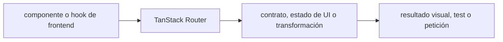

# TanStack Router — Vigilio línea instalada; validar compatibilidad de file routing

## Qué es, qué hace y cuándo usarla

Enrutamiento tipado para React con loaders y búsqueda validada. La navegación no reemplaza autenticación ni autorización del servidor.

**Ubicación en Vigilio:** usa esta dependencia en su stack propietario; otras skills deben enlazar esta guía, no duplicar sus reglas. **Versión:** la indicada en el encabezado es la línea documentada; consultar `technology/versions.md` y el lockfile antes de copiar APIs o aprobar un upgrade.

> **Guía propia de TanStack Router (frontend).** Estado a **2026-10-25**: línea instalada; validar compatibilidad de file routing. Versión del proyecto consumidor = `pnpm-lock.yaml` / `composer.lock` / imagen o manifest. Fuente: [documentación oficial](https://tanstack.com/router/latest/docs/framework/react/overview). Fuente normativa transversal de versiones: [versions.md](../versions.md). **No implica instalación automática ni upgrade aprobado.**

## Objetivo, responsabilidad y dónde usar

Responsabilidad routing/UI; cargas de datos mediante hooks Query; permisos backend siempre obligatorios.

**Uso:** aplicar solo si está declarada y resulta pertinente al consumidor; ver [política de adopción y DRY](README.md).

### Diagrama de integración (Mermaid)



El flujo muestra la **responsabilidad arquitectónica** de la librería; no representa llamadas reales de red para todas las operaciones.


## Instalación o verificación

```bash
pnpm add @tanstack/react-router
```

**Gate de instalación:** consultar [procedimiento compartido](README.md#protocolo-de-adopción-y-actualización); estos comandos son indicativos, no ejecuciones sobre un consumidor.

## ✅ Correcto — uso actual y ejemplo de referencia

```typescript
// Route files: validar params y search en el borde
import { createFileRoute } from '@tanstack/react-router';
export const Route = createFileRoute('/products/')({ component: ProductsPage });
```

**Por qué:** Responsabilidad routing/UI; cargas de datos mediante hooks Query; permisos backend siempre obligatorios.

## ❌ Incorrecto — patrón legacy, inseguro o mal ubicado

```typescript
// ❌ concatenar URLs desde inputs sin encode/validación
window.location.href = '/products/' + untrusted_id;
```

**Riesgo:** confundir versiones o responsabilidades y obtener un contrato incorrecto.

## Nuevas capacidades, migración y breaking changes

No confundir Router file-based moderno con APIs React Router; ver migración oficial de la versión instalada antes de usar search validators.

Aplicar el [protocolo de migración común](README.md#protocolo-de-adopción-y-actualización), sin asumir que una release nueva está desplegada.

## Buenas prácticas, seguridad, rendimiento y operación

Consultar la [política transversal de librerías](README.md) para seguridad, versionado, evidencia y revisión de contratos. Para esta librería, además, aplicar las verificaciones concretas que se detallan a continuación.

## Gates de aceptación y compatibilidad

Test deep links, search params, navegación autenticada y SSR si aplica.

Estado de prueba de estos ejemplos documentales: **NOT_RUN** en aplicaciones consumidoras; ver [criterios de evidencia](README.md#criterios-de-validación).


## Referencias

- [Documentación oficial y migración de TanStack Router](https://tanstack.com/router/latest/docs/framework/react/overview)
- [Matriz y baseline de versiones](../versions.md)
- [Calidad de código canónica](../../foundations/engineering/code-quality.md)


## Recetario operativo ampliado — tanstack-router (2026-10-25)

### API actual: dos tareas reales que debe saber ejecutar una skill

1. **Routes tipadas, loaders y search param validation según API estable instalada.**
2. **Separar navegación/autorización; loaders pueden precargar QueryClient.**

### Migración desde versiones anteriores: decisión concreta

- **Qué cambia o se debe revisar:** File route generation y route definitions cambian; migrar con plugin/documentación del major.

### Responsabilidades y capas

Router web, no endpoint backend ni DTO persistencia.

**✅ Correcto:** mantener la integración encapsulada, alinear los nombres del negocio con Vigilio y depender de un contrato estable.

**❌ Incorrecto:** importar internals de la librería desde Domain, declarar `any` para resolver un upgrade, o duplicar reglas ya propietarias de otra tecnología.

### Seguridad, resiliencia y rendimiento

- Route leakage entre tenant y SSR mismatch.

### Test de aceptación específico y evidencia mínima

- **Escenario comprobable:** Deep links, search validation, guard sessions y route-level code splitting.


## Guía operativa detallada — 8 casos y 4 antipatrones

### Ocho ejemplos de la API y casos de uso relevantes

Los fragmentos siguientes ilustran **operaciones independientes**. Variables, imports, provider, extensión y configuración se completan en el proyecto consumidor; **no están certificados como un archivo único compilable**. Cuando hay comentarios `#`, son pasos de integración o configuración y no APIs inventadas.

#### Ejemplo 1. Router

**✅ Correcto — router**

```tsx
const router = createRouter({ routeTree });
```


#### Ejemplo 2. Provider

**✅ Correcto — provider**

```tsx
<RouterProvider router={router} />
```


#### Ejemplo 3. Link

**✅ Correcto — link**

```tsx
<Link to="/products">Productos</Link>
```


#### Ejemplo 4. Navigate

**✅ Correcto — navigate**

```tsx
navigate({ to: '/products' });
```


#### Ejemplo 5. Params

**✅ Correcto — params**

```tsx
const { product_id } = Route.useParams();
```


#### Ejemplo 6. Search validation

**✅ Correcto — search validation**

```tsx
validateSearch: (search) => listProductsQueryDto.parse(search)
```


#### Ejemplo 7. Loader

**✅ Correcto — loader**

```tsx
loader: async () => listProductsApi({ limit: 25 })
```


#### Ejemplo 8. Not found

**✅ Correcto — not found**

```tsx
notFoundComponent: () => <NotFound />
```


### Cuatro antipatrones frecuentes y su sustitución

#### Antipatrón 1 — riesgo y alternativa

**❌ Incorrecto — Params no validados en destino.**

**Por qué está mal:** El patrón «Params no validados en destino» es riesgoso: la consulta puede producir resultados incorrectos, lentitud o aislamiento insuficiente de datos.

**✅ Correcto**

```tsx
validateSearch: (search) => listProductsQueryDto.parse(search)
```

**Por qué mejora:** Convierte la condición en un control verificable mediante validación o pruebas.

#### Antipatrón 2 — riesgo y alternativa

**❌ Incorrecto — Auth guard como permiso de backend.**

**Por qué está mal:** El patrón «Auth guard como permiso de backend» es riesgoso: puede permitir acceso a recursos no autorizados o de otro tenant.

**✅ Correcto — Backend verifica Policy.**

**Por qué mejora:** Separa permisos y secretos del código de negocio y permite comprobar el acceso mínimo.

#### Antipatrón 3 — riesgo y alternativa

**❌ Incorrecto — Route config hardcodeada duplicada con generated tree.**

**Por qué está mal:** El patrón «Route config hardcodeada duplicada con generated tree» es riesgoso: mezcla responsabilidades de interfaz y navegación o genera comportamiento inconsistente.

**✅ Correcto — Mantener routeTree fuente.**

**Por qué mejora:** El patrón «Mantener routeTree fuente» mejora el caso: la interfaz utiliza la API adecuada y separa presentación, estado y comunicación.

#### Antipatrón 4 — riesgo y alternativa

**❌ Incorrecto — Navegar en Domain.**

**Por qué está mal:** El patrón «Navegar en Domain» es riesgoso: la elección «Navegar en Domain» puede incumplir los requisitos operativos de tanstack-router.

**✅ Correcto**

```tsx
navigate({ to: "/products" }) # en Presentation
```

**Por qué mejora:** Convierte la condición en un control verificable mediante validación o pruebas.

### Versión estable, breaking changes y verificación

- **Versión estable exacta:** no se declara un parche universal cuando no hay verificación específica de su registry/release. Consultar el encabezado de esta guía, `technology/versions.md` y el manifiesto del servicio. **Estado de patch: VERIFY_LOCKFILE**.
- **Migración:** identificar major anterior, APIs retiradas/cambiadas, peer dependencies, requisitos de runtime, cambios de tipos, ejecución CI y plan de rollback. Si no hay prueba sobre el consumidor, **NOT_RUN**, no PASS.
- **Versiones previas:** el ejemplo marcado ❌ en esta guía explica al menos una incompatibilidad o un uso obsoleto; no trasplantar APIs de otras versiones.
- **Tests:** probar al menos happy path, error, seguridad/permiso y compatibilidad con el runtime donde aplique; solo activar nuevas capacidades mediante una PR versionada.

### Fuentes oficiales y referencias al final

- [Referencia propia oficial](https://tanstack.com/router/latest/docs/framework/react/overview)
- [Matriz canónica de versiones](../versions.md)
- [Política de adopción de librerías](README.md)

## Guía de compatibilidad y evaluación por versión (2026-10-25)

**Estado del patch exacto:** `VERIFY_LOCKFILE`. La guía documenta la familia de APIs; **no se ha verificado hoy el patch estable preciso de esta dependencia**. Consultar la fuente oficial enlazada al inicio y el lockfile antes de generar código o aprobar un upgrade.

### Checklist específico de esta librería

- **Migración/compatibilidad:** File route generation y route definitions cambian; migrar con plugin/documentación del major.
- **Prueba propia:** Deep links, search validation, guard sessions y route-level code splitting.
- **Límite de responsabilidad:** usar esta librería solo en su adaptador o capa propietaria; consultar los ejemplos de API y antipatrones anteriores antes de cambiar llamadas públicas.

**Gate de aprobación:** leer la referencia oficial y resolver la versión del consumidor, ejecutar typecheck y pruebas específicas, registrar PASS/FAIL/NOT_RUN/BLOCKED. No confundir esta guía con validación de un consumidor real. [Procedimiento único de adopción](README.md#protocolo-de-adopción-y-actualización).

