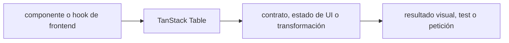

# TanStack Table — Vigilio v9 (estable; migración v8→v9 confirmada)

## Qué es, qué hace y cuándo usarla

Motor headless para tablas. Define modelos de filas, orden, filtros y paginación; la app aporta componentes y llamadas HTTP.

**Ubicación en Vigilio:** usa esta dependencia en su stack propietario; otras skills deben enlazar esta guía, no duplicar sus reglas. **Versión:** la indicada en el encabezado es la línea documentada; consultar `technology/versions.md` y el lockfile antes de copiar APIs o aprobar un upgrade.

> **Guía propia de TanStack Table (frontend).** Estado a **2026-10-25**: v9 (estable; migración v8→v9 confirmada). Versión del proyecto consumidor = `pnpm-lock.yaml` / `composer.lock` / imagen o manifest. Fuente: [documentación oficial](https://tanstack.com/table/latest/docs/framework/react/guide/migrating). Fuente normativa transversal de versiones: [versions.md](../versions.md). **No implica instalación automática ni upgrade aprobado.**

## Objetivo, responsabilidad y dónde usar

Tabla headless: Data/Columns separados de UI; server-side pagination/sorting usan contrato backend, `manualPagination` cuando pertinente. No ordenar página en cliente cuando el dataset está paginado en servidor. Registrar features usadas para tree-shaking y accesibilidad de encabezados/filas.

**Uso:** aplicar solo si está declarada y resulta pertinente al consumidor; ver [política de adopción y DRY](README.md).

### Diagrama de integración (Mermaid)



El flujo muestra la **responsabilidad arquitectónica** de la librería; no representa llamadas reales de red para todas las operaciones.


## Instalación o verificación

```bash
pnpm add @tanstack/react-table
```

**Gate de instalación:** consultar [procedimiento compartido](README.md#protocolo-de-adopción-y-actualización); estos comandos son indicativos, no ejecuciones sobre un consumidor.

## ✅ Correcto — uso actual y ejemplo de referencia

```typescript
import { useTable, stockFeatures } from '@tanstack/react-table';
// Dentro de un componente React, con `data` y `columns` definidos y tipados:
const table = useTable({ data, columns, features: stockFeatures });
```

El ejemplo completo del componente y tipos de columna v9 aparece al final de la guía.
**Por qué:** Tabla headless: Data/Columns separados de UI; server-side pagination/sorting usan contrato backend, `manualPagination` cuando pertinente. No ordenar página en cliente cuando el dataset está paginado en servidor. Registrar features usadas para tree-shaking y accesibilidad de encabezados/filas.

## ❌ Incorrecto — patrón legacy, inseguro o mal ubicado

```typescript
import { useReactTable, getCoreRowModel } from '@tanstack/react-table';
// ❌ hook y configuración de v8 usados como si fueran el API recomendado de v9
```

**Riesgo:** confundir versiones o responsabilidades y obtener un contrato incorrecto.

## Nuevas capacidades, migración y breaking changes

v8→v9: `useReactTable`→`useTable`; nuevo `features: tableFeatures(...)` explícito; `getSortedRowModel`→`createSortedRowModel`; `sortingFn`→`sortFn`; build ESM-only y target ES2022. `/legacy` y `useLegacyTable` son únicamente puente temporal.

Aplicar el [protocolo de migración común](README.md#protocolo-de-adopción-y-actualización), sin asumir que una release nueva está desplegada.

## Buenas prácticas, seguridad, rendimiento y operación

Consultar la [política transversal de librerías](README.md) para seguridad, versionado, evidencia y revisión de contratos. Para esta librería, además, aplicar las verificaciones concretas que se detallan a continuación.

## Gates de aceptación y compatibilidad

Migración compilación TypeScript y bundle, server filters/sort, teclado, columnas fijas, selección, virtualization cuando aplique; comparar resultados con dataset real.

Estado de prueba de estos ejemplos documentales: **NOT_RUN** en aplicaciones consumidoras; ver [criterios de evidencia](README.md#criterios-de-validación).

### Capacidades de v9
Tree-shakable feature plugins; TanStack Store y selectors; `table.Subscribe`; agrupación, agregación, selección de celdas y cell spanning. Para una tabla grande elegir manual server pagination y virtualización, no renderizar 100k filas.

## Tabla v9: API y migración no negociable

| Cambio | v8 ❌ | v9 ✅ |
|---|---|---|
| Hook | `useReactTable` | `useTable` |
| Features | implícitas | `tableFeatures({ ... })` |
| Sorting | `sortingFn` | `sortFn` |
| State | `table.getState()` | `table.state` o `table.store.state` |
| Row models | `getSortedRowModel()` | `createSortedRowModel()` en `features` |
| Bundle | features completas | tree-shakable |
| Selección | diseño v8 | plugins row/cell separados |

### Ejemplo server-side

```typescript
const features = tableFeatures({rowSortingFeature});
const table = useTable({
  features,
  data: products,
  columns,
  manualPagination: true,
  manualSorting: true,
  rowCount: page.count,
  state: { pagination, sorting },
  onPaginationChange: setPagination,
  onSortingChange: setSorting,
});
```

No mezclar ordenamiento en cliente con la paginación en servidor. Testear cambios de sort/query key, estados vacíos, responsive y accesibilidad. Fuentes: [guía v9 React](https://tanstack.com/table/latest/docs/framework/react/guide/migrating), [anuncio](https://tanstack.com/blog/announcing-tanstack-table-v9).

## Referencias

- [Documentación oficial y migración de TanStack Table](https://tanstack.com/table/latest/docs/framework/react/guide/migrating)
- [Matriz y baseline de versiones](../versions.md)
- [Calidad de código canónica](../../foundations/engineering/code-quality.md)


## Recetario operativo ampliado — tanstack-table (2026-10-25)

### API actual: dos tareas reales que debe saber ejecutar una skill

1. **TanStack Table v9 `useTable` y features plugins/stockFeatures.**
2. **`tableFeatures` define row models y feature tree shaking; columnas desde data types.**

### Migración desde versiones anteriores: decisión concreta

- **Qué cambia o se debe revisar:** v8 `useReactTable/getSortedRowModel`→ v9 `useTable/tableFeatures/createSortedRowModel`.

### Responsabilidades y capas

UI headless: paginación remota la hace TanStack Query/API.

**✅ Correcto:** mantener la integración encapsulada, alinear los nombres del negocio con Vigilio y depender de un contrato estable.

**❌ Incorrecto:** importar internals de la librería desde Domain, declarar `any` para resolver un upgrade, o duplicar reglas ya propietarias de otra tecnología.

### Seguridad, resiliencia y rendimiento

- No hacer sorting client con páginas incompletas del servidor.

### Test de aceptación específico y evidencia mínima

- **Escenario comprobable:** Tests sort/filter/page/selection, a11y table y performance 10k rows.

### Ejemplo de integración vigente (fragmento adicional)

```tsx
import { useTable, stockFeatures } from '@tanstack/react-table';
// Ejemplo compacto v9: solo las features realmente usadas en una pantalla real.
const table = useTable({ data: rows, columns, features: stockFeatures });
return table.getRowModel().rows.map((row) => row.getVisibleCells().map((cell) =>
  <table.FlexRender cell={cell} />
));
```

**Nota:** los fragmentos muestran la API específica y requieren imports/providers/fixtures del consumidor; no se certifica compilación por el solo hecho de aparecer aquí.

### V9 — ejemplos de migración de v8

| V8 anterior | V9 actual |
|---|---|
| `useReactTable` | `useTable` |
| `getSortedRowModel()` en options | `createSortedRowModel()` en `tableFeatures` |
| `getFilteredRowModel()` en options | `createFilteredRowModel()` registrado |
| `sortingFn` | `sortFn` |
| `useLegacyTable` | Solo puente **temporal de migración**, no destino |

- El modelo de features v9 permite tree shaking; `stockFeatures` reproduce comportamiento amplio y mayor bundle.
- Las cabeceras/filas HTML siguen siendo responsabilidad del componente (headless).
- No hacer paginación global client-side cuando el backend solo entregó 25 de miles de filas.
- Referencia: https://tanstack.com/table/latest/docs/framework/react/guide/migrating


## Guía operativa detallada — 8 casos y 4 antipatrones

### Ocho ejemplos de la API y casos de uso relevantes

Los fragmentos siguientes ilustran **operaciones independientes**. Variables, imports, provider, extensión y configuración se completan en el proyecto consumidor; **no están certificados como un archivo único compilable**. Cuando hay comentarios `#`, son pasos de integración o configuración y no APIs inventadas.

#### Ejemplo 1. Instancia v9

**✅ Correcto — instancia v9**

```tsx
const features = tableFeatures({}); const table = useTable({ data, columns, features });
```


#### Ejemplo 2. Columnas

**✅ Correcto — columnas**

```tsx
const columns = [{ accessorKey: 'nro_poliza', header: 'Póliza' }];
```


#### Ejemplo 3. Sorting feature

**✅ Correcto — sorting feature**

```tsx
const features = tableFeatures({rowSortingFeature, sortedRowModel: createSortedRowModel(), sortFns});
```


#### Ejemplo 4. Filas

**✅ Correcto — filas**

```tsx
table.getRowModel().rows
```


#### Ejemplo 5. Celdas

**✅ Correcto — celdas**

```tsx
table.getRowModel().rows[0]?.getAllCells()
```


#### Ejemplo 6. Render v9

**✅ Correcto — render v9**

```tsx
<table.FlexRender cell={cell} />
```


#### Ejemplo 7. Render headers

**✅ Correcto — render headers**

```tsx
<table.FlexRender header={header} />
```


#### Ejemplo 8. Tabla compartida

**✅ Correcto — tabla compartida**

```tsx
const { useAppTable } = createTableHook({ features });
```


### Cuatro antipatrones frecuentes y su sustitución

#### Antipatrón 1 — riesgo y alternativa

**❌ Incorrecto**

```tsx
useReactTable({data,columns,getCoreRowModel:getCoreRowModel()}) // v8
```

**Por qué está mal:** El patrón «useReactTable({data,columns,getCoreRowModel:getCoreRowModel()}) // v8» es riesgoso: puede mezclar firmas incompatibles o ejecutar una API retirada en la versión instalada.

**✅ Correcto**

```tsx
useTable({data,columns,features:tableFeatures({})})
```

**Por qué mejora:** El patrón «useTable({data,columns,features:tableFeatures({})})» mejora el caso: se utiliza la API apropiada para el major documentado y se comprueba el lockfile.

#### Antipatrón 2 — riesgo y alternativa

**❌ Incorrecto — Usar SortingFeature inventado.**

**Por qué está mal:** El patrón «Usar SortingFeature inventado» es riesgoso: la elección «Usar SortingFeature inventado» puede incumplir los requisitos operativos de tanstack-table.

**✅ Correcto**

```tsx
tableFeatures({rowSortingFeature,sortedRowModel:createSortedRowModel(),sortFns})
```

**Por qué mejora:** El patrón «tableFeatures({rowSortingFeature,sortedRowModel:createSortedRowModel(),sortFns})» mejora el caso: la alternativa «tableFeatures({rowSortingFeature,sortedRowModel:createSortedRowModel(),sort» establece el comportamiento esperado de tanstack-table.

#### Antipatrón 3 — riesgo y alternativa

**❌ Incorrecto**

```tsx
flexRender(cell.column.columnDef.cell,cell.getContext()) // v8
```

**Por qué está mal:** El patrón «flexRender(cell.column.columnDef.cell,cell.getContext()) // v8» es riesgoso: puede mezclar firmas incompatibles o ejecutar una API retirada en la versión instalada.

**✅ Correcto**

```tsx
<table.FlexRender cell={cell} />
```

**Por qué mejora:** El patrón «<table.FlexRender cell={cell} />» mejora el caso: se utiliza la API apropiada para el major documentado y se comprueba el lockfile.

#### Antipatrón 4 — riesgo y alternativa

**❌ Incorrecto — Cargar 1M registros client-side.**

**Por qué está mal:** El patrón «Cargar 1M registros client-side» es riesgoso: la consulta puede producir resultados incorrectos, lentitud o aislamiento insuficiente de datos.

**✅ Correcto — Paginación server-side y windowing.**

**Por qué mejora:** El patrón «Paginación server-side y windowing» mejora el caso: la consulta o el contrato se valida y mide sobre datos representativos.

### Versión estable, breaking changes y verificación

- **Release estable contrastada en fuente pública (25-10-2026):** `9.3.1`. Esto **no** significa que el consumidor ya la tenga instalada.
- **Referencia de versiones/releases:** [TanStack Table releases](https://www.npmjs.com/package/@tanstack/react-table).
- **API actual:** [documentación oficial específica](https://tanstack.com/table/latest/docs/framework/react/quick-start).
- **Migración:** identificar major anterior, APIs retiradas/cambiadas, peer dependencies, requisitos de runtime, cambios de tipos, ejecución CI y plan de rollback. Si no hay prueba sobre el consumidor, **NOT_RUN**, no PASS.
- **Versiones previas:** el ejemplo marcado ❌ en esta guía explica al menos una incompatibilidad o un uso obsoleto; no trasplantar APIs de otras versiones.
- **Tests:** probar al menos happy path, error, seguridad/permiso y compatibilidad con el runtime donde aplique; solo activar nuevas capacidades mediante una PR versionada.

### Fuentes oficiales y referencias al final

- [Referencia propia oficial](https://tanstack.com/table/latest/docs/framework/react/guide/migrating)
- [Referencia propia oficial](https://tanstack.com/blog/announcing-tanstack-table-v9)
- [Release o guía oficial](https://www.npmjs.com/package/@tanstack/react-table)
- [Release o guía oficial](https://tanstack.com/table/latest/docs/framework/react/quick-start)
- [Matriz canónica de versiones](../versions.md)
- [Política de adopción de librerías](README.md)

## Guía de compatibilidad y evaluación por versión (2026-10-25)

**Release contrastada para esta familia:** `9.3.1`. Fuente: [publicación oficial](https://www.npmjs.com/package/@tanstack/react-table). **Cambio clave:** v9: useTable/features; ESM/ES2022; migrar types y modelos de filas.

### Checklist específico de esta librería

- v9 requiere useTable con `features`; `stockFeatures` útil para migrar, pero tree shaking mejor con `tableFeatures(...)`.
- Migrar `getSortedRowModel` hacia `createSortedRowModel` y los tipos `ColumnDef<TFeatures,TData,...>`.
- Es ESM-only/ES2022; medir bundle y migrar adaptadores; `useLegacyTable` es temporal.
- Orden/paginación remotos los define API; no ordenar una sola página local como si fuera el total.

**Gate de aprobación:** leer la referencia oficial y resolver la versión del consumidor, ejecutar typecheck y pruebas específicas, registrar PASS/FAIL/NOT_RUN/BLOCKED. No confundir esta guía con validación de un consumidor real. [Procedimiento único de adopción](README.md#protocolo-de-adopción-y-actualización).

## Ejemplo íntegro de componente básico v9 con tipos correctos

**✅ Correcto — usar features v9 y no el hook v8**

```tsx
import { useTable, stockFeatures, type ColumnDef, type StockFeatures } from '@tanstack/react-table';

type ProductRow = { id: string; nro_poliza: string; estado: 'pendiente' | 'procesado' };

const columns: ColumnDef<StockFeatures, ProductRow>[] = [
  { accessorKey: 'nro_poliza', header: 'Póliza' },
  { accessorKey: 'estado', header: 'Estado' },
];

export function ProductTable({ rows }: { rows: ProductRow[] }) {
  const table = useTable({ data: rows, columns, features: stockFeatures });
  return (
    <table>
      <thead><tr><th scope="col">Póliza</th><th scope="col">Estado</th></tr></thead>
      <tbody>
        {table.getRowModel().rows.map((row) => (
          <tr key={row.id}>
            {row.getVisibleCells().map((cell) => (
              <td key={cell.id}><table.FlexRender cell={cell} /></td>
            ))}
          </tr>
        ))}
      </tbody>
    </table>
  );
}
```

`ProductRow` es un ejemplo independiente. **En Vigilio real**, sustituirlo por una proyección derivada de `ProductSchema`; no duplicar enums ni campos de dominio si ya se exportan. Para conjuntos grandes, `manualPagination` + filtros y sorting remotos con TanStack Query. `stockFeatures` incluye todas las features; sustituir por `tableFeatures(...)` para menor bundle tras migración. **❌ Incorrecto:** instalar v9 y mantener imports `useReactTable` v8 sin el adaptador legacy documentado. [Migración oficial v9](https://tanstack.com/table/latest/docs/framework/react/guide/migrating).
