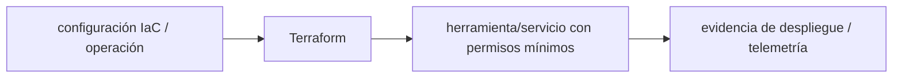

# Terraform — Vigilio línea por lockfile/providers

## Qué es, qué hace y cuándo usarla

Infraestructura como código declarativa. Plan y apply se ejecutan con estado remoto protegido, roles mínimos y revisión de cambios destructivos.

**Ubicación en Vigilio:** usa esta dependencia en su stack propietario; otras skills deben enlazar esta guía, no duplicar sus reglas. **Versión:** la indicada en el encabezado es la línea documentada; consultar `technology/versions.md` y el lockfile antes de copiar APIs o aprobar un upgrade.

> **Guía propia de Terraform (platform).** Estado a **2026-10-25**: línea por lockfile/providers. Versión del proyecto consumidor = `pnpm-lock.yaml` / `composer.lock` / imagen o manifest. Fuente: [documentación oficial](https://developer.hashicorp.com/terraform/docs). Fuente normativa transversal de versiones: [versions.md](../versions.md). **No implica instalación automática ni upgrade aprobado.**

## Objetivo, responsabilidad y dónde usar

Módulos por responsabilidad, state remoto, secretos/roles, tags/FinOps; no meter HCL en NestJS.

**Uso:** aplicar solo si está declarada y resulta pertinente al consumidor; ver [política de adopción y DRY](README.md).

### Diagrama de integración (Mermaid)



El flujo muestra la **responsabilidad arquitectónica** de la librería; no representa llamadas reales de red para todas las operaciones.


## Instalación o verificación

```bash
terraform init -lockfile=readonly
```

**Gate de instalación:** consultar [procedimiento compartido](README.md#protocolo-de-adopción-y-actualización); estos comandos son indicativos, no ejecuciones sobre un consumidor.

## ✅ Correcto — uso actual y ejemplo de referencia

```typescript
terraform fmt -check
terraform validate
terraform plan -out=tfplan
# apply tfplan sólo tras aprobación en CI
```

**Por qué:** Módulos por responsabilidad, state remoto, secretos/roles, tags/FinOps; no meter HCL en NestJS.

## ❌ Incorrecto — patrón legacy, inseguro o mal ubicado

```typescript
terraform apply -auto-approve
# ❌ en producción sin revisión ni separación de credenciales
```

**Riesgo:** confundir versiones o responsabilidades y obtener un contrato incorrecto.

## Nuevas capacidades, migración y breaking changes

Providers son versionados aparte: fijar `required_providers`, lockfile `.terraform.lock.hcl`; upgrades por plan y state compatibility.

Aplicar el [protocolo de migración común](README.md#protocolo-de-adopción-y-actualización), sin asumir que una release nueva está desplegada.

## Buenas prácticas, seguridad, rendimiento y operación

Consultar la [política transversal de librerías](README.md) para seguridad, versionado, evidencia y revisión de contratos. Para esta librería, además, aplicar las verificaciones concretas que se detallan a continuación.

## Gates de aceptación y compatibilidad

tfsec/checkov, drift, cost diff, policy gates y plan reproducible.

Estado de prueba de estos ejemplos documentales: **NOT_RUN** en aplicaciones consumidoras; ver [criterios de evidencia](README.md#criterios-de-validación).


## Referencias

- [Documentación oficial y migración de Terraform](https://developer.hashicorp.com/terraform/docs)
- [Matriz y baseline de versiones](../versions.md)
- [Calidad de código canónica](../../foundations/engineering/code-quality.md)


## Recetario operativo ampliado — terraform (2026-10-25)

### API actual: dos tareas reales que debe saber ejecutar una skill

1. **Proveedores con `required_providers`, lockfile y cambios por módulos.**
2. **Plan obligatorio con políticas y approvals; state remoto cifrado/locked.**

### Migración desde versiones anteriores: decisión concreta

- **Qué cambia o se debe revisar:** Terraform 1.x provider upgrades cambian recursos; no ejecutar apply sin plan/review.

### Responsabilidades y capas

IaC plataforma; no escribir lógicas Nest/Laravel dentro tf.

**✅ Correcto:** mantener la integración encapsulada, alinear los nombres del negocio con Vigilio y depender de un contrato estable.

**❌ Incorrecto:** importar internals de la librería desde Domain, declarar `any` para resolver un upgrade, o duplicar reglas ya propietarias de otra tecnología.

### Seguridad, resiliencia y rendimiento

- Secrets en state y drift; IAM least privilege.

### Test de aceptación específico y evidencia mínima

- **Escenario comprobable:** fmt -check, validate, tflint/tfsec si aprobados, plan y drift monitor.


## Guía operativa detallada — 8 casos y 4 antipatrones

### Ocho ejemplos de la API y casos de uso relevantes

Los fragmentos siguientes ilustran **operaciones independientes**. Variables, imports, provider, extensión y configuración se completan en el proyecto consumidor; **no están certificados como un archivo único compilable**. Cuando hay comentarios `#`, son pasos de integración o configuración y no APIs inventadas.

#### Ejemplo 1. Inicializar

**✅ Correcto — inicializar**

```bash
terraform init -lockfile=readonly
```


#### Ejemplo 2. Formato

**✅ Correcto — formato**

```bash
terraform fmt -check -recursive
```


#### Ejemplo 3. Validar

**✅ Correcto — validar**

```bash
terraform validate
```


#### Ejemplo 4. Plan

**✅ Correcto — plan**

```bash
terraform plan -out=release.tfplan
```


#### Ejemplo 5. Revisar plan

**✅ Correcto — revisar plan**

```bash
terraform show release.tfplan
```


#### Ejemplo 6. Aplicar plan aprobado

**✅ Correcto — aplicar plan aprobado**

```bash
terraform apply release.tfplan
```


#### Ejemplo 7. Auditar drift

**✅ Correcto — auditar drift**

```bash
terraform plan -detailed-exitcode
```


#### Ejemplo 8. Importar recurso existente

**✅ Correcto — importar recurso existente**

```bash
terraform import aws_s3_bucket.assets <bucket-id>
```


### Cuatro antipatrones frecuentes y su sustitución

#### Antipatrón 1 — riesgo y alternativa

**❌ Incorrecto**

```bash
terraform apply -auto-approve # sin plan gate
```

**Por qué está mal:** Omite un control operativo necesario, por lo que el comportamiento puede ser inseguro o difícil de verificar.

**✅ Correcto**

```bash
terraform plan -out=release.tfplan && terraform apply release.tfplan
```

**Por qué mejora:** El patrón «terraform plan -out=release.tfplan && terraform apply release.tfplan» mejora el caso: el contrato queda tipado y validado en el borde que recibe datos externos.

#### Antipatrón 2 — riesgo y alternativa

**❌ Incorrecto — Variables secrets en .tf.**

**Por qué está mal:** Expone credenciales o confunde autenticación con autorización; puede ocasionar filtración o acceso indebido.

**✅ Correcto — Vault/provider IAM secrets runtime.**

**Por qué mejora:** Separa permisos y secretos del código de negocio y permite comprobar el acceso mínimo.

#### Antipatrón 3 — riesgo y alternativa

**❌ Incorrecto — Provider versions sin restricciones.**

**Por qué está mal:** Omite un control operativo necesario, por lo que el comportamiento puede ser inseguro o difícil de verificar.

**✅ Correcto — Required_providers + .terraform.lock.hcl.**

**Por qué mejora:** El patrón «Required_providers + .terraform.lock.hcl» mejora el caso: se utiliza la API apropiada para el major documentado y se comprueba el lockfile.

#### Antipatrón 4 — riesgo y alternativa

**❌ Incorrecto — Eliminar recurso con state rm improvisado.**

**Por qué está mal:** El patrón «Eliminar recurso con state rm improvisado» es riesgoso: puede exponer datos obsoletos o mezclar estados de usuarios, sesiones y consultas diferentes.

**✅ Correcto — Plan y backup de state con revisión.**

**Por qué mejora:** El patrón «Plan y backup de state con revisión» mejora el caso: el estado se identifica e invalida con criterios explícitos y verificables.

### Versión estable, breaking changes y verificación

- **Versión estable exacta:** no se declara un parche universal cuando no hay verificación específica de su registry/release. Consultar el encabezado de esta guía, `technology/versions.md` y el manifiesto del servicio. **Estado de patch: VERIFY_LOCKFILE**.
- **Migración:** identificar major anterior, APIs retiradas/cambiadas, peer dependencies, requisitos de runtime, cambios de tipos, ejecución CI y plan de rollback. Si no hay prueba sobre el consumidor, **NOT_RUN**, no PASS.
- **Versiones previas:** el ejemplo marcado ❌ en esta guía explica al menos una incompatibilidad o un uso obsoleto; no trasplantar APIs de otras versiones.
- **Tests:** probar al menos happy path, error, seguridad/permiso y compatibilidad con el runtime donde aplique; solo activar nuevas capacidades mediante una PR versionada.

### Fuentes oficiales y referencias al final

- [Referencia propia oficial](https://developer.hashicorp.com/terraform/docs)
- [Matriz canónica de versiones](../versions.md)
- [Política de adopción de librerías](README.md)

## Guía de compatibilidad y evaluación por versión (2026-10-25)

**Estado del patch exacto:** `VERIFY_LOCKFILE`. La guía documenta la familia de APIs; **no se ha verificado hoy el patch estable preciso de esta dependencia**. Consultar la fuente oficial enlazada al inicio y el lockfile antes de generar código o aprobar un upgrade.

### Checklist específico de esta librería

- **Migración/compatibilidad:** Terraform 1.x provider upgrades cambian recursos; no ejecutar apply sin plan/review.
- **Prueba propia:** fmt -check, validate, tflint/tfsec si aprobados, plan y drift monitor.
- **Límite de responsabilidad:** usar esta librería solo en su adaptador o capa propietaria; consultar los ejemplos de API y antipatrones anteriores antes de cambiar llamadas públicas.

**Gate de aprobación:** leer la referencia oficial y resolver la versión del consumidor, ejecutar typecheck y pruebas específicas, registrar PASS/FAIL/NOT_RUN/BLOCKED. No confundir esta guía con validación de un consumidor real. [Procedimiento único de adopción](README.md#protocolo-de-adopción-y-actualización).

