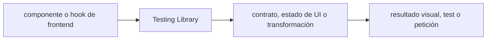

# Testing Library — guía version-aware Vigilio

## Qué es, qué hace y cuándo usarla

Herramientas de tests de componentes desde el comportamiento observable del usuario y roles accesibles. Evita tests acoplados a internals.

**Ubicación en Vigilio:** usa esta dependencia en su stack propietario; otras skills deben enlazar esta guía, no duplicar sus reglas. **Versión:** la indicada en el encabezado es la línea documentada; consultar `technology/versions.md` y el lockfile antes de copiar APIs o aprobar un upgrade.

**Stack propietario:** Pruebas TypeScript. **Versión objetivo:** @testing-library/react o preact; versión según runtime; versión instalada siempre desde lockfile/manifest. [Documentación oficial](https://testing-library.com/docs/). [Matriz de versiones](../versions.md).

## Responsabilidad y arquitectura

Tests a través de roles/nombres y accesibilidad; MSW maneja red.

No duplicar las reglas generales de SOLID, DDD y manejo de dependencias: [política de librerías](README.md). Al crear código, leer el API de la versión instalada, no solo un ejemplo de blog.

### Diagrama de integración (Mermaid)



El flujo muestra la **responsabilidad arquitectónica** de la librería; no representa llamadas reales de red para todas las operaciones.


## ✅ Correcto — ejemplo actual

```typescript
import { render, screen } from '@testing-library/react';
render(<ProductList />);
expect(screen.getByRole('heading',{name:'Productos'})).toBeVisible();
```

## ❌ Incorrecto — legado o mal uso

```typescript
// ❌ test frágil de implementación
expect(wrapper.state().products).toHaveLength(3);
```

## Migración, nuevas APIs y compatibilidad

Seleccionar adapter React vs Preact y user-event compatible; jsdom/happy-dom, act y async rendering deben cuadrar.

## Calidad, seguridad, performance y verificaciones

Test loading/empty/error/success, teclado, debounce y accesibilidad.

La adopción exige manifest/lockfile, pruebas runtime, seguridad, CI y rollback. Resultado real en consumidores de esta guía: **NOT_RUN**. No instalar nuevas dependencias solamente por estar catalogadas.

## Fuentes

- [Página oficial y referencias](https://testing-library.com/docs/)
- [Protocolo de adopción](README.md#protocolo-de-adopción-y-actualización)
- [Calidad transversal](../../foundations/engineering/code-quality.md)


## Recetario operativo ampliado — testing-library (2026-10-25)

### API actual: dos tareas reales que debe saber ejecutar una skill

1. **`screen.getByRole` y user-event para comportamientos visibles del usuario.**
2. **Evitar queries internas de implementación, manejar async `findBy`/waitFor.**

### Migración desde versiones anteriores: decisión concreta

- **Qué cambia o se debe revisar:** Versiones de testing library y framework require adapter consistente.

### Responsabilidades y capas

Test UI, no test de DB ni contrato backend.

**✅ Correcto:** mantener la integración encapsulada, alinear los nombres del negocio con Vigilio y depender de un contrato estable.

**❌ Incorrecto:** importar internals de la librería desde Domain, declarar `any` para resolver un upgrade, o duplicar reglas ya propietarias de otra tecnología.

### Seguridad, resiliencia y rendimiento

- Tests falsos por mocking excesivo y timers sin limpiar.

### Test de aceptación específico y evidencia mínima

- **Escenario comprobable:** Form submit/keyboard/focus/a11y, invalid states y navigation.


## Guía operativa detallada — 8 casos y 4 antipatrones

### Ocho ejemplos de la API y casos de uso relevantes

Los fragmentos siguientes ilustran **operaciones independientes**. Variables, imports, provider, extensión y configuración se completan en el proyecto consumidor; **no están certificados como un archivo único compilable**. Cuando hay comentarios `#`, son pasos de integración o configuración y no APIs inventadas.

#### Ejemplo 1. Render

**✅ Correcto — render**

```tsx
render(<ProductList />);
```


#### Ejemplo 2. Role

**✅ Correcto — role**

```tsx
screen.getByRole('heading', { name: /productos/i });
```


#### Ejemplo 3. Asíncrono

**✅ Correcto — asíncrono**

```tsx
await screen.findByRole('status');
```


#### Ejemplo 4. Click

**✅ Correcto — click**

```tsx
await userEvent.setup().click(screen.getByRole('button', { name: /registrar/i }));
```


#### Ejemplo 5. Teclado

**✅ Correcto — teclado**

```tsx
await userEvent.setup().keyboard('{Escape}');
```


#### Ejemplo 6. Error

**✅ Correcto — error**

```tsx
expect(screen.getByRole('alert')).toHaveTextContent(/error/i);
```


#### Ejemplo 7. Query vacía

**✅ Correcto — query vacía**

```tsx
expect(screen.queryByText(/sin resultados/i)).toBeNull();
```


#### Ejemplo 8. Mock HTTP

**✅ Correcto — mock http**

**Nota técnica (no es código ejecutable):** MSW intercepta fetch; no mockear internals de TanStack Query.


### Cuatro antipatrones frecuentes y su sustitución

#### Antipatrón 1 — riesgo y alternativa

**❌ Incorrecto**

```tsx
container.querySelector(".btn-primary")
```

**Por qué está mal:** El patrón «container.querySelector(".btn-primary")» es riesgoso: la consulta puede producir resultados incorrectos, lentitud o aislamiento insuficiente de datos.

**✅ Correcto**

```tsx
screen.getByRole("button", {name:"Registrar"})
```

**Por qué mejora:** El patrón «screen.getByRole("button", {name:"Registrar"})» mejora el caso: la consulta o el contrato se valida y mide sobre datos representativos.

#### Antipatrón 2 — riesgo y alternativa

**❌ Incorrecto — Mocks de internals del hook.**

**Por qué está mal:** El patrón «Mocks de internals del hook» es riesgoso: mezcla responsabilidades de interfaz y navegación o genera comportamiento inconsistente.

**✅ Correcto — Simular HTTP con MSW.**

**Por qué mejora:** El patrón «Simular HTTP con MSW» mejora el caso: la interfaz utiliza la API adecuada y separa presentación, estado y comunicación.

#### Antipatrón 3 — riesgo y alternativa

**❌ Incorrecto — GetByText para inputs sin label.**

**Por qué está mal:** Omite un control operativo necesario, por lo que el comportamiento puede ser inseguro o difícil de verificar.

**✅ Correcto**

```tsx
screen.getByLabelText("Nro póliza")
```

**Por qué mejora:** El patrón «screen.getByLabelText("Nro póliza")» mejora el caso: la observabilidad conserva contexto útil sin usar identificadores sensibles como etiquetas masivas.

#### Antipatrón 4 — riesgo y alternativa

**❌ Incorrecto — Test async con waitForTimeout.**

**Por qué está mal:** El patrón «Test async con waitForTimeout» es riesgoso: la implementación puede fallar sin que el flujo crítico o la accesibilidad lo detecte.

**✅ Correcto**

```tsx
await screen.findByRole("status")
```

**Por qué mejora:** El patrón «await screen.findByRole("status")» mejora el caso: el comportamiento se verifica con pruebas y criterios observables.

### Versión estable, breaking changes y verificación

- **Versión estable exacta:** no se declara un parche universal cuando no hay verificación específica de su registry/release. Consultar el encabezado de esta guía, `technology/versions.md` y el manifiesto del servicio. **Estado de patch: VERIFY_LOCKFILE**.
- **Migración:** identificar major anterior, APIs retiradas/cambiadas, peer dependencies, requisitos de runtime, cambios de tipos, ejecución CI y plan de rollback. Si no hay prueba sobre el consumidor, **NOT_RUN**, no PASS.
- **Versiones previas:** el ejemplo marcado ❌ en esta guía explica al menos una incompatibilidad o un uso obsoleto; no trasplantar APIs de otras versiones.
- **Tests:** probar al menos happy path, error, seguridad/permiso y compatibilidad con el runtime donde aplique; solo activar nuevas capacidades mediante una PR versionada.

### Fuentes oficiales y referencias al final

- [Referencia propia oficial](https://testing-library.com/docs/)
- [Matriz canónica de versiones](../versions.md)
- [Política de adopción de librerías](README.md)

## Guía de compatibilidad y evaluación por versión (2026-10-25)

**Estado del patch exacto:** `VERIFY_LOCKFILE`. La guía documenta la familia de APIs; **no se ha verificado hoy el patch estable preciso de esta dependencia**. Consultar la fuente oficial enlazada al inicio y el lockfile antes de generar código o aprobar un upgrade.

### Checklist específico de esta librería

- **Migración/compatibilidad:** Versiones de testing library y framework require adapter consistente.
- **Prueba propia:** Form submit/keyboard/focus/a11y, invalid states y navigation.
- **Límite de responsabilidad:** usar esta librería solo en su adaptador o capa propietaria; consultar los ejemplos de API y antipatrones anteriores antes de cambiar llamadas públicas.

**Gate de aprobación:** leer la referencia oficial y resolver la versión del consumidor, ejecutar typecheck y pruebas específicas, registrar PASS/FAIL/NOT_RUN/BLOCKED. No confundir esta guía con validación de un consumidor real. [Procedimiento único de adopción](README.md#protocolo-de-adopción-y-actualización).

