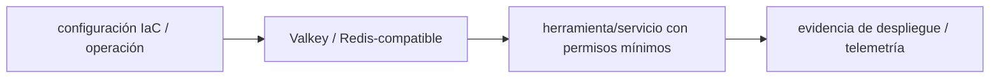

# Valkey / Redis-compatible — Vigilio línea runtime según manifiesto, protocolo y cliente

## Qué es, qué hace y cuándo usarla

Almacén key-value in-memory compatible con protocolos Redis. Sirve para caché/colas; requiere TTL, aislamiento tenant y límites de memoria.

**Ubicación en Vigilio:** usa esta dependencia en su stack propietario; otras skills deben enlazar esta guía, no duplicar sus reglas. **Versión:** la indicada en el encabezado es la línea documentada; consultar `technology/versions.md` y el lockfile antes de copiar APIs o aprobar un upgrade.

> **Guía propia de Valkey / Redis-compatible (data).** Estado a **2026-10-25**: línea runtime según manifiesto, protocolo y cliente. Versión del proyecto consumidor = `pnpm-lock.yaml` / `composer.lock` / imagen o manifest. Fuente: [documentación oficial](https://valkey.io/docs/). Fuente normativa transversal de versiones: [versions.md](../versions.md). **No implica instalación automática ni upgrade aprobado.**

## Objetivo, responsabilidad y dónde usar

Cache-aside, lock acotado, evitar stampede, secrets, PII y tenant leakage.

**Uso:** aplicar solo si está declarada y resulta pertinente al consumidor; ver [política de adopción y DRY](README.md).

### Diagrama de integración (Mermaid)



El flujo muestra la **responsabilidad arquitectónica** de la librería; no representa llamadas reales de red para todas las operaciones.


## Instalación o verificación

```bash
elegir driver según NestJS/Laravel; validar compat
```

**Gate de instalación:** consultar [procedimiento compartido](README.md#protocolo-de-adopción-y-actualización); estos comandos son indicativos, no ejecuciones sobre un consumidor.

## ✅ Correcto — uso actual y ejemplo de referencia

```typescript
// Regla: clave tenant scoped, TTL explícito, invalidación al escribir
const cache_key = `products:list:${tenant_id}:${hash_filters}`;
```

**Por qué:** Cache-aside, lock acotado, evitar stampede, secrets, PII y tenant leakage.

## ❌ Incorrecto — patrón legacy, inseguro o mal ubicado

```typescript
// ❌ clave global cross-tenant o TTL infinito sin invalidación
const cache_key = 'products:index';
```

**Riesgo:** confundir versiones o responsabilidades y obtener un contrato incorrecto.

## Nuevas capacidades, migración y breaking changes

Migraciones Redis→Valkey requieren comprobar comandos, cliente, persistencia y failover; Redis/Valkey no son plenamente intercambiables en todas las versiones.

Aplicar el [protocolo de migración común](README.md#protocolo-de-adopción-y-actualización), sin asumir que una release nueva está desplegada.

## Buenas prácticas, seguridad, rendimiento y operación

Consultar la [política transversal de librerías](README.md) para seguridad, versionado, evidencia y revisión de contratos. Para esta librería, además, aplicar las verificaciones concretas que se detallan a continuación.

## Gates de aceptación y compatibilidad

Eviction, latency, failure mode, TTL drift, auth y backups si es source of truth temporal.

Estado de prueba de estos ejemplos documentales: **NOT_RUN** en aplicaciones consumidoras; ver [criterios de evidencia](README.md#criterios-de-validación).


## Referencias

- [Documentación oficial y migración de Valkey / Redis-compatible](https://valkey.io/docs/)
- [Matriz y baseline de versiones](../versions.md)
- [Calidad de código canónica](../../foundations/engineering/code-quality.md)


## Recetario operativo ampliado — valkey (2026-10-25)

### API actual: dos tareas reales que debe saber ejecutar una skill

1. **Cache keys versionadas/tenant scope, TTL con jitter y locks con fencing si aplica.**
2. **Pipelines y batches para evitar roundtrips; invalidación explícita por evento.**

### Migración desde versiones anteriores: decisión concreta

- **Qué cambia o se debe revisar:** Valkey/Redis cliente compatibles según comandos, no asumir módulos Redis Enterprise.

### Responsabilidades y capas

Cache/queue runtime: distinta de PostgreSQL fuente de verdad.

**✅ Correcto:** mantener la integración encapsulada, alinear los nombres del negocio con Vigilio y depender de un contrato estable.

**❌ Incorrecto:** importar internals de la librería desde Domain, declarar `any` para resolver un upgrade, o duplicar reglas ya propietarias de otra tecnología.

### Seguridad, resiliencia y rendimiento

- Nunca almacenar tokens/PII en claro, eviction y flood protection.

### Test de aceptación específico y evidencia mínima

- **Escenario comprobable:** Test miss/hit/expiration, failover, stampede, eviction y queue retry.


## Guía operativa detallada — 8 casos y 4 antipatrones

### Ocho ejemplos de la API y casos de uso relevantes

Los fragmentos siguientes ilustran **operaciones independientes**. Variables, imports, provider, extensión y configuración se completan en el proyecto consumidor; **no están certificados como un archivo único compilable**. Cuando hay comentarios `#`, son pasos de integración o configuración y no APIs inventadas.

#### Ejemplo 1. Ping

**✅ Correcto — ping**

```bash
valkey-cli PING
```


#### Ejemplo 2. Set TTL

**✅ Correcto — set ttl**

```bash
SET products:tenant:123:page:1 '{"count":0}' EX 60
```


#### Ejemplo 3. Get

**✅ Correcto — get**

```bash
GET products:tenant:123:page:1
```


#### Ejemplo 4. Borrar

**✅ Correcto — borrar**

```bash
DEL products:tenant:123:page:1
```


#### Ejemplo 5. SET NX

**✅ Correcto — set nx**

```bash
SET job:uuid:lock '1' NX EX 30
```


#### Ejemplo 6. Increment

**✅ Correcto — increment**

```bash
INCR counter:requests
```


#### Ejemplo 7. Pipeline

**✅ Correcto — pipeline**

**Nota técnica (no es código ejecutable):** Pipeline comandos batch del cliente oficial/compatible.


#### Ejemplo 8. Memoria

**✅ Correcto — memoria**

```bash
INFO memory
```


### Cuatro antipatrones frecuentes y su sustitución

#### Antipatrón 1 — riesgo y alternativa

**❌ Incorrecto**

```bash
SET session:token abc123 # secreto en plain
```

**Por qué está mal:** Expone credenciales o confunde autenticación con autorización; puede ocasionar filtración o acceso indebido.

**✅ Correcto — Almacenar identificador opaco y TTL mínimo.**

**Por qué mejora:** El patrón «Almacenar identificador opaco y TTL mínimo» mejora el caso: las credenciales quedan fuera del código o bajo un mecanismo de acceso controlado.

#### Antipatrón 2 — riesgo y alternativa

**❌ Incorrecto — Usar KEYS products:* en producción.**

**Por qué está mal:** El patrón «Usar KEYS products:* en producción» es riesgoso: la consulta puede producir resultados incorrectos, lentitud o aislamiento insuficiente de datos.

**✅ Correcto**

```bash
SCAN 0 MATCH products:* COUNT 100
```

**Por qué mejora:** El patrón «SCAN 0 MATCH products:* COUNT 100» mejora el caso: la consulta o el contrato se valida y mide sobre datos representativos.

#### Antipatrón 3 — riesgo y alternativa

**❌ Incorrecto — Caché sin tenant.**

**Por qué está mal:** Omite un control operativo necesario, por lo que el comportamiento puede ser inseguro o difícil de verificar.

**✅ Correcto**

```bash
SET products:tenant:123:list ... EX 60
```

**Por qué mejora:** El patrón «SET products:tenant:123:list ... EX 60» mejora el caso: se fuerza autorización en el borde/servidor y se limita el acceso por recurso.

#### Antipatrón 4 — riesgo y alternativa

**❌ Incorrecto — Olvidar TTL/evicción.**

**Por qué está mal:** Omite un control operativo necesario, por lo que el comportamiento puede ser inseguro o difícil de verificar.

**✅ Correcto**

```bash
SET cache:key value EX 60
```

**Por qué mejora:** El patrón «SET cache:key value EX 60» mejora el caso: el estado se identifica e invalida con criterios explícitos y verificables.

### Versión estable, breaking changes y verificación

- **Versión estable exacta:** no se declara un parche universal cuando no hay verificación específica de su registry/release. Consultar el encabezado de esta guía, `technology/versions.md` y el manifiesto del servicio. **Estado de patch: VERIFY_LOCKFILE**.
- **Migración:** identificar major anterior, APIs retiradas/cambiadas, peer dependencies, requisitos de runtime, cambios de tipos, ejecución CI y plan de rollback. Si no hay prueba sobre el consumidor, **NOT_RUN**, no PASS.
- **Versiones previas:** el ejemplo marcado ❌ en esta guía explica al menos una incompatibilidad o un uso obsoleto; no trasplantar APIs de otras versiones.
- **Tests:** probar al menos happy path, error, seguridad/permiso y compatibilidad con el runtime donde aplique; solo activar nuevas capacidades mediante una PR versionada.

### Fuentes oficiales y referencias al final

- [Referencia propia oficial](https://valkey.io/docs/)
- [Matriz canónica de versiones](../versions.md)
- [Política de adopción de librerías](README.md)

## Guía de compatibilidad y evaluación por versión (2026-10-25)

**Estado del patch exacto:** `VERIFY_LOCKFILE`. La guía documenta la familia de APIs; **no se ha verificado hoy el patch estable preciso de esta dependencia**. Consultar la fuente oficial enlazada al inicio y el lockfile antes de generar código o aprobar un upgrade.

### Checklist específico de esta librería

- **Migración/compatibilidad:** Valkey/Redis cliente compatibles según comandos, no asumir módulos Redis Enterprise.
- **Prueba propia:** Test miss/hit/expiration, failover, stampede, eviction y queue retry.
- **Límite de responsabilidad:** usar esta librería solo en su adaptador o capa propietaria; consultar los ejemplos de API y antipatrones anteriores antes de cambiar llamadas públicas.

**Gate de aprobación:** leer la referencia oficial y resolver la versión del consumidor, ejecutar typecheck y pruebas específicas, registrar PASS/FAIL/NOT_RUN/BLOCKED. No confundir esta guía con validación de un consumidor real. [Procedimiento único de adopción](README.md#protocolo-de-adopción-y-actualización).

