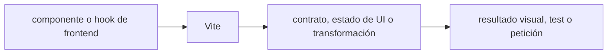

# Vite — Vigilio 8.3.5 estable verificado

## Qué es, qué hace y cuándo usarla

Bundler y dev server para apps frontend. Configura transforms, plugins y builds; no reemplaza framework ni testing.

**Ubicación en Vigilio:** usa esta dependencia en su stack propietario; otras skills deben enlazar esta guía, no duplicar sus reglas. **Versión:** la indicada en el encabezado es la línea documentada; consultar `technology/versions.md` y el lockfile antes de copiar APIs o aprobar un upgrade.

> **Guía propia de Vite (frontend).** Estado a **2026-10-25**: 8.3.5 estable verificado. Versión del proyecto consumidor = `pnpm-lock.yaml` / `composer.lock` / imagen o manifest. Fuente: [documentación oficial](https://vite.dev/guide/). Fuente normativa transversal de versiones: [versions.md](../versions.md). **No implica instalación automática ni upgrade aprobado.**

## Objetivo, responsabilidad y dónde usar

Aislar configuración runtime pública de secretos backend. Los entornos se validan, y variables `VITE_` son públicas. Diferenciar build-time de runtime config en MFE.

**Uso:** aplicar solo si está declarada y resulta pertinente al consumidor; ver [política de adopción y DRY](README.md).

### Diagrama de integración (Mermaid)



El flujo muestra la **responsabilidad arquitectónica** de la librería; no representa llamadas reales de red para todas las operaciones.


## Instalación o verificación

```bash
pnpm add -D vite
```

**Gate de instalación:** consultar [procedimiento compartido](README.md#protocolo-de-adopción-y-actualización); estos comandos son indicativos, no ejecuciones sobre un consumidor.

## ✅ Correcto — uso actual y ejemplo de referencia

```typescript
import { defineConfig } from 'vite';
export default defineConfig({
  plugins: [],
  server: { port: 5173 },
  build: { sourcemap: 'hidden' },
});
// solo variables públicas: import.meta.env.VITE_PUBLIC_API_URL
```

**Por qué:** Aislar configuración runtime pública de secretos backend. Los entornos se validan, y variables `VITE_` son públicas. Diferenciar build-time de runtime config en MFE.

## ❌ Incorrecto — patrón legacy, inseguro o mal ubicado

```typescript
const secret = import.meta.env.VITE_DATABASE_PASSWORD;
// ❌ cualquier VITE_ se expone al navegador
```

**Riesgo:** confundir versiones o responsabilidades y obtener un contrato incorrecto.

## Nuevas capacidades, migración y breaking changes

v7→v8: revisar toolchain Node, plugins (Preact/React/Tailwind), SSR/build y cambios de bundler mediante guía de migración; no trasladar ciegamente configuración Rollup incompatible.

Aplicar el [protocolo de migración común](README.md#protocolo-de-adopción-y-actualización), sin asumir que una release nueva está desplegada.

## Buenas prácticas, seguridad, rendimiento y operación

Consultar la [política transversal de librerías](README.md) para seguridad, versionado, evidencia y revisión de contratos. Para esta librería, además, aplicar las verificaciones concretas que se detallan a continuación.

## Gates de aceptación y compatibilidad

Build reproducible; tamaño de chunks; dynamic imports; CSP; SSR; tests de integración de plugins, HMR y sourcemaps sin secretos.

Estado de prueba de estos ejemplos documentales: **NOT_RUN** en aplicaciones consumidoras; ver [criterios de evidencia](README.md#criterios-de-validación).


## Referencias

- [Documentación oficial y migración de Vite](https://vite.dev/guide/)
- [Matriz y baseline de versiones](../versions.md)
- [Calidad de código canónica](../../foundations/engineering/code-quality.md)


## Recetario operativo ampliado — vite (2026-10-25)

### API actual: dos tareas reales que debe saber ejecutar una skill

1. **Vite 8 config ESM, aliases resueltos y env vars públicos `VITE_*` nunca secrets.**
2. **`build` con lazy chunks, CSS assets y manifest en CDN cuando sea necesario.**

### Migración desde versiones anteriores: decisión concreta

- **Qué cambia o se debe revisar:** Vite 7→8 verificar runtime Node/plugin React/Preact/Vitest antes de upgrade.

### Responsabilidades y capas

Bundler web, no server Domain.

**✅ Correcto:** mantener la integración encapsulada, alinear los nombres del negocio con Vigilio y depender de un contrato estable.

**❌ Incorrecto:** importar internals de la librería desde Domain, declarar `any` para resolver un upgrade, o duplicar reglas ya propietarias de otra tecnología.

### Seguridad, resiliencia y rendimiento

- `import.meta.env` client se inyecta en bundle público.

### Test de aceptación específico y evidencia mínima

- **Escenario comprobable:** Build prod, chunk diff, env leakage scan, HMR y SSR smoke.

### Ejemplo de integración vigente (fragmento adicional)

```typescript
import { defineConfig } from 'vite';
export default defineConfig({
  build: { sourcemap: false, manifest: true },
  server: { strictPort: true },
});
// VITE_* se expone en el bundle: jamás secretos.
```

**Nota:** los fragmentos muestran la API específica y requieren imports/providers/fixtures del consumidor; no se certifica compilación por el solo hecho de aparecer aquí.


## Guía operativa detallada — 8 casos y 4 antipatrones

### Ocho ejemplos de la API y casos de uso relevantes

Los fragmentos siguientes ilustran **operaciones independientes**. Variables, imports, provider, extensión y configuración se completan en el proyecto consumidor; **no están certificados como un archivo único compilable**. Cuando hay comentarios `#`, son pasos de integración o configuración y no APIs inventadas.

#### Ejemplo 1. Config

**✅ Correcto — config**

```typescript
export default defineConfig({ plugins: [react()] });
```


#### Ejemplo 2. Arranque

**✅ Correcto — arranque**

```typescript
pnpm vite
```


#### Ejemplo 3. Build

**✅ Correcto — build**

```typescript
pnpm vite build
```


#### Ejemplo 4. Preview

**✅ Correcto — preview**

```typescript
pnpm vite preview
```


#### Ejemplo 5. Alias

**✅ Correcto — alias**

```typescript
resolve: { alias: { '@': fileURLToPath(new URL('./src', import.meta.url)) } }
```


#### Ejemplo 6. Chunks

**✅ Correcto — chunks**

```typescript
build: { rollupOptions: { output: { manualChunks: { vendor: ['react'] } } } }
```


#### Ejemplo 7. Env pública

**✅ Correcto — env pública**

```typescript
import.meta.env.VITE_PUBLIC_API_URL
```


#### Ejemplo 8. Dev proxy

**✅ Correcto — dev proxy**

```typescript
server: { proxy: { '/api': 'http://localhost:3000' } }
```


### Cuatro antipatrones frecuentes y su sustitución

#### Antipatrón 1 — riesgo y alternativa

**❌ Incorrecto**

```typescript
process.env.API_URL // browser code
```

**Por qué está mal:** El patrón «process.env.API_URL // browser code» es riesgoso: puede permitir acceso a recursos no autorizados o de otro tenant.

**✅ Correcto**

```typescript
import.meta.env.VITE_PUBLIC_API_URL
```

**Por qué mejora:** El patrón «import.meta.env.VITE_PUBLIC_API_URL» mejora el caso: se fuerza autorización en el borde/servidor y se limita el acceso por recurso.

#### Antipatrón 2 — riesgo y alternativa

**❌ Incorrecto — Poner secretos en VITE_*.**

**Por qué está mal:** Expone credenciales o confunde autenticación con autorización; puede ocasionar filtración o acceso indebido.

**✅ Correcto — Mantener server-side; env VITE_* es público.**

**Por qué mejora:** El patrón «Mantener server-side; env VITE_* es público» mejora el caso: las credenciales quedan fuera del código o bajo un mecanismo de acceso controlado.

#### Antipatrón 3 — riesgo y alternativa

**❌ Incorrecto — Copiar plugin de Vite 6 sin compat gate.**

**Por qué está mal:** Omite un control operativo necesario, por lo que el comportamiento puede ser inseguro o difícil de verificar.

**✅ Correcto — Revisar major Vite 8 y peer deps.**

**Por qué mejora:** El patrón «Revisar major Vite 8 y peer deps» mejora el caso: se utiliza la API apropiada para el major documentado y se comprueba el lockfile.

#### Antipatrón 4 — riesgo y alternativa

**❌ Incorrecto — Publicar build sin preview.**

**Por qué está mal:** Omite un control operativo necesario, por lo que el comportamiento puede ser inseguro o difícil de verificar.

**✅ Correcto**

```typescript
pnpm vite build && pnpm vite preview
```

**Por qué mejora:** El patrón «pnpm vite build && pnpm vite preview» mejora el caso: se fuerza autorización en el borde/servidor y se limita el acceso por recurso.

### Versión estable, breaking changes y verificación

- **Versión estable exacta:** no se declara un parche universal cuando no hay verificación específica de su registry/release. Consultar el encabezado de esta guía, `technology/versions.md` y el manifiesto del servicio. **Estado de patch: VERIFY_LOCKFILE**.
- **Migración:** identificar major anterior, APIs retiradas/cambiadas, peer dependencies, requisitos de runtime, cambios de tipos, ejecución CI y plan de rollback. Si no hay prueba sobre el consumidor, **NOT_RUN**, no PASS.
- **Versiones previas:** el ejemplo marcado ❌ en esta guía explica al menos una incompatibilidad o un uso obsoleto; no trasplantar APIs de otras versiones.
- **Tests:** probar al menos happy path, error, seguridad/permiso y compatibilidad con el runtime donde aplique; solo activar nuevas capacidades mediante una PR versionada.

### Fuentes oficiales y referencias al final

- [Referencia propia oficial](https://vite.dev/guide/)
- [Matriz canónica de versiones](../versions.md)
- [Política de adopción de librerías](README.md)

## Guía de compatibilidad y evaluación por versión (2026-10-25)

**Release contrastada para esta familia:** `8.3.5`. Fuente: [publicación oficial](https://github.com/vitejs/vite/releases). **Cambio clave:** Vite 8.x; revisar requisitos de Node, ESM/plugins.

### Checklist específico de esta librería

- **Migración/compatibilidad:** Vite 7→8 verificar runtime Node/plugin React/Preact/Vitest antes de upgrade.
- **Prueba propia:** Build prod, chunk diff, env leakage scan, HMR y SSR smoke.
- **Límite de responsabilidad:** usar esta librería solo en su adaptador o capa propietaria; consultar los ejemplos de API y antipatrones anteriores antes de cambiar llamadas públicas.

**Gate de aprobación:** leer la referencia oficial y resolver la versión del consumidor, ejecutar typecheck y pruebas específicas, registrar PASS/FAIL/NOT_RUN/BLOCKED. No confundir esta guía con validación de un consumidor real. [Procedimiento único de adopción](README.md#protocolo-de-adopción-y-actualización).

