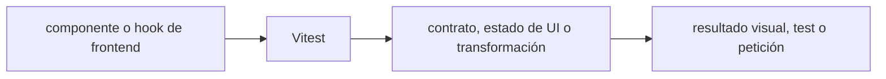

# Vitest — Vigilio 5.0.5 estable verificado

## Qué es, qué hace y cuándo usarla

Runner de tests moderno integrado con Vite, compatible con TypeScript y mocks. Usa entornos correctos y cobertura verificable.

**Ubicación en Vigilio:** usa esta dependencia en su stack propietario; otras skills deben enlazar esta guía, no duplicar sus reglas. **Versión:** la indicada en el encabezado es la línea documentada; consultar `technology/versions.md` y el lockfile antes de copiar APIs o aprobar un upgrade.

> **Guía propia de Vitest (testing).** Estado a **2026-10-25**: 5.0.5 estable verificado. Versión del proyecto consumidor = `pnpm-lock.yaml` / `composer.lock` / imagen o manifest. Fuente: [documentación oficial](https://vitest.dev/guide/migration/). Fuente normativa transversal de versiones: [versions.md](../versions.md). **No implica instalación automática ni upgrade aprobado.**

## Objetivo, responsabilidad y dónde usar

Tests dominio puros, integración con DB real donde corresponda; evitar unit mocks que prueban implementación en vez de comportamiento. Usar factories que no muten estado compartido.

**Uso:** aplicar solo si está declarada y resulta pertinente al consumidor; ver [política de adopción y DRY](README.md).

### Diagrama de integración (Mermaid)



El flujo muestra la **responsabilidad arquitectónica** de la librería; no representa llamadas reales de red para todas las operaciones.


## Instalación o verificación

```bash
pnpm add -D vitest@^5 vite
```

**Gate de instalación:** consultar [procedimiento compartido](README.md#protocolo-de-adopción-y-actualización); estos comandos son indicativos, no ejecuciones sobre un consumidor.

## ✅ Correcto — uso actual y ejemplo de referencia

```typescript
import { describe, expect, it, vi } from 'vitest';
describe('calculatePremium', () => {
  it('calcula una prima', () => { expect(calculatePremium(100)).toBe(118); });
});
// vi.mock() para fronteras; usar integración real para DB/HTTP.
```

**Por qué:** Tests dominio puros, integración con DB real donde corresponda; evitar unit mocks que prueban implementación en vez de comportamiento. Usar factories que no muten estado compartido.

## ❌ Incorrecto — patrón legacy, inseguro o mal ubicado

```typescript
// ❌ patrones antiguos de Vitest 4
import { bench } from 'vitest';
bench('calc',()=>calculatePremium(100));
// ❌ asumir clearMocks=false sin configurar
```

**Riesgo:** confundir versiones o responsabilidades y obtener un contrato incorrecto.

## Nuevas capacidades, migración y breaking changes

v4→v5: requiere Vite >=6.4 y Node >=22.12; `clearMocks` ahora true; benchmarks integrados en `test(...({ bench }))`; APIs `.sequential` retiradas; reportes movidos a `.vitest`; imports antiguos `vitest/coverage|reporters` removidos.

Aplicar el [protocolo de migración común](README.md#protocolo-de-adopción-y-actualización), sin asumir que una release nueva está desplegada.

## Buenas prácticas, seguridad, rendimiento y operación

Consultar la [política transversal de librerías](README.md) para seguridad, versionado, evidencia y revisión de contratos. Para esta librería, además, aplicar las verificaciones concretas que se detallan a continuación.

## Gates de aceptación y compatibilidad

Correr typecheck, test, coverage, mocks y snapshots; verificar cambios de reporters en CI y Browser Mode con versiones compatibles.

Estado de prueba de estos ejemplos documentales: **NOT_RUN** en aplicaciones consumidoras; ver [criterios de evidencia](README.md#criterios-de-validación).


## Tests de aplicación

```typescript
import { describe, it, expect, vi, beforeEach } from 'vitest';
describe('OrderEntity', () => {
  beforeEach(() => vi.clearAllMocks());
  it('rechaza cancelar pedido enviado', () => {
    const order = OrderEntity.from({estado:'shipped'});
    expect(() => order.cancel()).toThrow(OrderAlreadyShippedError);
  });
});
```

| v4 | v5 |
|---|---|
| reset/clear mocks configurables | `clearMocks=true` por defecto |
| `bench()` en suite | `test(..., async ({bench}) => ... )` |
| `vitest/reporters` | APIs en `vitest/node` |
| artefactos varios | `.vitest/` |

Ejemplo conceptual de dominio: usar el constructor real de `OrderEntity` del consumidor. No declarar que `from()` existe por la librería.

## Referencias

- [Documentación oficial y migración de Vitest](https://vitest.dev/guide/migration/)
- [Matriz y baseline de versiones](../versions.md)
- [Calidad de código canónica](../../foundations/engineering/code-quality.md)


## Recetario operativo ampliado — vitest (2026-10-25)

### API actual: dos tareas reales que debe saber ejecutar una skill

1. **`describe/it/expect/vi` y setupFiles aislados; tests sin estado compartido.**
2. **Coverage con V8, fake timers con cleanup y mocks explícitos.**

### Migración desde versiones anteriores: decisión concreta

- **Qué cambia o se debe revisar:** Vitest 4→5 requiere Vite>=6.4 y Node>=22.12; defaults mocks cambian.

### Responsabilidades y capas

Runner JS/TS, no PHPUnit/Pest.

**✅ Correcto:** mantener la integración encapsulada, alinear los nombres del negocio con Vigilio y depender de un contrato estable.

**❌ Incorrecto:** importar internals de la librería desde Domain, declarar `any` para resolver un upgrade, o duplicar reglas ya propietarias de otra tecnología.

### Seguridad, resiliencia y rendimiento

- Snapshots grandes frágiles; mock call state limpiado entre casos.

### Test de aceptación específico y evidencia mínima

- **Escenario comprobable:** Typecheck+unit+integration, coverage, isolate tests y parallel DB.

### Ejemplo de integración vigente (fragmento adicional)

```typescript
import { describe, it, expect, vi, afterEach } from 'vitest';
import { registerProduct } from './register-product';
afterEach(() => vi.restoreAllMocks());
describe('registerProduct', () => {
  it('rejects invalid input', async () => {
    await expect(registerProduct({ nro_poliza: '' })).rejects.toThrow();
  });
});
```

**Nota:** los fragmentos muestran la API específica y requieren imports/providers/fixtures del consumidor; no se certifica compilación por el solo hecho de aparecer aquí.

### Vitest v5: migración y compatibilidad verificadas

- Requiere Node.js >=22.12.0 y Vite >=6.4.0; `vitest` necesita peer Vite en ciertos gestores de paquetes.
- `clearMocks` ahora está activado por defecto: no confiar en conteos de llamadas entre pruebas.
- Audit snapshots, cobertura V8, suites concurrentes, mocks de módulos, TS decorators y ESM durante v4→v5.
- CI: ejecutar suite en Node version fijada y comparar coverage antes/después, no solo instalar el patch.
- Referencia: https://vitest.dev/guide/migration/


## Guía operativa detallada — 8 casos y 4 antipatrones

### Ocho ejemplos de la API y casos de uso relevantes

Los fragmentos siguientes ilustran **operaciones independientes**. Variables, imports, provider, extensión y configuración se completan en el proyecto consumidor; **no están certificados como un archivo único compilable**. Cuando hay comentarios `#`, son pasos de integración o configuración y no APIs inventadas.

#### Ejemplo 1. Test

**✅ Correcto — test**

```typescript
test('sum', () => expect(1 + 1).toBe(2));
```


#### Ejemplo 2. Mock función

**✅ Correcto — mock función**

```typescript
const repository = vi.fn(async () => []);
```


#### Ejemplo 3. Mock módulo

**✅ Correcto — mock módulo**

```typescript
vi.mock('./api', () => ({ listProductsApi: vi.fn() }));
```


#### Ejemplo 4. Spy

**✅ Correcto — spy**

```typescript
const spy = vi.spyOn(service, 'listProducts');
```


#### Ejemplo 5. Fake timers

**✅ Correcto — fake timers**

```typescript
vi.useFakeTimers();
```


#### Ejemplo 6. Lifecycle

**✅ Correcto — lifecycle**

```typescript
afterEach(() => vi.restoreAllMocks());
```


#### Ejemplo 7. Cobertura

**✅ Correcto — cobertura**

```typescript
pnpm vitest run --coverage
```


#### Ejemplo 8. Config

**✅ Correcto — config**

```typescript
defineConfig({ test: { environment: 'jsdom' } });
```


### Cuatro antipatrones frecuentes y su sustitución

#### Antipatrón 1 — riesgo y alternativa

**❌ Incorrecto**

```typescript
jest.fn()
```

**Por qué está mal:** El patrón «jest.fn()» es riesgoso: la elección «jest.fn()» puede incumplir los requisitos operativos de vitest.

**✅ Correcto**

```typescript
vi.fn()
```

**Por qué mejora:** El patrón «vi.fn()» mejora el caso: la alternativa «vi.fn()» establece el comportamiento esperado de vitest.

#### Antipatrón 2 — riesgo y alternativa

**❌ Incorrecto — Snapshots sin assertions de semántica.**

**Por qué está mal:** Omite un control operativo necesario, por lo que el comportamiento puede ser inseguro o difícil de verificar.

**✅ Correcto**

```typescript
expect(result).toEqual(expected)
```

**Por qué mejora:** El patrón «expect(result).toEqual(expected)» mejora el caso: se exige revisión de cambios, retención y un plan de reversión o recuperación.

#### Antipatrón 3 — riesgo y alternativa

**❌ Incorrecto — Tests con timers reales lentos.**

**Por qué está mal:** El patrón «Tests con timers reales lentos» es riesgoso: la implementación puede fallar sin que el flujo crítico o la accesibilidad lo detecte.

**✅ Correcto**

```typescript
vi.useFakeTimers()
```

**Por qué mejora:** El patrón «vi.useFakeTimers()» mejora el caso: el comportamiento se verifica con pruebas y criterios observables.

#### Antipatrón 4 — riesgo y alternativa

**❌ Incorrecto — Upgrade Vitest4→5 sin revisar mocks.**

**Por qué está mal:** Omite un control operativo necesario, por lo que el comportamiento puede ser inseguro o difícil de verificar.

**✅ Correcto — Migración y pruebas isolate en Node/Vite compatibles.**

**Por qué mejora:** El patrón «Migración y pruebas isolate en Node/Vite compatibles» mejora el caso: se exige revisión de cambios, retención y un plan de reversión o recuperación.

### Versión estable, breaking changes y verificación

- **Release estable contrastada en fuente pública (25-10-2026):** `5.0.5`. Esto **no** significa que el consumidor ya la tenga instalada.
- **Referencia de versiones/releases:** [Vitest releases](https://github.com/vitest-dev/vitest/releases).
- **API actual:** [documentación oficial específica](https://vitest.dev/guide/).
- **Migración:** identificar major anterior, APIs retiradas/cambiadas, peer dependencies, requisitos de runtime, cambios de tipos, ejecución CI y plan de rollback. Si no hay prueba sobre el consumidor, **NOT_RUN**, no PASS.
- **Versiones previas:** el ejemplo marcado ❌ en esta guía explica al menos una incompatibilidad o un uso obsoleto; no trasplantar APIs de otras versiones.
- **Tests:** probar al menos happy path, error, seguridad/permiso y compatibilidad con el runtime donde aplique; solo activar nuevas capacidades mediante una PR versionada.

### Fuentes oficiales y referencias al final

- [Referencia propia oficial](https://vitest.dev/guide/migration/)
- [Release o guía oficial](https://github.com/vitest-dev/vitest/releases)
- [Release o guía oficial](https://vitest.dev/guide/)
- [Matriz canónica de versiones](../versions.md)
- [Política de adopción de librerías](README.md)

## Guía de compatibilidad y evaluación por versión (2026-10-25)

**Release contrastada para esta familia:** `5.x`. Fuente: [publicación oficial](https://vitest.dev/guide/migration/). **Cambio clave:** Vitest 5 requiere Vite >=6.4 y Node >=22.12; clearMocks true; artifacts .vitest.

### Checklist específico de esta librería

- v5 requiere Vite >= 6.4.0 y Node >= 22.12.0; verificar package peer y CI.
- `clearMocks` activa por defecto; no depender de historial de llamadas entre tests.
- Deprecated entrypoints retirados; consultar migration y adaptar reporters/artefactos `.vitest/`.

**Gate de aprobación:** leer la referencia oficial y resolver la versión del consumidor, ejecutar typecheck y pruebas específicas, registrar PASS/FAIL/NOT_RUN/BLOCKED. No confundir esta guía con validación de un consumidor real. [Procedimiento único de adopción](README.md#protocolo-de-adopción-y-actualización).

## Migración 4 → 5: gates para CI

```typescript
import { describe, expect, it, vi } from 'vitest';

describe('listProducts', () => {
  it('devuelve solo productos autorizados', () => {
    const repository = { findByCriteria: vi.fn().mockReturnValue([{ id: 'a' }]) };
    expect(repository.findByCriteria()).toHaveLength(1);
  });
});
```

Test pedagógico; tests reales deben crear el application service con un fake tipado y verificar tenant/casos. En Vitest 5: **Vite >= 6.4, Node >= 22.12**, `clearMocks: true` por defecto, artefactos `.vitest/`; adaptar entrypoints retirados, reporters y benchmarks. **❌ Incorrecto:** mantener `vitest/reporters` o suponer que `vi` retiene calls entre pruebas. [Migración oficial](https://vitest.dev/guide/migration/).
