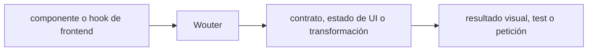

# Wouter — guía version-aware Vigilio

## Qué es, qué hace y cuándo usarla

Router ligero de React para aplicaciones pequeñas. Mantiene rutas simples sin confundirlas con políticas de acceso.

**Ubicación en Vigilio:** usa esta dependencia en su stack propietario; otras skills deben enlazar esta guía, no duplicar sus reglas. **Versión:** la indicada en el encabezado es la línea documentada; consultar `technology/versions.md` y el lockfile antes de copiar APIs o aprobar un upgrade.

**Stack propietario:** Frontend web / MFE. **Versión objetivo:** rama instalada; API y hook de routing por lockfile; versión instalada siempre desde lockfile/manifest. [Documentación oficial](https://github.com/molefrog/wouter). [Matriz de versiones](../versions.md).

## Responsabilidad y arquitectura

Rutas solo presentación, parámetros validados, authz backend. Evitar acoplar API client a router.

No duplicar las reglas generales de SOLID, DDD y manejo de dependencias: [política de librerías](README.md). Al crear código, leer el API de la versión instalada, no solo un ejemplo de blog.

### Diagrama de integración (Mermaid)



El flujo muestra la **responsabilidad arquitectónica** de la librería; no representa llamadas reales de red para todas las operaciones.


## ✅ Correcto — ejemplo actual

```tsx
import { Route, Switch, Link } from 'wouter';
<Switch><Route path="/products" component={ProductsPage}/>
<Route path="/products/:product_id" component={ProductDetailPage}/></Switch>;
```

## ❌ Incorrecto — legado o mal uso

```tsx
// ❌ asumir React Router APIs como parte de Wouter
<Routes><Route element={<ProductsPage/>}/></Routes>
```

## Migración, nuevas APIs y compatibilidad

Hooks minimalistas de routing; la versión puede introducir variantes de search/location y bindings React/Preact. Confirmar peer deps.

## Calidad, seguridad, performance y verificaciones

Test deep links, back/forward, search, not found, errores.

La adopción exige manifest/lockfile, pruebas runtime, seguridad, CI y rollback. Resultado real en consumidores de esta guía: **NOT_RUN**. No instalar nuevas dependencias solamente por estar catalogadas.

## Fuentes

- [Página oficial y referencias](https://github.com/molefrog/wouter)
- [Protocolo de adopción](README.md#protocolo-de-adopción-y-actualización)
- [Calidad transversal](../../foundations/engineering/code-quality.md)


## Recetario operativo ampliado — wouter (2026-10-25)

### API actual: dos tareas reales que debe saber ejecutar una skill

1. **`Route`, `Switch`, `Link` y hook useLocation del paquete instalado.**
2. **Search params y nested routing con validación, sin reimplementar authz server.**

### Migración desde versiones anteriores: decisión concreta

- **Qué cambia o se debe revisar:** No confundir Wouter con React Router: `<Routes>` no está en Wouter.

### Responsabilidades y capas

Router ligero frontend; backend ownership de endpoints.

**✅ Correcto:** mantener la integración encapsulada, alinear los nombres del negocio con Vigilio y depender de un contrato estable.

**❌ Incorrecto:** importar internals de la librería desde Domain, declarar `any` para resolver un upgrade, o duplicar reglas ya propietarias de otra tecnología.

### Seguridad, resiliencia y rendimiento

- Navegación sin sanitizar redirect permite open redirect.

### Test de aceptación específico y evidencia mínima

- **Escenario comprobable:** Test URL params, history, notFound y deep linking.


## Guía operativa detallada — 8 casos y 4 antipatrones

### Ocho ejemplos de la API y casos de uso relevantes

Los fragmentos siguientes ilustran **operaciones independientes**. Variables, imports, provider, extensión y configuración se completan en el proyecto consumidor; **no están certificados como un archivo único compilable**. Cuando hay comentarios `#`, son pasos de integración o configuración y no APIs inventadas.

#### Ejemplo 1. Route

**✅ Correcto — route**

```tsx
const route = <Route path="/products" component={ProductsPage} />;
```


#### Ejemplo 2. Switch

**✅ Correcto — switch**

```tsx
<Switch><Route path="/products" component={ProductsPage}/><Route>Not found</Route></Switch>
```


#### Ejemplo 3. Link

**✅ Correcto — link**

```tsx
<Link href="/products">Productos</Link>
```


#### Ejemplo 4. Location

**✅ Correcto — location**

```tsx
const [location, navigate] = useLocation();
```


#### Ejemplo 5. Navegar

**✅ Correcto — navegar**

```tsx
navigate('/products');
```


#### Ejemplo 6. Params

**✅ Correcto — params**

```tsx
const { product_id } = useParams<{ product_id: string }>();
```


#### Ejemplo 7. Query

**✅ Correcto — query**

```tsx
const search = useSearch();
```


#### Ejemplo 8. Base path

**✅ Correcto — base path**

```tsx
<Router base="/app"><App /></Router>
```


### Cuatro antipatrones frecuentes y su sustitución

#### Antipatrón 1 — riesgo y alternativa

**❌ Incorrecto**

```tsx
<Routes><Route element={<Page/>}/></Routes> // React Router
```

**Por qué está mal:** El patrón «<Routes><Route element={<Page/>}/></Routes> // React Router» es riesgoso: mezcla responsabilidades de interfaz y navegación o genera comportamiento inconsistente.

**✅ Correcto**

```tsx
<Switch><Route path="/products" component={Page}/></Switch>
```

**Por qué mejora:** El patrón «<Switch><Route path="/products" component={Page}/></Switch>» mejora el caso: la interfaz utiliza la API adecuada y separa presentación, estado y comunicación.

#### Antipatrón 2 — riesgo y alternativa

**❌ Incorrecto — Authz solo en Route.**

**Por qué está mal:** El patrón «Authz solo en Route» es riesgoso: puede permitir acceso a recursos no autorizados o de otro tenant.

**✅ Correcto — Comprobar Policy en backend.**

**Por qué mejora:** Separa permisos y secretos del código de negocio y permite comprobar el acceso mínimo.

#### Antipatrón 3 — riesgo y alternativa

**❌ Incorrecto — Path params usados sin validar.**

**Por qué está mal:** Omite un control operativo necesario, por lo que el comportamiento puede ser inseguro o difícil de verificar.

**✅ Correcto — Validar product_id antes de HTTP.**

**Por qué mejora:** Convierte la condición en un control verificable mediante validación o pruebas.

#### Antipatrón 4 — riesgo y alternativa

**❌ Incorrecto — Importar router dentro Domain.**

**Por qué está mal:** El patrón «Importar router dentro Domain» es riesgoso: puede publicar cambios sin evidencia suficiente ni una revisión del impacto.

**✅ Correcto — Navegación pertenece a presentation.**

**Por qué mejora:** El patrón «Navegación pertenece a presentation» mejora el caso: el cambio pasa por gates automáticos y aprobación de riesgos operativos.

### Versión estable, breaking changes y verificación

- **Versión estable exacta:** no se declara un parche universal cuando no hay verificación específica de su registry/release. Consultar el encabezado de esta guía, `technology/versions.md` y el manifiesto del servicio. **Estado de patch: VERIFY_LOCKFILE**.
- **Migración:** identificar major anterior, APIs retiradas/cambiadas, peer dependencies, requisitos de runtime, cambios de tipos, ejecución CI y plan de rollback. Si no hay prueba sobre el consumidor, **NOT_RUN**, no PASS.
- **Versiones previas:** el ejemplo marcado ❌ en esta guía explica al menos una incompatibilidad o un uso obsoleto; no trasplantar APIs de otras versiones.
- **Tests:** probar al menos happy path, error, seguridad/permiso y compatibilidad con el runtime donde aplique; solo activar nuevas capacidades mediante una PR versionada.

### Fuentes oficiales y referencias al final

- [Referencia propia oficial](https://github.com/molefrog/wouter)
- [Matriz canónica de versiones](../versions.md)
- [Política de adopción de librerías](README.md)

## Guía de compatibilidad y evaluación por versión (2026-10-25)

**Estado del patch exacto:** `VERIFY_LOCKFILE`. La guía documenta la familia de APIs; **no se ha verificado hoy el patch estable preciso de esta dependencia**. Consultar la fuente oficial enlazada al inicio y el lockfile antes de generar código o aprobar un upgrade.

### Checklist específico de esta librería

- **Migración/compatibilidad:** No confundir Wouter con React Router: `<Routes>` no está en Wouter.
- **Prueba propia:** Test URL params, history, notFound y deep linking.
- **Límite de responsabilidad:** usar esta librería solo en su adaptador o capa propietaria; consultar los ejemplos de API y antipatrones anteriores antes de cambiar llamadas públicas.

**Gate de aprobación:** leer la referencia oficial y resolver la versión del consumidor, ejecutar typecheck y pruebas específicas, registrar PASS/FAIL/NOT_RUN/BLOCKED. No confundir esta guía con validación de un consumidor real. [Procedimiento único de adopción](README.md#protocolo-de-adopción-y-actualización).

