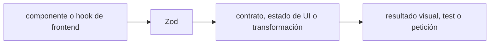

# Zod — Vigilio 4.6.7 estable

## Qué es, qué hace y cuándo usarla

Librería runtime de schemas y validación TypeScript. Una sola fuente estructurada deriva tipos y contratos; valida entradas no confiables en el borde.

**Ubicación en Vigilio:** usa esta dependencia en su stack propietario; otras skills deben enlazar esta guía, no duplicar sus reglas. **Versión:** la indicada en el encabezado es la línea documentada; consultar `technology/versions.md` y el lockfile antes de copiar APIs o aprobar un upgrade.

> **Guía propia de Zod (shared).** Estado a **2026-11-01**: línea de producción estable `^4` (4.6.7). Versión del proyecto consumidor = `pnpm-lock.yaml` / `composer.lock` / imagen o manifest. Fuente: [documentación oficial](https://zod.dev/). Fuente normativa transversal de versiones: [versions.md](../versions.md). **No implica instalación automática ni upgrade aprobado.**

## Objetivo, responsabilidad y dónde usar

Entity *.schema.ts contiene campos de datos; HTTP DTO define validador y tipo en mismo *.dto.ts; persistencia Drizzle usa *.table.ts. Domain Entity defiende invariantes; DTO no es modelo ORM. Inferir `ProductSchema['id']` directamente sin alias trivial.

**Uso:** aplicar solo si está declarada y resulta pertinente al consumidor; ver [política de adopción y DRY](README.md).

### Diagrama de integración (Mermaid)



El flujo muestra la **responsabilidad arquitectónica** de la librería; no representa llamadas reales de red para todas las operaciones.


## Instalación o verificación

```bash
pnpm add zod@^4
```

**Gate de instalación:** consultar [procedimiento compartido](README.md#protocolo-de-adopción-y-actualización); estos comandos son indicativos, no ejecuciones sobre un consumidor.

## ✅ Correcto — uso actual y ejemplo de referencia

```typescript
import { z } from 'zod';
export const productSchema = z.object({
  id: z.uuid(),
  nro_poliza: z.string().trim().min(1).max(30),
  estado: z.enum(['pendiente','procesado','anulado']),
});
export type ProductSchema = z.infer<typeof productSchema>;
// DTO HTTP en su único archivo .dto.ts
export const registerProductRequestDto = productSchema.pick({nro_poliza:true});
export type RegisterProductRequestDto = z.output<typeof registerProductRequestDto>;
const input = registerProductRequestDto.parse(raw_unknown);
```

**Por qué:** Entity *.schema.ts contiene campos de datos; HTTP DTO define validador y tipo en mismo *.dto.ts; persistencia Drizzle usa *.table.ts. Domain Entity defiende invariantes; DTO no es modelo ORM. Inferir `ProductSchema['id']` directamente sin alias trivial.

## ❌ Incorrecto — patrón legacy, inseguro o mal ubicado

```typescript
export type ProductStatus = 'pendiente' | 'procesado' | 'anulado';
// ❌ duplicar valores del schema fuente
const product = (await response.json()) as ProductSchema; // ❌ si dato externo requiere validación
```

**Riesgo:** confundir versiones o responsabilidades y obtener un contrato incorrecto.

## Nuevas capacidades, migración y breaking changes

Zod v3→v4: API top-level `z.email()`, `z.uuid()`, `z.url()`, `z.iso.date()` y `z.iso.datetime()` son nativas de Zod 4. En Vigilio senior mode se adopta esta sintaxis directa y concisa en todos los schemas y DTOs. Zod 4.6 añade además `.validate()` para comprobación booleana de alta velocidad sin serialización redundante.

Aplicar el [protocolo de migración común](README.md#protocolo-de-adopción-y-actualización), sin asumir que una release nueva está desplegada.

## Buenas prácticas, seguridad, rendimiento y operación

Consultar la [política transversal de librerías](README.md) para seguridad, versionado, evidencia y revisión de contratos. Para esta librería, además, aplicar las verificaciones concretas que se detallan a continuación.

## Gates de aceptación y compatibilidad

Validar entradas de API, responses de proveedores externos, serialización ISO, coerción numérica estricta, OpenAPI compatible, errores amigables y benchmark de parse de lotes grandes.

Estado de prueba de estos ejemplos documentales: **NOT_RUN** en aplicaciones consumidoras; ver [criterios de evidencia](README.md#criterios-de-validación).


## Reglas Vigilio de DTOs y composición

```typescript
// domain/schemas/product.schema.ts
export const productSchema = z.object({ id: z.uuid(), estado: z.enum(['pendiente','anulado']), nro_poliza:z.string().min(1) });
export type ProductSchema = z.infer<typeof productSchema>;

// presentation/http/dto/register-product.request.dto.ts
export const registerProductRequestDto = productSchema.pick({ nro_poliza:true });
export type RegisterProductRequestDto = z.output<typeof registerProductRequestDto>;

// derivación sin aliases vacíos
function getProduct(product_id: ProductSchema['id']): Promise<ProductSchema> { /* ... */ }
```

### Validación de entrada HTTP vs entidad y SQL

- Schema estructural `product.schema.ts`: forma e invariantes de datos, no entidad con comportamiento.
- `*.dto.ts`: único módulo para validador Zod runtime y tipo `z.output`; no crear `validators/*.validator.ts` paralelos.
- Drizzle `*.table.ts`: tabla SQL/índices/checks/migración, independiente de Zod; `pgEnum(..., productSchema.shape.estado.options)` evita repetición literal.
- `z.input` puede diferir de `z.output` por default/coercion/transform: Controller debe recibir output tras validar.
- Payload HTTP desconocido es `unknown`, validar con `.parse`/`.safeParse`; `as ProductSchema` no valida runtime.

### Coerción estricta de query

```typescript
const integer_query = z.string().regex(/^(0|[1-9]\d*)$/).transform(Number)
 .pipe(z.number().int().safe().nonnegative());
export const offsetPaginationQueryDto = z.object({
  limit: integer_query.pipe(z.number().min(1).max(100)).default(25),
  offset: integer_query.default(0),
});
```

✅ Correcto: errores Zod mapeados a 400/422 y testing límite. ❌ Incorrecto: `z.coerce.number()` sin control de strings vacíos o tomar type-only como validador.

## Referencias

- [Documentación oficial y migración de Zod](https://zod.dev/v4/changelog)
- [Matriz y baseline de versiones](../versions.md)
- [Calidad de código canónica](../../foundations/engineering/code-quality.md)


## Recetario operativo ampliado — zod (2026-10-25)

### API actual: dos tareas reales que debe saber ejecutar una skill

1. **Schema canónico en domain/schemas y `ProductSchema=z.infer<typeof productSchema>`.**
2. **DTO HTTP incluye Zod + `z.output`, pick/omit/extend y respuesta reutilizable.**

### Migración desde versiones anteriores: decisión concreta

- **Qué cambia o se debe revisar:** Zod 4 estandariza las APIs top-level `z.uuid()`, `z.email()` y `z.iso.datetime()`, sustituyendo la sintaxis encadenada v3 `z.string().uuid()`. Mantener una sola fuente en Domain Schemas y derivar DTOs con `.pick()` y `z.output`.

### Responsabilidades y capas

Validación estructura de datos, SQL lo gobierna Drizzle/Eloquent.

**✅ Correcto:** mantener la integración encapsulada, alinear los nombres del negocio con Vigilio y depender de un contrato estable.

**❌ Incorrecto:** importar internals de la librería desde Domain, declarar `any` para resolver un upgrade, o duplicar reglas ya propietarias de otra tecnología.

### Seguridad, resiliencia y rendimiento

- No asumir que `as Type` valida; unknown HTTP debe parse al borde configurado.

### Test de aceptación específico y evidencia mínima

- **Escenario comprobable:** Test input/output coerce, transforms, safeParse, errors y serialization.

### Ejemplo de integración vigente (fragmento adicional)

```typescript
const productSchema = z.object({
  id: z.uuid(),
  estado: z.enum(['pendiente', 'procesado', 'anulado']),
});
export type ProductSchema = z.infer<typeof productSchema>;
const registerProductRequestDto = productSchema.pick({ estado: true });
type RegisterProductRequestDto = z.output<typeof registerProductRequestDto>;
const result = registerProductRequestDto.safeParse(request_body);
```

**Nota:** los fragmentos muestran la API específica y requieren imports/providers/fixtures del consumidor; no se certifica compilación por el solo hecho de aparecer aquí.

### Zod 4.6 — no confundir un tipo TS con validación runtime

- 4.6 añadió `.validate()` para comprobar validez sin fabricar resultado: usar cuando solo se necesita booleano/check y benchmark real.
- `safeParse()` devuelve data tipada/error; el DTO se define una sola vez en su `.dto.ts` con `z.output`.
- `z.string().email()` y formas viejas se sustituyen por `z.email()` cuando se define el modelo en Zod v4.
- No hacer `parse()` en cada hop interno ni `as ProductSchema` al recibir respuesta externa no confiable.
- Zod Mini importa desde entrypoint correspondiente: revisar compatibilidad de paquetes terceros antes de cambiar tamaño de bundle.
- Referencia de release: https://github.com/colinhacks/zod/releases


## Guía operativa detallada — 8 casos y 4 antipatrones

### Ocho ejemplos de la API y casos de uso relevantes

Los fragmentos siguientes ilustran **operaciones independientes**. Variables, imports, provider, extensión y configuración se completan en el proyecto consumidor; **no están certificados como un archivo único compilable**. Cuando hay comentarios `#`, son pasos de integración o configuración y no APIs inventadas.

#### Ejemplo 1. Entidad

**✅ Correcto — entidad**

```typescript
const productSchema = z.object({ id: z.uuid(), estado: z.enum(['pendiente', 'procesado']) });
```


#### Ejemplo 2. Tipo Vigilio

**✅ Correcto — tipo vigilio**

```typescript
type ProductSchema = z.infer<typeof productSchema>;
```


#### Ejemplo 3. DTO pick

**✅ Correcto — dto pick**

```typescript
const getProductResponseDto = productSchema.pick({ id: true });
```


#### Ejemplo 4. Extend

**✅ Correcto — extend**

```typescript
const registerProductRequestDto = productSchema.pick({ estado: true }).extend({ note: z.string().optional() });
```


#### Ejemplo 5. Parse

**✅ Correcto — parse**

```typescript
const parsed = registerProductRequestDto.parse(raw_body);
```


#### Ejemplo 6. SafeParse

**✅ Correcto — safeparse**

```typescript
const result = registerProductRequestDto.safeParse(raw_body);
```


#### Ejemplo 7. Transform query

**✅ Correcto — transform query**

```typescript
const query = z.string().regex(/^\d+$/).transform(Number).pipe(z.number().int()).parse('25');
```


#### Ejemplo 8. Paginación

**✅ Correcto — paginación**

```typescript
const pageDto = z.object({ count: z.number(), results: z.array(productSchema) });
```


### Cuatro antipatrones frecuentes y su sustitución

#### Antipatrón 1 — riesgo y alternativa

**❌ Incorrecto**

```typescript
type ProductSchema = { id:string }
```

**Por qué está mal:** El patrón «type ProductSchema = { id:string }» es riesgoso: puede aceptar entradas inválidas o duplicar contratos difíciles de mantener.

**✅ Correcto**

```typescript
type ProductSchema = z.infer<typeof productSchema>
```

**Por qué mejora:** El patrón «type ProductSchema = z.infer<typeof productSchema>» mejora el caso: el contrato queda tipado y validado en el borde que recibe datos externos.

#### Antipatrón 2 — riesgo y alternativa

**❌ Incorrecto — Dto separado solo como .validator.ts.**

**Por qué está mal:** El patrón «Dto separado solo como .validator.ts» es riesgoso: puede aceptar entradas inválidas o duplicar contratos difíciles de mantener.

**✅ Correcto — DTO Zod + tipo inferido en un archivo *.dto.ts.**

**Por qué mejora:** El patrón «DTO Zod + tipo inferido en un archivo *.dto.ts» mejora el caso: el contrato queda tipado y validado en el borde que recibe datos externos.

#### Antipatrón 3 — riesgo y alternativa

**❌ Incorrecto**

```typescript
z.coerce.number().parse("") // 0 indeseado
```

**Por qué está mal:** El patrón «z.coerce.number().parse("") // 0 indeseado» es riesgoso: puede aceptar entradas inválidas o duplicar contratos difíciles de mantener.

**✅ Correcto**

```typescript
z.string().regex(/^\d+$/).transform(Number).parse(raw)
```

**Por qué mejora:** El patrón «z.string().regex(/^\d+$/).transform(Number).parse(raw)» mejora el caso: el contrato queda tipado y validado en el borde que recibe datos externos.

#### Antipatrón 4 — riesgo y alternativa

**❌ Incorrecto — Parse(await response.json()) solo para TS typing.**

**Por qué está mal:** El patrón «Parse(await response.json()) solo para TS typing» es riesgoso: puede aceptar entradas inválidas o duplicar contratos difíciles de mantener.

**✅ Correcto — Validar solo cuando el borde es no confiable.**

**Por qué mejora:** Convierte la condición en un control verificable mediante validación o pruebas.

### Versión estable, breaking changes y verificación

- **Release estable contrastada en fuente pública (25-10-2026):** `4.6.7`. Esto **no** significa que el consumidor ya la tenga instalada.
- **Referencia de versiones/releases:** [Zod releases](https://github.com/colinhacks/zod/releases).
- **API actual:** [documentación oficial específica](https://zod.dev/).
- **Migración:** identificar major anterior, APIs retiradas/cambiadas, peer dependencies, requisitos de runtime, cambios de tipos, ejecución CI y plan de rollback. Si no hay prueba sobre el consumidor, **NOT_RUN**, no PASS.
- **Versiones previas:** el ejemplo marcado ❌ en esta guía explica al menos una incompatibilidad o un uso obsoleto; no trasplantar APIs de otras versiones.
- **Tests:** probar al menos happy path, error, seguridad/permiso y compatibilidad con el runtime donde aplique; solo activar nuevas capacidades mediante una PR versionada.

### Fuentes oficiales y referencias al final

- [Referencia propia oficial](https://zod.dev/v4/changelog)
- [Release o guía oficial](https://github.com/colinhacks/zod/releases)
- [Release o guía oficial](https://zod.dev/)
- [Matriz canónica de versiones](../versions.md)
- [Política de adopción de librerías](README.md)

## Guía de compatibilidad y evaluación por versión (2026-10-25)

**Estado del patch exacto:** `VERIFY_LOCKFILE`. La guía documenta la familia de APIs; **no se ha verificado hoy el patch estable preciso de esta dependencia**. Consultar la fuente oficial enlazada al inicio y el lockfile antes de generar código o aprobar un upgrade.

### Checklist específico de esta librería

- Schema base de entidad en `.schema.ts`, tipo `ProductSchema = z.infer<typeof productSchema>`.
- Zod y tipo del contrato HTTP deben estar en el mismo `.dto.ts`; no crear `*.validator.ts` por duplicado.
- Parsear input externo una vez en el borde; `z.output` expresa salida transformada/coercion.
- No duplicar `ProductId`/`ProductStatus` cuando basta `ProductSchema["id"]`/`["estado"]`.

**Gate de aprobación:** leer la referencia oficial y resolver la versión del consumidor, ejecutar typecheck y pruebas específicas, registrar PASS/FAIL/NOT_RUN/BLOCKED. No confundir esta guía con validación de un consumidor real. [Procedimiento único de adopción](README.md#protocolo-de-adopción-y-actualización).

## Ejemplo completo de DTO sin `*.validator.ts`

`domain/schemas/product.schema.ts`:

```typescript
import { z } from 'zod';
export const productSchema = z.object({
  id: z.uuid(),
  nro_poliza: z.string().trim().min(1).max(30),
  estado: z.enum(['pendiente', 'procesado', 'anulado']),
});
export type ProductSchema = z.infer<typeof productSchema>;
```

`presentation/http/dto/list-products.query.dto.ts`:

```typescript
import { z } from 'zod';
import { productSchema } from '../../../domain/schemas/product.schema';

export const listProductsQueryDto = z.object({
  limit: z.coerce.number().int().min(1).max(100).default(25),
  estado: productSchema.shape.estado.optional(),
});
export type ListProductsQueryDto = z.output<typeof listProductsQueryDto>;
```

**Precaución de entrada:** `z.coerce.number()` admite ciertos strings vacíos como cero; si eso está prohibido, validar el string numérico antes de transformarlo. Aplicar `safeParse`/pipe **una vez** al borde HTTP. **❌ Incorrecto:** crear `list-products.query.validator.ts` extra con la misma definición; escribir aliases `ProductId = string` que duplican tipos; convertir un DTO Zod en tabla Drizzle. [Zod v4](https://zod.dev/v4/changelog).
