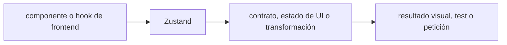

# Zustand — Vigilio línea instalada; solo para estado cliente

## Qué es, qué hace y cuándo usarla

Store simple de estado cliente React. Ideal para estado local compartido; no debe duplicar el caché de TanStack Query.

**Ubicación en Vigilio:** usa esta dependencia en su stack propietario; otras skills deben enlazar esta guía, no duplicar sus reglas. **Versión:** la indicada en el encabezado es la línea documentada; consultar `technology/versions.md` y el lockfile antes de copiar APIs o aprobar un upgrade.

> **Guía propia de Zustand (frontend).** Estado a **2026-10-25**: línea instalada; solo para estado cliente. Versión del proyecto consumidor = `pnpm-lock.yaml` / `composer.lock` / imagen o manifest. Fuente: [documentación oficial](https://zustand.docs.pmnd.rs/). Fuente normativa transversal de versiones: [versions.md](../versions.md). **No implica instalación automática ni upgrade aprobado.**

## Objetivo, responsabilidad y dónde usar

Uso: estado local global liviano; no reemplaza backend ni server cache.

**Uso:** aplicar solo si está declarada y resulta pertinente al consumidor; ver [política de adopción y DRY](README.md).

### Diagrama de integración (Mermaid)



El flujo muestra la **responsabilidad arquitectónica** de la librería; no representa llamadas reales de red para todas las operaciones.


## Instalación o verificación

```bash
pnpm add zustand
```

**Gate de instalación:** consultar [procedimiento compartido](README.md#protocolo-de-adopción-y-actualización); estos comandos son indicativos, no ejecuciones sobre un consumidor.

## ✅ Correcto — uso actual y ejemplo de referencia

```typescript
import { create } from 'zustand';
type UiStore={panel_open:boolean;togglePanel:()=>void};
export const useUiStore=create<UiStore>(set=>({panel_open:false,togglePanel:()=>set(s=>({panel_open:!s.panel_open}))}));
```

**Por qué:** Uso: estado local global liviano; no reemplaza backend ni server cache.

## ❌ Incorrecto — patrón legacy, inseguro o mal ubicado

**Nota técnica (no es código ejecutable):** ❌ duplicar respuestas remotas con TanStack Query como fuente conflictiva.

**Riesgo:** confundir versiones o responsabilidades y obtener un contrato incorrecto.

## Nuevas capacidades, migración y breaking changes

Revisar persist/middleware/versiones y suscriptores antes de actualización.

Aplicar el [protocolo de migración común](README.md#protocolo-de-adopción-y-actualización), sin asumir que una release nueva está desplegada.

## Buenas prácticas, seguridad, rendimiento y operación

Consultar la [política transversal de librerías](README.md) para seguridad, versionado, evidencia y revisión de contratos. Para esta librería, además, aplicar las verificaciones concretas que se detallan a continuación.

## Gates de aceptación y compatibilidad

Test SSR aislamiento por request, limpieza logout y persistencia.

Estado de prueba de estos ejemplos documentales: **NOT_RUN** en aplicaciones consumidoras; ver [criterios de evidencia](README.md#criterios-de-validación).


## Referencias

- [Documentación oficial y migración de Zustand](https://zustand.docs.pmnd.rs/)
- [Matriz y baseline de versiones](../versions.md)
- [Calidad de código canónica](../../foundations/engineering/code-quality.md)


## Recetario operativo ampliado — zustand (2026-10-25)

### API actual: dos tareas reales que debe saber ejecutar una skill

1. **Store slices pequeñas, selectors estables y persist solo datos permitidos.**
2. **Distinguir estado UI de TanStack Query para server state.**

### Migración desde versiones anteriores: decisión concreta

- **Qué cambia o se debe revisar:** Middleware subscribe/persist y cambios major deben comprobarse por lockfile.

### Responsabilidades y capas

Estado local frontend, no lógica servidor.

**✅ Correcto:** mantener la integración encapsulada, alinear los nombres del negocio con Vigilio y depender de un contrato estable.

**❌ Incorrecto:** importar internals de la librería desde Domain, declarar `any` para resolver un upgrade, o duplicar reglas ya propietarias de otra tecnología.

### Seguridad, resiliencia y rendimiento

- Persist en localStorage no para tokens privados por defecto.

### Test de aceptación específico y evidencia mínima

- **Escenario comprobable:** Test selectors, store reset logout y SSR cross-request isolation.


## Guía operativa detallada — 8 casos y 4 antipatrones

### Ocho ejemplos de la API y casos de uso relevantes

Los fragmentos siguientes ilustran **operaciones independientes**. Variables, imports, provider, extensión y configuración se completan en el proyecto consumidor; **no están certificados como un archivo único compilable**. Cuando hay comentarios `#`, son pasos de integración o configuración y no APIs inventadas.

#### Ejemplo 1. Store

**✅ Correcto — store**

```typescript
const useUiStore = create<UiState>()((set) => ({ sidebar_open: false, toggleSidebar: () => set(state => ({ sidebar_open: !state.sidebar_open })) }));
```


#### Ejemplo 2. Selector

**✅ Correcto — selector**

```typescript
const sidebar_open = useUiStore(state => state.sidebar_open);
```


#### Ejemplo 3. Actualizar

**✅ Correcto — actualizar**

```typescript
useUiStore.getState().toggleSidebar();
```


#### Ejemplo 4. Estado derivado

**✅ Correcto — estado derivado**

```typescript
const is_modal_open = useUiStore(state => state.sidebar_open);
```


#### Ejemplo 5. Persist

**✅ Correcto — persist**

```typescript
persist(storeInitializer, { name: 'vigilio-ui' })
```


#### Ejemplo 6. Reset al logout

**✅ Correcto — reset al logout**

```typescript
useUiStore.setState(initial_state);
```


#### Ejemplo 7. Slice

**✅ Correcto — slice**

**Nota técnica (no es código ejecutable):** Extraer slice cuando responsabilidades divergen, no crear global monolítico.


#### Ejemplo 8. Devtools

**✅ Correcto — devtools**

```typescript
devtools(storeInitializer, { name: 'Vigilio UI' })
```


### Cuatro antipatrones frecuentes y su sustitución

#### Antipatrón 1 — riesgo y alternativa

**❌ Incorrecto — Guardar listas del servidor duplicadas en Zustand.**

**Por qué está mal:** El patrón «Guardar listas del servidor duplicadas en Zustand» es riesgoso: puede exponer datos obsoletos o mezclar estados de usuarios, sesiones y consultas diferentes.

**✅ Correcto — TanStack Query para server state.**

**Por qué mejora:** El patrón «TanStack Query para server state» mejora el caso: el estado se identifica e invalida con criterios explícitos y verificables.

#### Antipatrón 2 — riesgo y alternativa

**❌ Incorrecto**

```typescript
useUiStore() // suscripción a todo
```

**Por qué está mal:** El patrón «useUiStore() // suscripción a todo» es riesgoso: puede exponer datos obsoletos o mezclar estados de usuarios, sesiones y consultas diferentes.

**✅ Correcto**

```typescript
useUiStore(state => state.sidebar_open)
```

**Por qué mejora:** El patrón «useUiStore(state => state.sidebar_open)» mejora el caso: el estado se identifica e invalida con criterios explícitos y verificables.

#### Antipatrón 3 — riesgo y alternativa

**❌ Incorrecto — Estado privado retenido tras logout.**

**Por qué está mal:** El patrón «Estado privado retenido tras logout» es riesgoso: puede exponer datos obsoletos o mezclar estados de usuarios, sesiones y consultas diferentes.

**✅ Correcto**

```typescript
useUiStore.setState(initial_state)
```

**Por qué mejora:** El patrón «useUiStore.setState(initial_state)» mejora el caso: el estado se identifica e invalida con criterios explícitos y verificables.

#### Antipatrón 4 — riesgo y alternativa

**❌ Incorrecto — Mezclar lógica de negocio autorizada en UI store.**

**Por qué está mal:** El patrón «Mezclar lógica de negocio autorizada en UI store» es riesgoso: puede permitir acceso a recursos no autorizados o de otro tenant.

**✅ Correcto — Backend Application/Domain gobierna invariantes.**

**Por qué mejora:** El patrón «Backend Application/Domain gobierna invariantes» mejora el caso: se fuerza autorización en el borde/servidor y se limita el acceso por recurso.

### Versión estable, breaking changes y verificación

- **Versión estable exacta:** no se declara un parche universal cuando no hay verificación específica de su registry/release. Consultar el encabezado de esta guía, `technology/versions.md` y el manifiesto del servicio. **Estado de patch: VERIFY_LOCKFILE**.
- **Migración:** identificar major anterior, APIs retiradas/cambiadas, peer dependencies, requisitos de runtime, cambios de tipos, ejecución CI y plan de rollback. Si no hay prueba sobre el consumidor, **NOT_RUN**, no PASS.
- **Versiones previas:** el ejemplo marcado ❌ en esta guía explica al menos una incompatibilidad o un uso obsoleto; no trasplantar APIs de otras versiones.
- **Tests:** probar al menos happy path, error, seguridad/permiso y compatibilidad con el runtime donde aplique; solo activar nuevas capacidades mediante una PR versionada.

### Fuentes oficiales y referencias al final

- [Referencia propia oficial](https://zustand.docs.pmnd.rs/)
- [Matriz canónica de versiones](../versions.md)
- [Política de adopción de librerías](README.md)

## Guía de compatibilidad y evaluación por versión (2026-10-25)

**Estado del patch exacto:** `VERIFY_LOCKFILE`. La guía documenta la familia de APIs; **no se ha verificado hoy el patch estable preciso de esta dependencia**. Consultar la fuente oficial enlazada al inicio y el lockfile antes de generar código o aprobar un upgrade.

### Checklist específico de esta librería

- **Migración/compatibilidad:** Middleware subscribe/persist y cambios major deben comprobarse por lockfile.
- **Prueba propia:** Test selectors, store reset logout y SSR cross-request isolation.
- **Límite de responsabilidad:** usar esta librería solo en su adaptador o capa propietaria; consultar los ejemplos de API y antipatrones anteriores antes de cambiar llamadas públicas.

**Gate de aprobación:** leer la referencia oficial y resolver la versión del consumidor, ejecutar typecheck y pruebas específicas, registrar PASS/FAIL/NOT_RUN/BLOCKED. No confundir esta guía con validación de un consumidor real. [Procedimiento único de adopción](README.md#protocolo-de-adopción-y-actualización).

